# Apex 26 — session flow (menu → race → results)

Read from `js/game.js` on the ship branch, not from memory. Function names, not line
numbers: the lines move every day, `grep` the name. Behaviour is described, not changed — if a
row below looks wrong, that is a finding for an issue, not an edit to this file.

For player-facing action sequences and the regression checklist, see
[USAGE-PATHS.md](USAGE-PATHS.md). Entry routes below were cross-checked against
`f5381b40efa332211ea3973371c2c6835ae5f8d2` on 2026-10-14.

## The state machine

`state` has exactly four values and ONE writer, `setState(next, why)` (it logs every
transition as `State a->b why=…`).

| `state` | entered by (`why`) | left by |
|---|---|---|
| `menu` | `quit` (`quitToMenu`), `quali-sheet` (`openQualiBody`), `sheet-start` (`startRaceFromSheet`) | `startRaceBody` → `count` |
| `count` | `race-start` (`startRaceBody`), `red-flag-restart` (`redFlagRestart`) | `lights-out` → `race`; `goRolling()` (`rolling-start`: a jump-in, WATCH from a lap, a designer test drive) → `race` |
| `race` | `lights-out`, `restart-green` (after a red flag), `rolling-start` | `endRace` → `results`; `quitToMenu` → `menu` |
| `results` | `endRace` (`flag`, `forced-order`, `quali-end`) | `quitToMenu` → `menu`; quick retry → `count`; championship/qualifying continuation → `menu` for a sheet/intro, then `count` |

```mermaid
stateDiagram-v2
  [*] --> menu
  menu --> count: startRaceBody (race-start)
  count --> race: lights-out / goRolling
  race --> count: red-flag-restart, pause RESTART
  race --> results: endRace
  results --> count: RACE AGAIN / TRY AGAIN (build cover)
  results --> menu: quitToMenu
  results --> menu: startRaceFromSheet (sheet-start; intro follows)
  race --> menu: quitToMenu (pause QUIT)
  count --> menu: quitToMenu
  menu --> menu: openQualiBody (quali sheet)
```

`quitToMenu` is the full teardown (HUD, lights, pause, rotate blocker, audio, session
entry, netplay, season reload, title overlay). `openQualiBody` also enters
`menu`: no race is up while the quali sheet is. `startRaceFromSheet` enters
`menu` for an intro while preserving qualifying, flow and the built circuit.
(The completed-season arm of
`startRaceBody` was a second one — it left the race chrome up — until it was changed to `quitToMenu`; see
the flow C PR "a start that finds the season finished".)

## Entering a session

Every start ends in `startRace()` → `SessionEntry.begin("race", key, prepare, commit, valid,
recover)` → `startRaceBody`. `key` is `entrySettings()` (track, flow, session, weather, laps,
team, grid, season round…).

- **superseded** (a newer start, or `quitToMenu` → `sessionEntry.cancel()`): the old request
  resolves `{kind:"canceled", reason:"superseded"}` and runs nothing.
- **settings changed** before commit (`valid()` false): `cancel()`, then `recover()` — for a
  race that is `quitToMenu()` — and `{kind:"canceled", reason:"settings changed"}`.
- **error**: `recover(e)` (`quitToMenu` + a "COULD NOT LOAD CIRCUIT" card), then the error rethrows.

`recover` is therefore a *quit*, never a hand-back of a previous race. A pause RESTART whose
`entrySettings()` changed in the async window ends on the title, not back in the old race.

| route | pre-race screen (garage → card → flyby) | calls |
|---|---|---|
| START RACE / START TIME TRIAL / START PRACTICE on RACE SETTINGS | yes (`raceIntroFromSheet`, sheet stays up as PREPARING…); START QUALIFYING first opens its sheet | `raceIntro(startRace)` |
| Data Hub JUMP IN / WATCH | card/flyby (`opts.intro`); outgoing garage is omitted for WATCH and mid-race JUMP IN | `raceIntro(startRace)` |
| designer TEST HERE | yes (a solo "my racing" start) | `raceIntro(go)`; `go` = `startRace`; the car is then placed on the point (`TrackDesigner.placeTest`) |
| qualifying TO THE GRID / DRIVE, championship next session/round | yes on a visible normal solo page; build cover only when hidden/headless/online or friend qualifying is armed | `startRaceFromSheet()` → `raceIntro(startRace)` or `startRaceCovered()` |
| one-off RACE AGAIN, TT TRY AGAIN | no — the build card covers the load | `startRaceCovered()` |
| pause RESTART | no | `startRace()` direct (disabled in an active friend race or armed friend qualifying) |
| red flag | no — re-grids in place | `redFlagRestart()` → `count` |

An intro that is abandoned (settings changed, or a stale request) ends in `titleIfBare()`:
it gives the sheet's buttons back and re-shows the title only when `state === "menu"` and no
screen is up.

While a designer test drive's return is armed (`CustomTracks.armReturn`), every
`startRace` that reaches its countdown calls `CustomTracks.afterStart()`, which puts the car
back on the test point and goes green: TRY AGAIN and RESTART return to the point, and
`quitToMenu` (via `consumeTrackHash`) reopens the designer.

## Leaving a session — what is shown at the flag, per mode

`endRace` runs once per session. Classification and championship/career award happen
there exactly once. Presentation after the award is either **today's instant results
path** or (when `RaceCeremony` is live — plan
[`2026-10-27-cooldown-podium.md`](plans/2026-10-27-cooldown-podium.md)) a short
**ceremony** before the full sheet owns the session.

Pieces that can follow the award:

1. **Ceremony** (eligible solo GP / sprint / season / career only): `cooldown` →
   `parcFerme` → optional `podium` → `results`. SKIP/CONTINUE advances; Esc = SKIP.
   `__apex.finishRace({ ceremony: true })` opts in; bare `finishRace()` keeps the
   instant path for existing harnesses.
2. **Chequered cut + orbit, with optional HIGHLIGHTS** (`ResultsCam.onFlag`) — the
   first frame of ceremony or of `results` when ceremony is skipped.
3. **TV director** on the player's own car (`Director`, `autoSpectate` once
   `player.finished` or `retired`) — the *player finished, field still running*
   wait (`USAGE-PATHS` R11). Ceremony is different: the player may still drive
   the cooldown lap after classification.
4. The **results surface** (`#results` / TT / quali sheet).

| mode | Ceremony | ResultsCam (cheq → orbit → highlights) | TV director on own car | surface |
|---|---|---|---|---|
| solo GP / sprint | on when `RaceCeremony` eligible | yes — if `enabled` (see below) | yes, after the player finishes (pre-ceremony wait) | results sheet after ceremony (or instant if ceremony off / skipped) |
| season / career round | as GP | as GP | as GP | results sheet (+ career settlement); settlement stays in `endRace`, sheet show deferred until `results` phase |
| practice / duel | **off** | yes — if `enabled` | yes, after the player finishes | results sheet |
| time trial | **off** (`ceremony().eligible === false`) | **no** — `endRace` returns before `onFlag` | yes (the player finishes) | TT results |
| qualifying | **off** | **no** — returns to the quali sheet first | yes | quali sheet (`q-done`) |
| friend race (netplay) | **off** | **no** — `allowed()` is false while `netPlay.active()` | **no** — `wantOn` is false when `net` | results sheet, the host's classification |
| WATCH (RealRace replay) | **off** | **no** — `eligible()` is `!realRace.isWatch()` | **no** — the replay owns the picture | results sheet (published classification) |
| any mode on **mobile** / `PerfGov.tier() >= 2` | timers + SKIP + frozen frame (no live ResultsCam orbit) | **no** — `enabled()` is false | as the row above | the last race frame **freezes** behind the sheet: `render()` returns early when `state === "results"` and the cam is not live |

Ceremony phase table (eligible sessions only; see the plan for timers and SKIP):

| phase | player | camera | UI |
|---|---|---|---|
| `cooldown` | drive (throttle/brake/steer); AI cools or parks | chase / cockpit | thin HUD + SKIP |
| `parcFerme` | none | ResultsCam park / orbit on pit subject | caption + SKIP |
| `podium` | none (only if three classified finishers) | ResultsCam on winner | `ResultsStory` podium overlay + CONTINUE |
| `results` | sheet buttons | today's cheq → orbit (or resume); HIGHLIGHTS opt-in | `buildResults` + `#results` |

Retired / DSQ player: skip the cooldown drive; no podium unless classified P≤3.
Browser gate: `tests/specs/results-flow.spec.js` (`test:results-flow`). Acceptance
must observe a real line crossing and automatic phase progression, then exercise
the actual SKIP / CONTINUE controls. A capability skip, debug phase seek, or
`finishRace({ ceremony: true })` alone does not verify the production finish path.
The separately named harness cases cover backward compatibility and settlement;
they are not evidence of natural progression. Slice integration and the complete
mode / cleanup matrix remain unverified until the integrated browser gate runs.

Two consequences worth knowing before changing any of it:

1. TT and qualifying skip the cut that GP gets, yet still switch to TV once the player is done —
   the table is inconsistent by construction, not by a single decision.
2. On mobile (and under load) the results screen is a still image by design (unpaid work
   avoided); ceremony on phone advances on timers + SKIP without paying for a live orbit.

## Where to look

| question | read |
|---|---|
| what runs on quit | `quitToMenu` (`js/game.js`) |
| the async gap before a start | `js/race/session-entry.js`, `startRace` |
| the pre-race screen | `raceIntro`, `afterGarageOut`, `studioOpen`/`studioDone` |
| the finish | `endRace`, `RaceCeremony` (when shipped), `js/camera/results-cam.js`, `js/camera/director.js` (`wantOn`) |
| results sheet and its buttons | `js/ui/results-sheet.js`, `els.resNext.onclick` |
| ceremony browser gate | `tests/specs/results-flow.spec.js` |
| pause menu | `setPaused`, `#pm-restart` / `#pm-quit` handlers |
