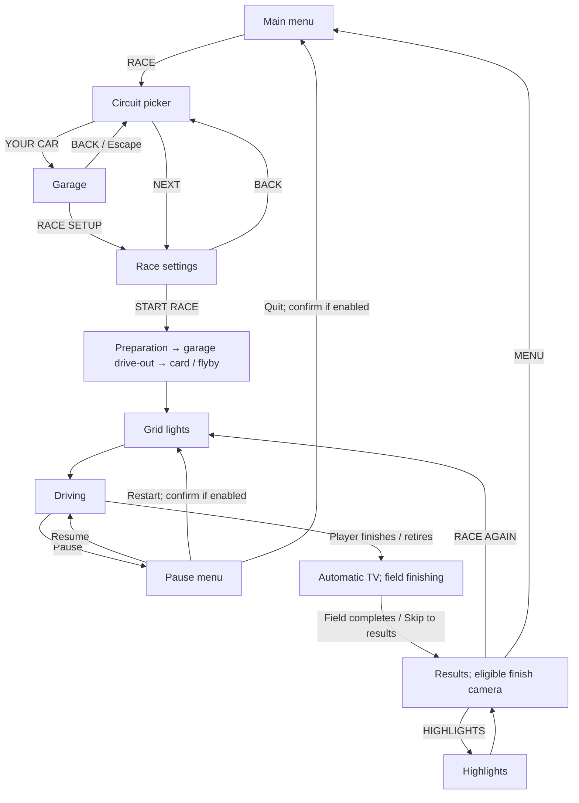

# Apex 26 — usage paths and journey checklist

This map follows the player from an entry point through a session and back out.
Use it to choose regression journeys, including the full **menu → Race → Garage
→ start → restart → finish with TV cameras → menu** loop.

Source baseline: `f5381b40efa332211ea3973371c2c6835ae5f8d2`, 2026-10-14.
The routes below were traced through the current handlers and shell. They are
**source-verified, not a claim that every journey has been played in a browser**.
The older [UI map](UI-MAP.md) supplies the detailed control inventory;
[session flow](FLOW.md) explains the engine state and asynchronous entry.

“All paths” means the distinct entry, forward, back, restart, completion and
recovery branches. Repeating a restart, switching settings, or doing another
season creates unlimited sequences. Cover each branch, then repeat loops to
catch state leaking between visits; do not enumerate every permutation of
circuits, cars and setting values.

## 1. The requested race journey

Use a solo GP, a short distance, and a desktop rendering tier that supports
the results camera. Keep qualifying off for this first journey.

| Step | Player action | Expected destination / checkpoint |
|---|---|---|
| 1 | Main menu (`#overlay`) → **RACE** (`#mb-race`) | Circuit picker (`#select`); free-play race mode. |
| 2 | Choose a circuit → **YOUR CAR** (`#sel-car`) | Garage (`#carsetup`), remembering the picker as its caller. |
| 3 | Choose team, parts, setup or livery → **RACE SETUP** (`#cs-done`) | Race settings (`#race-settings`). **BACK** (`#cs-back`) instead returns to the picker; it also keeps the car changes. |
| 4 | Set distance, conditions and grid → **START RACE** (`#rs-go`) | Settings shows PREPARING… while needed, then garage drive-out → session card / circuit flyby (`#loading`) → grid lights. This animated garage is separate from the editable Garage in step 2. |
| 5 | Lights out → drive | Race HUD and player control; menu/loading input gates released. |
| 6 | Pause (`#pausemenu`) → **RESTART RACE** (`#pm-restart`) | With Confirm Quit on, press again to confirm. New grid/countdown for the same session; no garage/flyby replay. |
| 7 | Select **TV**, then drive to the flag | Hold/right-click CAM to open its picker, or cycle with CAM / C. Choose **TV**, not the separate **TV SIDE** rig. Camera choice does not drive the car for you. |
| 8 | Finish → let the rest of the field finish | Automatic TV spectating follows the remaining runners in eligible solo sessions, with the player as fallback when no runners remain. During the wait, Enter or Pause → **SKIP TO RESULTS** can advance. |
| 9 | Results (`#results`) | Eligible GP results use the chequered cut, then orbit; **HIGHLIGHTS** is a separate optional action. Classification appears once. |
| 10 | **MENU** (`#res-menu`) | Main menu, with the race, replay, pause and loading surfaces torn down. Start a second race to check that no stale state survives. |

The graph abbreviates quick restarts' build cover and shows the solo GP path.
Qualifying, online races and WATCH have the branches below. Primary source:
[`js/game.js`](../js/game.js) (`openGarage`, `garageBack`, `startRaceFromSheet`,
`startRaceCovered`, `setPaused`, `endRace`, `quitToMenu`),
[`race-settings.js`](../js/race/race-settings.js),
[`mode-switch.js`](../js/camera/mode-switch.js).

## 2. Every main-menu door

Each row is a journey family. Conditional doors must be tested both present
and absent; Continue stages a menu/hub, not an in-progress physics snapshot.

| ID | Main-menu door | Forward route | Return route / condition |
|---|---|---|---|
| M01 | RACE (`#mb-race`) | Circuit picker → NEXT → race settings → start. Optional YOUR CAR detour above. | Picker BACK → menu; settings BACK → picker. |
| M02 | TIME TRIAL (`#mb-tt`) | TT picker → settings → start → TT results → TRY AGAIN. | Picker BACK or results MENU → menu. |
| M03 | DAILY TIME TRIAL (`#mb-daily`) | Today's challenge → TT picker/settings → run → daily/TT result and retry/share actions. | BACK/MENU; also enter Daily Standard and Daily Open from the TT filters. |
| M04 | PRACTICE (`#mb-practice`) | Solo practice goal → picker → practice settings → drive with coaching/checkpoints. | Pause → quit, or TT-style result → menu/retry. This door uses `session = tt`; test a later ordinary TT/Race visit for stale PRACTICE labels. |
| M05 | SEASON (`#mb-season`) | Championship picker → optional CUSTOMISE SEASON (`#season-setup`) → settings → weekend. | Customisation BACK → picker; picker BACK → menu. Finished saves offer final standings/new season. |
| M06 | CAREER MODES (`#mb-career`) | Slot picker (`#career`) → new Driver/My Team setup or existing career hub. | Title-opened slot picker MAIN MENU → menu; hub-opened slot picker BACK → hub. |
| M07 | CONTINUE (`#mb-continue`) | Depending on saved hint: career hub, Daily picker, or last free-play circuit/session picker. | Corresponding hub/picker exit. Hidden without a usable hint. |
| M08 | RACE A FRIEND (`#mb-vs`) | Lazy bundle → lobby (`#vsfriend`) → host/join → agree settings → optional qualifying → online race. | CLOSE/cancel → menu; failed bundle load leaves the title usable with a message. |
| M09 | WATCH REAL RACES (`#mb-watch`) | Data Hub's Race It tab → load event → WATCH/HIGHLIGHTS. | Hub CLOSE → menu; replay pause/quit or result exit → menu. |
| M10 | DATA HUB (`#mb-data`) | Data Hub (`#datahub`): schedule, standings, results, live, telemetry, export, Race It. | CLOSE (`#dh-close-btn`) → menu. See D paths. |
| M11 | TRACK DESIGNER (`#mb-designer`) | Designer (`#trackdesigner`) → edit/save/test/race/share. | CLOSE → menu; TEST HERE has a special return to the designer. |
| M12 | GARAGE (`#mb-garage`) | Garage → team/parts/setup/livery and camera tools. | CLOSE GARAGE / BACK / Escape → menu. |
| M13 | PHOTO STUDIO (`#mb-photo`) | Home subject → framing/capture/background controls (`#photo-studio`). | DONE / Escape restores Home. Door waits while a required Home track scene is loading. |
| M14 | SETTINGS (`#mb-settings`) | Settings (`#pmsettings`) index → a settings page or editor. | Page BACK → index; index BACK → menu. |
| M15 | HOW TO PLAY (`#mb-help`) | Help anchors and input instructions (`#howtoplay`). | CLOSE / Escape → menu; closing clears a stale help-section hash. |
| M16 | STANDINGS (`#mb-standings`) | Standalone championship standings (`#standings`). | CLOSE → menu; shown for an in-progress standalone season. |
| M17 | USE AS CONTROLLER (`#mb-phonepad`) | `controller.html` → room code / pairing → phone driving controls. | Disconnect/browser return; door is conditional on coarse-pointer input. |

Sources: [`index.html`](../index.html), [`title-flow.js`](../js/ui/title-flow.js),
[`title-menu.js`](../js/ui/title-menu.js), [`experience.js`](../js/ui/experience.js),
[`platform-session.js`](../js/ui/platform-session.js), [`js/game.js`](../js/game.js).

## 3. Selection, Garage and race preparation

| ID | Route / branch | Expected result |
|---|---|---|
| S01 | Picker → filter/search/favourite → circuit detail (`#track-detail`) → close | Same picker and selected circuit; favourite state persists. Include saved custom circuits and EDIT IN DESIGNER. |
| S02 | Picker → YOUR CAR → Garage → BACK | Same picker; selected car changes retained. |
| S03 | Picker → YOUR CAR → Garage → RACE SETUP → settings BACK | Back reaches the picker, not Garage. |
| S04 | Garage → team picker (`#teampicker`) → select/close; My Team → customisation (`#customize`) → save/cancel | Return to Garage. Cancel the customisation draft separately from leaving Garage, whose selected parts are already kept. |
| S05 | Visit each Garage tab → select a part/setup/livery → leave → reopen | Team, Engine, Aero, Susp, Brakes, Tyres, ERS, Gearbox, Fuel, Exhaust, Floor, Cockpit, Wheels, Setup, Livery. Check budget/ownership restrictions in career and editable livery save/cancel/duplicate/delete. |
| S06 | Settings → presets/manual options → duel picker (`#duel-picker`) → choose/close | Return to settings; changed mode, distance and grid determine the correct start label. Practice/TT/Daily/championship expose different subsets. |
| S07 | START → preparation → garage drive-out → flyby → lights → race | One start commits. Compare cold/warm circuit loads and a normal intro with a tap-to-skip intro. Skip advances presentation; it does not cancel back to menu. |
| S08 | Start via qualifying DRIVE / TO THE GRID, or championship next session | On a visible normal solo page, `startRaceFromSheet()` also plays garage/flyby. Hidden/headless/online or armed friend qualifying uses build cover only. |
| S09 | Pause RESTART; one-off RACE AGAIN; TT TRY AGAIN | Quick start, without the full intro. Restart must reset the session, replay buffer and result presentation. |

Garage's caller is part of the navigation state:

| Caller | Forward exit | Back / Escape |
|---|---|---|
| Main menu / shared setup or livery | CLOSE GARAGE → menu | Menu |
| Circuit picker | RACE SETUP → race settings | Picker |
| Career hub | RETURN TO CAREER → hub | Hub |
| Friend lobby | RETURN TO LOBBY → waiting room, car selection synced | Same lobby |
| In-race WORK ON CAR | RETURN TO RACE → pit stop resumes | Same race; changes are retained and work time applies if the spec changed |

Sources: [`select-screen.js`](../js/ui/select-screen.js),
[`race-settings.js`](../js/race/race-settings.js),
[`setup-sheet.js`](../js/garage/setup-sheet.js), [`js/game.js`](../js/game.js).

## 4. Qualifying, season and career loops

| ID | Journey | Required branch / return check |
|---|---|---|
| C01 | Race settings with qualifying → qualifying sheet (`#quali`) → DRIVE → out-lap/flying lap → completed qualifying sheet → TO THE GRID → race | Completion returns to qualifying, not GP results. Grid uses the qualifying classification. |
| C02 | Same setup → SIMULATE → completed sheet → TO THE GRID | No driven qualifying session; still a classified grid. |
| C03 | Unrun qualifying → BACK → race settings → BACK | Restore `session = race`; return to the originating picker/career hub. |
| C04 | Completed solo qualifying → MENU / Escape → menu → resume the matching weekend | Standalone season/career classification remains available for continuation. Quitting a one-off GP discards its qualifying order; it has no matching weekend to resume. Quitting a completed sheet differs from cancelling an unrun one. |
| C05 | Season → customise calendar/format → BACK or APPLY | BACK discards draft. Unchanged APPLY preserves an unfinished season, including its qualifying grid. Changed rules confirm before discarding standings or qualifying. A completed season's START NEW SEASON confirms and restarts at round zero even with unchanged rules. |
| C06 | Season, qualifying off → GP → results → NEXT ROUND → next start | Correct next circuit and distance. Race settings is not an obligatory stop between every round. |
| C07 | Season, qualifying on and sprint enabled → sprint qualifying → sprint → TO THE GRAND PRIX → GP qualifying → GP → NEXT ROUND | Sprint keeps the circuit/round; the GP advances it. Each racing session gets its own qualifying branch. |
| C08 | Final season result → VIEW CHAMPION → MAIN MENU | First press shows champion panel on results; second exits and clears the standalone season. Existing finished save → final standings is a separate entry. |
| C09 | Career Modes → empty Driver slot → identity/team/seat → START CAREER → hub | Invalid setup stays on setup with errors; starting creates the selected slot and opens the hub. Repeat for My Team creation/hire. |
| C10 | Career hub → Garage / guide / history / offers / save slots → back | Return to correct caller. Relevant roots: `#career-guide`, `#career-history`, `#career-offers`. Existing slots open their own career. |
| C11 | Career hub → GO RACING → settings → qualifying/race → results → career continuation | Result continuation tears down the race and returns to the hub for settlement/upgrades; it does not jump straight into the next round. |
| C12 | Career season ends → hub → offers/rollover → accept/continue → next season | Driver contract and My Team branches differ; new season starts on its opening circuit. |
| C13 | Slot picker → export/import/delete, including confirm/cancel and invalid backup | Stay in slot management or return via its origin. Exercise destructive variants only on disposable saves; reload verifies save isolation. |

Sources: [`js/game.js`](../js/game.js) (`openQualiBody`, `q-*` handlers,
`resNext.onclick`), [`career-ui.js`](../js/career/career-ui.js),
[`season-ui.js`](../js/career/season-ui.js), [`results-sheet.js`](../js/ui/results-sheet.js).

## 5. During the session and at the finish

| ID | Journey | Required branch / return check |
|---|---|---|
| R01 | Driving → Pause → RESUME / Escape | Same solo session resumes; normal player interaction has a short resume countdown. Automation suppresses that countdown. |
| R02 | Pause → Settings / How to Play / championship Standings → back → resume | Child closes to pause; no settings key/wheel capture remains armed after resume. |
| R03 | Pause → Strategy / Practice / Session Review → back | Shared Driving settings page opens the relevant panel. Check checkpoint save/retry/rewind enabled and disabled states, then return to driving. |
| R04 | Pause → RECOVER CAR | Resume and request recovery in the current session, not a new race. |
| R05 | Pause → RESTART or QUIT | Confirm on: first tap arms, second acts; confirm off: one tap. Restart is disabled during active friend racing or armed friend qualifying. |
| R06 | Race → pit lane → service box → WORK ON CAR → arrival → Garage → RETURN TO RACE | Same session stays frozen in Garage; changing the car adds work time, a no-change visit does not. Escape during arrival can skip it before the normal Garage Back route applies. |
| R07 | Driving → CAM picker/cycle → TV or another rig → driving | Manual camera selection stays within the session. Hide HUD → restore eye is another reversible in-race branch. |
| R08 | Solo race → Pause → instant REPLAY → scrub/play/camera → leave replay/resume | Live race snapshot is restored; replay must not settle results or mutate championship progress. Requires recorded frames. |
| R09 | Pause → PHOTO STUDIO → capture/edit → DONE | Restore the previous paused race and caller; WATCH PHOTO restores its own replay context. |
| R10 | Caution/VSC/safety car → green; red flag → restart countdown → race | Race-control transitions, not the user's RESTART command. Same session continues. |
| R11 | Player finishes or retires → TV waiting phase → natural results or SKIP TO RESULTS | Settlement happens once; skip only appears during the post-finish wait. Also quit during that wait to exercise settlement-before-teardown. |
| R12 | GP results → HIGHLIGHTS → orbit/results → RACE AGAIN or MENU | Only when eligible and replay data exists; retry/quit clears results-camera and scrub ownership. |

Three camera concepts need separate checks: **TV** while driving, automatic
**post-finish spectating**, and **ResultsCam** after classification. Real-race
WATCH has a fourth, independent replay director.

| Session / device | Post-finish TV | Results surface and camera | Forward / exit |
|---|---|---|---|
| Solo GP / race-form practice / duel | Automatic on finished/retired player | GP results; eligible chequered → orbit, optional highlights | RACE AGAIN / MENU |
| Standalone season | As solo GP | Race results + championship standings | Next weekend session/round; champion branch at end |
| Career | As solo GP | Race results + career settlement | Career hub / menu |
| TT, Daily, title PRACTICE (TT) | Director can activate after finish | TT results; skips `ResultsCam.onFlag` | TRY AGAIN / MENU, plus available ghost/share actions |
| Qualifying | Director can activate after finish | Completed qualifying sheet; no GP results montage | TO THE GRID / MENU |
| Friend race | Disabled | Host's classification; no ResultsCam | RACE AGAIN (SOLO), or NEW FRIEND ROOM (teardown → new lobby) |
| Real-race WATCH | Replay owns the camera | Published classification; no ResultsCam | WATCH AGAIN / MENU |
| Mobile or `PerfGov.tier() >= 2` | Depends on session as above | ResultsCam disabled; results background stays still | Same session-specific buttons |

Sources: [`js/game.js`](../js/game.js), [`pause-opts.js`](../js/ui/pause-opts.js),
[`director.js`](../js/camera/director.js), [`results-cam.js`](../js/camera/results-cam.js),
[`replay-buf.js`](../js/camera/replay-buf.js), [`experience.js`](../js/ui/experience.js).

## 6. Data, online racing, authoring and tools

| ID | Journey | Return / exceptional branch |
|---|---|---|
| D01 | Data Hub → each browsing tab → event/session/year/driver selection → detail/telemetry playback → close | Remain in Hub until CLOSE; include empty data, loading and provider errors. Export → gather → download is conditional on data. |
| D02 | Race It → event/seat → START from lap 1 | Race intro → simulated real-event scenario → results/menu. |
| D03 | Race It → lap → JUMP IN | Card/flyby → rolling start and handover countdown → drive. No outgoing-garage shot for a mid-race entry. |
| D04 | WATCH / HIGHLIGHTS → load recorded positions → replay | No player drive-out. Pause/play, speed, timeline seek, previous/next event, driver follow, camera, AUTO/FOLLOW LOCK and PHOTO all return to replay. Finish → WATCH AGAIN or MENU; quit and re-enter to test camera reset. |
| N01 | Friend lobby → host → code/link/QR/manual offer → peer joins → settings/car → start | Host stages race settings; their settings CTA returns to lobby rather than independently starting a race. Garage returns to the same room. |
| N02 | Join → enter/scan invite → answer/connect → ready → race | Include rejected/expired code, incompatible build, connection failure and cancellation. Close/reopen while clipboard or connection preparation is pending: old results must not alter the replacement lobby, and fresh retries must still work. |
| N03 | Friend qualifying → drive or simulate → wait for peers → grid | Grid is gated on peers. BACK before completion aborts to lobby; completed MENU can require a second press while waiting. Timeout/disconnect must leave a way out. |
| N04 | Online race → pause → resume / peer disconnect / host result while paused | Online simulation continues behind pause. Result closes pause; classification is authoritative. Check NEW FRIEND ROOM and RACE AGAIN (SOLO) separately. |
| N05 | Settings Controls → phone pairing → controller page → connect → drive → disconnect | Connected display switches to VISOR; disconnect restores prior camera unless the player changed it. Start calibration then Reset/Back/reconnect: no late offset may be saved. Reconnect while rebinding: hidden capture must stop; explicit rebind and calibration retries must still work. Include wheel setup cancellation. |
| E01 | Track Designer → edit/check/fix → SAVE → MY CIRCUITS → RACE or TIME TRIAL | Opens ordinary picker for the saved circuit → settings → session → menu. Invalid red checks/full library can block saving/starting. |
| E02 | Designer → select point → TEST HERE → drive → restart/retry → quit | Solo rolling test starts at selected point; restart/retry repositions there. Quit reopens the same designer selection. This return overrides the ordinary menu destination. |
| E03 | Designer → share/export/import or library management → continue editing → close | Shared circuit link opens a draft; SAVE keeps it. Include invalid import, unsaved close and delete confirmation branches. |
| E04 | Home/Garage/paused race/WATCH → Photo Studio → subject/framing/capture → save/download/background → DONE | Restore the actual caller. Home can switch between garage and circuit subjects; photo background can then be selected for Home. |
| E05 | Settings → Controls / Driving / Display / Appearance / Steering & Assists / Music & Sound | Back follows settings navigation to index/caller. Include Spotify panel (`#spotifypanel`) close and settings import/export/reset. |
| E06 | Display → Advanced Visuals → Lighting (`#lighting`) / Camera (`#camtune`) / Flyby (`#flyby`) → done | Race-only doors are disabled outside a session. Flyby → Free Camera (`#freecam`, `#photo-controls`) → set shot start/end → done returns to editor. |
| E07 | Display → Garage Arrival (`#garrival`) → PREVIEW IN/OUT → finish/skip → DONE | Preview returns to tuner, DONE to Settings. Refused while Garage/drive-out owns the room. |
| E08 | Appearance → title layout editor (`#tl-editor`) or screen PEEK → done | Layout editor is title-only; PEEK/Escape restores settings without committing a navigation jump. |

Sources: [`real-race-tab.js`](../js/data/real-race-tab.js),
[`real-race.js`](../js/race/real-race.js), [`watch-transport.js`](../js/ui/watch-transport.js),
[`js/net/`](../js/net/), [`phone-pad.js`](../js/input/phone-pad.js),
[`designer.js`](../js/editor/designer.js), [`custom-tracks.js`](../js/editor/custom-tracks.js),
[`photo-studio.js`](../js/ui/photo-studio.js), [`settings-tabs.js`](../js/ui/settings-tabs.js),
[`arrival.js`](../js/garage/arrival.js), [`title-layout.js`](../js/ui/title-layout.js).

## 7. Boot, interruptions and recovery

| ID | Trigger | Expected route / checkpoint |
|---|---|---|
| X01 | Fresh browser vs saved preferences/season/career | Title and conditional Continue/Standings doors reflect stored state. First-run coaching uses current input bindings. Renderer failure exposes `#nogl` rather than a usable race. |
| X02 | Installed shortcut `?go=race`, `daily`, `nextgp`, `garage` | Corresponding menu door; nextgp selects Data Hub Schedule. Runs only when bare title is available; parameter is consumed to avoid repeated entry on reload. |
| X03 | `#ghost=` / `#share=` / `#track=` / friend invite | Ghost/Daily → TT picker; setup/livery → Garage; track → designer; invite → lobby. Links arriving under an active session/layer must follow that feature's defer/validation policy, not silently replace the current race. |
| X04 | Start requested twice, changed settings while preparing, quit during an asynchronous entry | Superseded request does not commit. Invalid race entry recovers through menu teardown. Preparation failure restores a usable sheet/title with a message; circuit-load failure returns to menu with failure presentation. |
| X05 | Intro preparation/drive-out → hide tab → return | Hidden time does not consume visible preparation/animation budgets. Loading (`#loading`) blocks pause/driving keys; it is not an ordinary dismissible dialog. |
| X06 | Solo race → blur/app switch/portrait blocker (`#rotate-device`) → return/rotate/resume | Preserve current session and input state; pit Garage remains the pause owner during work. Online pause does not freeze peers. |
| X07 | Reload / storage failure / another tab changes save | Last-session Continue stages a picker, not a live checkpoint. Save-recovery retry/export and cross-tab conflict messages must remain reachable; use disposable saves. |
| X08 | Close/reopen modes in sequence: Daily → Race → Career → Season → WATCH → Race | Track, session, selected team, qualifying grid, weather, paused state and camera ownership belong to the new mode. Check no previous HUD, loading card, tuner or replay overlay survives. |

Sources: [`session-entry.js`](../js/race/session-entry.js),
[`deep-link.js`](../js/ui/deep-link.js), [`title-flow.js`](../js/ui/title-flow.js),
[`platform-session.js`](../js/ui/platform-session.js), [`select-screen.js`](../js/ui/select-screen.js),
[`layers.js`](../js/ui/layers.js), [`js/game.js`](../js/game.js).

## 8. How to turn the map into regression coverage

Start with section 1. Then execute every ID above at least once, including each
explicit alternative in its row. Record `PASS`, `FAIL`, `BLOCKED` or `NOT RUN`,
with the exact commit, initial save/mode, input/device, actions, expected vs
actual destination, and evidence. A mapped route is not a passed test.

Prioritise the full GP loop, Garage forward/back, quit/restart confirmation,
qualifying drive/simulate/cancel, next round/sprint/final champion, career return,
TT/Daily retry, WATCH seek/exit/re-entry, pit work and designer TEST HERE return.
Run two consecutive iterations of restart, race again and quit/re-entry.

Apply these independent variations to representative journeys rather than
cross-multiplying every value:

- Mouse, keyboard (Tab/arrows/Enter/Escape), gamepad, and touch; rebinding and phone pairing.
- Desktop vs phone landscape/portrait; normal vs large UI; motion on/reduced.
- Fresh vs existing saves; no storage vs writable storage; a changed save in another tab.
- Qualifying on/off, sprint on/off, normal finish/DNF, tyre work/no work, dry/wet.
- ResultsCam-eligible desktop vs mobile/degraded tier; manual TV vs automatic TV vs WATCH AUTO.
- Cold/warm circuit load, intro skip, offline/provider/peer failure, repeated entry and interrupted loading.

Existing tests are starting points, not proof of every arrow in this map:

| Area | Existing test entry points |
|---|---|
| Entry/restart/recovery | `tests/unit/session-entry-vm.test.mjs`, `tests/unit/race-flow-fixes-vm.test.mjs`, `tests/unit/race-settings-vm.test.mjs` |
| Garage / intro | `tests/specs/garage-first-frame.spec.js`, `tests/specs/garage-out-before-card.spec.js`, `tests/unit/garage-arrival.test.mjs` |
| Qualifying / championship | `tests/specs/quali.spec.js`, `tests/specs/season.spec.js`, `tests/specs/season-format.spec.js`, `tests/unit/quali-handoff-vm.test.mjs` |
| Career | `tests/specs/career-hub.spec.js`, `tests/specs/career-season.spec.js`, `tests/unit/career-backup.test.mjs` |
| Camera / replay / photos | `tests/unit/results-cam.test.mjs`, `tests/unit/replay-buf.test.mjs`, `tests/unit/real-replay-vm.test.mjs`, `tests/specs/photo-studio.spec.js` |
| Multiplayer / phone | `tests/unit/net-lobby-lifecycle.test.mjs`, `tests/unit/net-lobby-friend-quali.test.mjs`, `tests/unit/phone-pad.test.mjs` |
| Designer / external entry | `tests/specs/track-designer.spec.js`, `tests/unit/deep-link.test.mjs`, `tests/unit/share-code.test.mjs`, `tests/unit/ghost-share.test.mjs` |

The `ui-journey-*.test.mjs` suites contain layout/source contracts; their names
do not mean they execute these complete player journeys. Browser execution of
this checklist remains separate work. Use [TESTING.md](TESTING.md) to select
bounded suites, and retain visual evidence for the TV/garage/flyby transitions.
