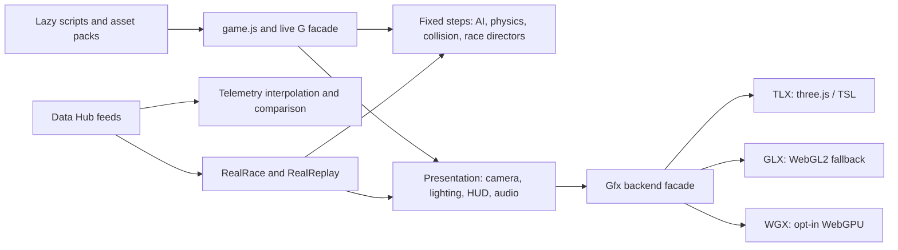

# Performance at call sites and resource boundaries

Source baseline: `cfefcbf7fd3f972ce2adaaf1c5579946acbbd085`.
These measurements distinguish eliminated work from whole-game frame rate.

## Where the work happens

Simulation already pools traffic/AI scratch, uses collision buckets and cached
track lookahead, and gates several presentation updates to the final step of a
frame. Rendering already pools submissions, partitions geometry and lights, and
separates main/mirror/shadow instance ownership. Replay, event, API and audio
caches have explicit bounds. A broad rewrite would discard those contracts;
the useful gaps here were at callers and asynchronous ownership boundaries.

## Corrections

| Path | Repeated work | Correction and correctness boundary |
| --- | --- | --- |
| `game.js`, driving cues, engine | Full `RealRace.status()` snapshots merely to read booleans | Existing instance predicates plus a call-time static `isWatch()` delegate; diagnostic output remains available |
| Telemetry model | Linear validity scan per distance query; two prefix copies for incomplete data | Check the last distance, binary-search an unknown suffix, interpolate with an exclusive end; preserve complete-series clamps and unavailable gaps |
| WATCH transport | Assign both `disabled` properties every 100 ms | Write only on a state transition, including seeks and event boundaries |
| Fold summaries | Replace identical HTML during audio/settings refresh | Cache requested and browser-serialized markup in a WeakMap; repaint changed content or externally changed DOM |
| Voice packs | Deselected pending packs become resident after completion; obsolete staged tiers start later | Track current keep/request intent for pending and queued packs; prune on success/failure and skip obsolete tiers; allow reselection without duplicate loads |

The telemetry boundary search relies on `cumDist`: once its accumulated distance
becomes nonfinite, subsequent samples cannot restore a finite accumulator.
There is no cached boundary, so repairing, extending or replacing channel arrays
is visible immediately. Handcrafted cumulative arrays that violate this producer
contract are outside the optimization's input domain.

## Measured effects

Chromium 154.0.8037.57 ran on the container's confirmed SwiftShader adapter.
The baseline game page was Monza, 22 cars, helmet camera, dry weather,
1280×720 at DPR 1, reduced motion enabled. GPU execution speed is unavailable
as player-device evidence here.

A seeded headless fixed-step baseline (seed 42, 300 warm steps, 600 measured
steps in batches of 10, three repeats) had p50s of 0.51, 0.53 and 0.56 ms per
step. This is a baseline, not an improvement claim: ordinary races do not
exercise the active real-race snapshot cost, and container/JIT load affects tails.

Telemetry used the actual baseline/candidate model source inside isolated
functions on that Chromium page. Each arm queried 1,200 samples across three
comparison lanes, with 40 warm rounds and 40 rounds per timed measurement,
five alternating-order repeats. Values below are milliseconds per three-lane
workload; the comparison excludes DOM, fetch, rasterization and full UI latency.

| Input | Baseline median (range) | Candidate median (range) |
| --- | ---: | ---: |
| Complete distances | 2.108 (2.095–3.973) | 0.163 (0.160–0.165) |
| Unknown suffix after 80% | 4.275 (4.160–4.458) | 0.140 (0.140–0.148) |

Both browser workloads had zero result mismatches. A separate source-based VM
comparison matched 69,875 values with `Object.is`, including stops, missing
channels, nonfinite queries, prefix endpoints and array mutations. VM timing
inflates global lookup costs and is not a mobile timing substitute.

An active 22-car Baku JUMP IN fixture's `status()` explicitly creates 22 row
objects, one array and one outer snapshot, and invokes `toFixed` 111 times per
read. Five Node repeats of 3,000 boolean reads took 27.6–35.6 ms through status
versus 0.058–0.202 ms through the existing instance predicate. These are isolated
Node measurements, not whole-frame allocation totals or an FPS estimate.

Behavioral regressions establish 200 → 0 redundant WATCH property writes over
100 unchanged ticks, and 101 → 1 fold replacements across initial rendering
plus 100 equal requests. Voice tests establish the retaining table drops
deselected completed packs and never starts obsolete queued tiers. Shipped
voice binaries are approximately 2.4–7.1 MiB each; that is encoded asset size,
not measured process-memory savings.

A native DOM check at 844×390 with touch confirmed the fold optimization:
101 → 1 child-list mutation records, stable child identity, correctly normalized
entities, immediate dynamic updates and repair after an external replacement.
Three integrated Chromium fixed-step runs also reproduced the baseline's
rounded field-state snapshots. Their timing changed with JIT warm-up, so they
are behavioral corroboration rather than a whole-game speedup claim.

## Expanded CPU, allocation and UI pass

The next pass used six independent implementation lanes and cross-reviews.
CPU samples and separate collected-object allocation samples identified AI
braking and per-car scratch work as useful targets. Allocation samples include
objects already collected; their weights are neither live heap nor retained bytes.
Source debugger logpoints also confirmed the 24-value scratch refill already
matched its inputs in every retained hit, including the human car.

| Area | Additional correction | Preserved boundary |
| --- | --- | --- |
| Simulation | Remove 32 redundant scratch stores per car, reuse settled tread grip, read typed lookahead directly, sample only Frenet's four channels, bypass zero-yaw trigonometry | Same arithmetic, distance accumulation, player controls and tyre behavior; oversized lookahead retains its pooled path |
| Lighting | Bounded stable nearest-24 lamp selection; settled warm-up path; skip unused cockpit caster construction; reuse unchanged lamp projection matrices | Identical lamp lists, factors and matrix bytes; live knobs, governor tiers and camera changes invalidate correctly |
| Replay/network | Forward event cursor; invariant fit trigonometry; binary event-window start; scalar arc wrapping | Inclusive caption boundaries, equal-time order, seek/reel resets, rank ties and packet fields |
| Audio | Stop moving parameter scheduling after ten disabled-layer gain time constants | Keep fade-tail updates, continuous oscillators and current pitch before re-enabling gain |
| Effects/debris | In-place spray selection; construct only relevant storm strikes; cache sleeping debris poses and uploads | Same admission/event results and Float32 matrices; solve/reseat/membership changes invalidate poses |
| Loading | Exact double-to-half bit conversion; bulk typed accumulator appends | Existing midpoint rounding, signed zero and nonfinite codes; identical geometry channels |
| Settings UI | Narrow pause polling; guard unchanged text/metadata; scope ARIA updates to affected semantic groups | Full page entry refresh, formatted range announcements, structural discovery and owner invalidations |

The paired-wall lookup experiment was discarded after its helper benchmark
regressed. A proposed settings observer filter was also removed: an owner can
change an explanation without changing its disabled state. Existing observer
invalidations remain intact.

### Actual game CPU comparison

Chromium 154 used the 844×390 touch profile, DPR 2, GLX fallback on SwiftShader.
Drawing was disabled for this fixed-step measurement. Each page load pinned
seed 42 **before** race construction, awaited the built race, then reset the
whole field with the same seed. Inputs were throttle plus steer 0.02, player
start 0.02 lap at 55 m/s. After 3,000 initial warm steps, each repeat reset,
warmed 1,000 steps and timed 6,000 steps. ABBA page-load order, three repeats
per load, produced six measurements per version and track.

The comparison baseline contains the earlier callsite/voice/DOM corrections
above; it measures the additional batch. All 437 intercepted baseline script
paths came from the saved baseline source; service worker and network caches
were bypassed during the comparison.

| Track | Baseline median ms (range) | Candidate median ms (range) | Median reduction |
| --- | ---: | ---: | ---: |
| Monza | 1,255.65 (1,129.50–1,371.60) | 1,076.05 (990.30–1,214.50) | 14.3% |
| Vegas | 1,072.10 (968.90–1,267.90) | 904.40 (866.40–992.20) | 15.6% |

Every rounded starting and finishing field snapshot matched across both
versions and all repeats. Separately, raw VM comparisons matched 1,351,303
primitive car values with `Object.is` across both tracks, dry/wet weather,
22 cars and active tyre wear. These are workload CPU measurements with visible
JIT/container variability, not physical-device frame rates or GPU speedups.

An earlier Monza comparison seeded only at reset and was rejected. Race startup
bakes driver skill and lane preference; reset reuses those cars. Both startup
and episode seeding are necessary. Another discarded capture did not await
race construction and failed to advance physics. These are measurement setup
errors, not game regressions; neither supplies an improvement claim.

The shipped profiler's spans, step and trace modes now seed before race
construction, await it and verify the actual built track/grid. Fixed-step
capture rejects an idle field, handles a final partial batch exactly and
clears input/restores drawing on errors. Its digest and legacy `bitIdentical`
output field compare rounded hook data; raw float equality remains a separate
VM check. Focused tests execute the real serialized callbacks with controlled
thenables and moving/nonmoving fields.

### Other measured work

- In the actual pause UI, the hidden settings/audio subtree produced 1,015
  mutations over 5.2 seconds before the change and zero afterward. A native
  tone range alternating 8/9 still displayed 100/105 with matching
  `aria-valuetext`.
- A running native AudioContext confirmed muted wind, whine, sub and harvest
  frequency scheduling fell from 120 writes per moving 120-call workload to
  zero after settling. Graph processing itself remains active; this measures
  automation scheduling, not elimination of audio rendering cost.
- A Node lamp fixture with 600 lights and 256 chunks retained identical packed
  tables: median bake 8.92 → 5.30 ms, with 34,703 hit objects eliminated.
  Sixty same-lamp moving-car shadow refreshes required one matrix construction
  instead of sixty, with identical submitted matrices.
- Shared half conversion measured 60.97 → 9.07 ms per million Float32 inputs in
  Node; all half codes, midpoint-adjacent doubles and 300,000 additional inputs
  matched the legacy conversion. Actual Monza stage copying improved only
  1.083 → 0.840 ms; this is a modest loading reduction.
- A 203-event replay's 60 late ticks avoided 12,180 historical timestamp reads
  and Set membership checks. Storm tests constructed 19 relevant records
  instead of 11,060 records across 32,400 intervals, with identical events.
- Seventeen sleeping debris cones over 60 skipped-solve frames reduced each
  pose getter from 1,020 calls to 17 and uploads from 60 to one. Draws and
  matrices matched. Debris is opt-in; every successful physics solve still
  conservatively invalidates the cache.

Raw profiles, comparison scripts, counts, exact-state fixtures and review
reports are under ignored `artifacts/perf-hunt/` in the working checkout.

## Follow-up priorities and measurement limits

- Reconcile loading, livery and track-retention changes already in PRs #3382,
  #3385, #3386, #3395, #3377, #3391 and #3392 before measuring their combined
  cold/warm result. TLX road culling in #3396 owns `tlx-chunked.js`.
- A separate exact-byte packing experiment removed temporary RGB/MAT arrays
  (3–6 bytes per colour vertex and 2 per MAT vertex). Its patch is isolated
  because of that ownership overlap and outstanding renderer hardware gates.
- WGX instance construction still creates one typed-array view per transform.
  A synthetic scalar-copy experiment removed 20,000 views with identical packed
  output. This remains a candidate, not a shipped renderer change.
- Use `profile.mjs --mode step --repeat 3 --base <ref>` for simulation timing
  and raw VM characterization for determinism. Its rounded-field hash is weaker
  than raw float equality. CPU/hitch/trace modes currently do not implement all
  the repeat/base flags the unified CLI accepts.
- Existing allocation sampling records survivors. Collected-object sampling
  must be an explicitly separate churn experiment. LoAF's 50 ms threshold
  misses smaller missed-frame budgets; retain frame-time tails too.
- Keep JS heap, audio PCM, requested graphics bytes and GPU execution timings
  separate. Physical-GPU evidence requires the existing macOS GPU census or a
  player device with verified adapter identity.

## Primary references

- [Chrome Performance](https://developer.chrome.com/docs/devtools/performance/reference)
  and [heap snapshots](https://developer.chrome.com/docs/devtools/memory-problems/heap-snapshots).
- [Current CDP protocol](https://raw.githubusercontent.com/ChromeDevTools/devtools-protocol/master/json/js_protocol.json):
  CPU sample intervals and separate collected-object allocation options.
- [CDP browser protocol](https://raw.githubusercontent.com/ChromeDevTools/devtools-protocol/master/json/browser_protocol.json):
  exact baseline response substitution and service-worker/cache bypass.
- [Long animation frames](https://developer.chrome.com/docs/web-platform/long-animation-frames).
- [Element.innerHTML](https://developer.mozilla.org/en-US/docs/Web/API/Element/innerHTML):
  reads serialize DOM rather than preserve original markup spelling.
- [WebGL timer queries](https://registry.khronos.org/webgl/extensions/EXT_disjoint_timer_query_webgl2/)
  and [WebGPU developer features](https://developer.chrome.com/docs/web-platform/webgpu/developer-features).
