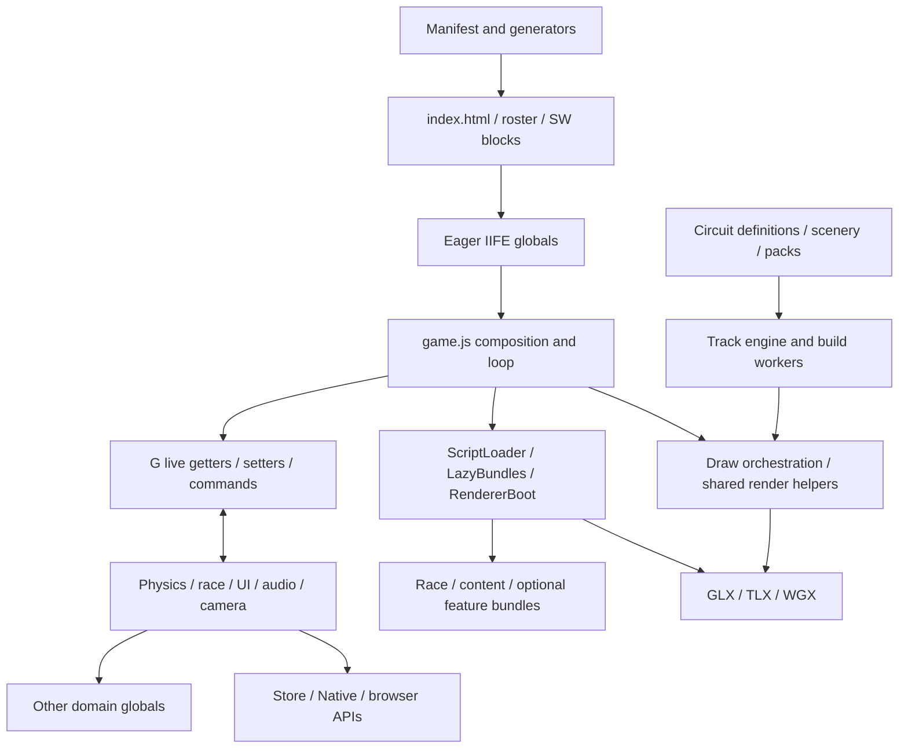
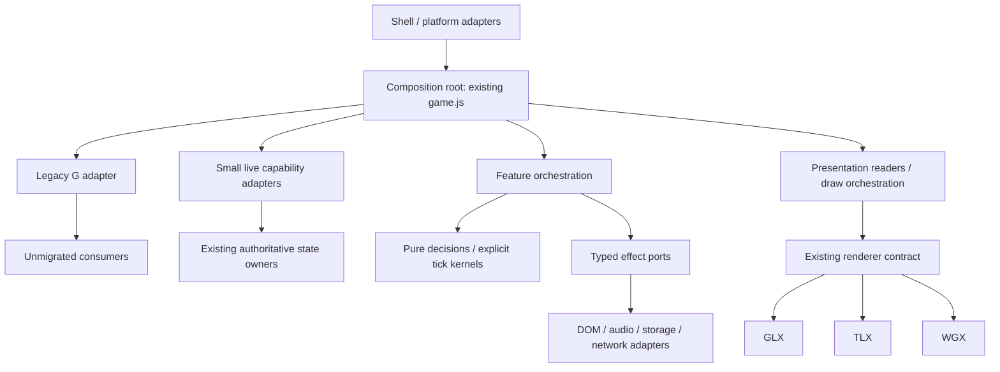

# Apex 26 architecture evolution: contracts before relocation

Status: proposed decision, not implementation authorization for a migration.
Assessed 2026-10-30 at `7c6d11c68ad8fd670ee2a882d53bb2eec50c548b`, fetched from
`origin/claude/f1-game-project-26h3ng`. Isolated branch:
`cursor/architecture-evolution-7c6d11c68`, checkout `/workspace/apex-architecture`.
The original `/workspace/f1-game` checkout was clean at `2220af2c1`; it was not
pulled, reset or edited. These are source observations, not proof of the bytes
currently published on Pages. No live deployment identity was verified.

## Decision in brief

Keep the domain directories and IIFE runtime. Continue the already adopted
Bedrock-with-grafts direction, but make ownership and effect boundaries the next
unit of work. Introduce small, checked capability contracts for selected consumers;
extract pure decisions only where characterization is affordable; retain G as a
compatibility adapter. Do not introduce a central event bus, framework, bundler,
shared mutable domain stores, mass rename or TypeScript conversion.

This is a design deliverable. No runtime proof was attempted: ownership of the
JavaScript refactoring session could not be confirmed. No implementation depends
on that session accepting this proposal.

Labels throughout: **Observed** means source/tool evidence at this SHA;
**Guidance** means an external source; **Judgment** means the proposed choice.
Counts below are dated inventory, not new maintained ceilings.

## Current architecture and actual dependencies

**Observed.** The project already groups runtime files by domain. Moving them
again would not remove dependencies. See [architecture map](../ARCHITECTURE-MAP.md),
[module contract](../ARCHITECTURE.md), [manifest](../../tools/manifest.cjs), and
[prior decision](../research/ARCHITECTURE-REDESIGN-2026-08.md).

Arrows denote dependency/access, not exclusively imports. The G/domains loop is
an authority and callback loop; it is not an ESM import cycle. Eval-time global
reads and later function calls must be analyzed separately.

| Boundary | Actual responsibility and consequence |
|---|---|
| Entry points | `index.html` loads the game; `controller.html`, `cockpit-view.html`, `overlay.html`, `bench.html` are separate staged entry points. `js/game.js` composes the session, owns major state, advances and draws it. `js/agent/apex.js` is an optional automation surface. |
| Simulation | `js/physics/` and `js/race/` contain substantial logic, but integration/writeback and phase order remain in game.js. `PlayerForces.step(c, ctx)` already receives explicit tick inputs; its module-level G still makes repeated create calls share context (`player-forces.js:28–33`). |
| Presentation | DOM stays in index.html; UI and CSS are split by screen. Camera, audio and rendering consume live session state. Cross-domain flows still compose classification, ceremony, garage arrival and commentary in game.js (`game.js:3030–3040`). |
| State | G exposes `player`, `cars`, `track` by reference (`game.js:3058–3072`). Readonly properties do not prevent mutation of returned cars. Career owns its save; G reads through `Career.data()`. A universal new state store would duplicate an existing authority. |
| Rendering | Gfx/RendererBoot select backends; shared stable GLX handle supports eval-time consumers. The seam uses feature-detected members, opaque handles and parity tests. Shader implementations still need coordinated semantic changes across three backends. A shared folder cannot eliminate that requirement. |
| Platform | GameStore owns persistence mechanics; Native/download and PlatformSession bridge host APIs. Browser effects also occur inside domain modules. Ports should grow at such effect sites, not wrap every Math call. |
| Loading | Manifest snapshot: FULL 325; HARD_EDGES 247; deferred backend files 29 (GLX 10, WGX 9, TLX 10). Lazy circuit/scenery rosters each contain 52. Other feature rosters include race-session, track-build, audio, data, net, editor, XR, career UI and workers. A domain is not a loading unit. |

**Observed loading mechanics.** `ScriptLoader` orders injection; `LazyBundles`
tracks loaded/in-flight state and retries failures. Race-session ready hooks can
fail independently of script fetches and must not latch a rejected memo
(`js/core/lazy-bundles.js:45–80`). New boundaries must preserve ready timing,
retry, instance reconstruction, fallback and teardown, not just module names.
Circuit metadata loads for the picker; full definitions and scenery hydrate on
selection/build. Preserve circuit identity and positional persistence contracts.

**Observed content/deployment taxonomy.** Circuit definitions and scenery are
authored content; shared spline/mesh/scenery APIs are engine code. `assets/atlases`
is author input excluded from shipment; `assets/pack` is baked runtime output
with licensing verification. `vendor` ships feature-loaded third-party code.
`tools/manifest.cjs` and `tests/groups.json` are authored sources; roster and shell
blocks are generated. `js/track/circuit-meta.js` is built, ignored output, produced
by ensure-built and staging. Tests use VM fixtures and Playwright; `tools/` owns
CI, source audits, generators, capture tools and MCP infrastructure. `desktop/`
and `mobile/` own Electron/Capacitor packaging, not alternative simulation cores.
Scratch and artifacts are evidence, not deploy inputs.

The phrase “no build step” describes direct local source execution. Deployment
DOES stage, generate built content, minify copied JS, and stamp hashes/SRI:
[stage](../../tools/desktop/stage.mjs:1),
[allow-list](../../tools/desktop/stage-files.mjs:1),
[generated/built inventory](../../tools/lib/generated-paths.mjs:1).
Any ESM or new content proposal must work in the staged tree and wrappers.

## Documentation drift, structural causes and hotspots

1. **Observed:** the old review says roughly 150 files and the historical panel
   assumes 40 circuits; the current eager roster alone has 325 scripts and lazy
   definitions number 52. Treat those old numbers as history. Its direction is
   still relevant; its conversion estimates and execution-order assumptions are
   not current engineering evidence.
2. **Observed:** GameCtx's header says `any` is used nowhere, but the declaration
   includes `any`. `jsconfig.json` has `checkJs:false`. `check-gctx.mjs:39–46`
   explicitly checks member existence/writability through a shadow program, not
   full expression types. The type gate is useful but does not prove behavior,
   units, nested immutability or ownership.
3. **Observed:** game.js's G comment encourages adding getters; the contributor
   map instead recommends explicit arguments before G growth. **Judgment:** the
   latter should govern new work. Correct the comment only in the owning refactor
   PR; do not create competing code edits here.
4. **Observed:** `gfx.js:14–24` describes fallback/injection as game.js's job;
   current architecture map names RendererBoot and LazyBundles. Trace actual
   boot ownership before using old headers as a refactoring specification.
5. **Structural cause:** classic global visibility permits domain bypasses;
   G narrows access conventionally but hands consumers broad authority. A folder
   move changes neither. Pure helper extraction can reduce game.js line count
   while retaining all its coupling if helpers still receive unrestricted G.
6. **Hotspots:** game.js (composition and phase order), GameCtx (compatibility
   surface), manifest (load order/tier), index.html (authored DOM plus generated
   regions), groups/fixtures and shared renderer contracts. Generated conflicts
   should be regenerated from their sources; index.html remains partly authored.
   Serialize edits to these contracts rather than serializing every domain PR.
7. **Naming:** GLX means both a backend and the stable compatibility handle;
   “data” includes remote API and grid data, while circuit data lives elsewhere;
   “core” includes browser effects as well as math. Clarify vocabulary/contracts;
   do not rename public globals to repair ambiguous prose.

**Observed baseline failure:** boot-load-budget has 8,209,755 eager raw JS bytes
against 8,200,000 at this SHA (325-script ceiling). The test failed before this
prose change; evidence `artifacts/architecture/boot-budget.txt`. Raw bytes are not
network transfer bytes or device startup time. Open PRs #4277 and #4268 address
this area. This design neither raises the limit nor claims the deploy is green.

## Serious alternatives

| Option | Benefits | Cost / migration mechanics | Tooling and failure modes | Decision |
|---|---|---|---|---|
| A. Retain structure, improve targeted contracts | Lowest churn; preserves static delivery, VM tests and parallel domain work; directly attacks G authority | Add one port and consumer at a time; retain old adapter; modest ongoing explicit wiring | Guards can become decorative if they check only names; must test unauthorized access and semantic contracts | Recommended near term |
| B. Feature vertical slices for new optional features | Co-locates controller/model/view ownership and lazy lifecycle; useful for Data Hub/editor-like work | New feature gets one public entry and explicit imports/deps; retain existing domains for reusable physics/rendering | Duplicates helpers or pulls renderer implementations into eager boot if “feature” is mistaken for loading tier; DOM still belongs to shell | Selectively combine with A |
| C. Native ESM islands / eventual strangler | Explicit graph, lexical scope and local checkJs; no required bundler | Pilot a new small lazy subsystem; dynamic import returns API; one compatibility adapter; staged hash/SW/VM work first | Module fetch depth, MIME/CORS, async initialization, cached mixed versions, duplicate singleton identities; classic/module ordering cannot be assumed | Optional escalation after measurement |
| D. Whole ESM + typed build pipeline | Compiler/bundler can enforce graph and optimize packaging | Rewrite loaders, generators, test VMs, deployment and debugging; many integration PRs before net benefit | Startup savings unproven; changes source-to-runtime model, mobile packaging and three-backend diagnosis together | Reject now; revisit only with measured failure of A/C |
| E. Broad domain stores plus ports/adapters everywhere | Explicit owners in theory; adapter testing | Moves state and rewires nearly every consumer | Shared mutable stores become G distributed across files; wrapper proliferation; phase timing changes; immutable frame snapshots allocate | Reject broad version; adopt ports only at concrete effect boundaries |

Costs are engineering judgment, not benchmarks. C/D do not intrinsically solve
ownership; A does not intrinsically solve the global graph. No numerical scoring
is used to conceal these different tradeoffs.

## Proposed dependency and state contract

Proposed enforceable rules:

- Pure decision modules depend only on constants/math and explicit inputs. No G,
  DOM, storage, clock, random, renderer or network access; inject RNG/time when
  needed. Mutable numeric kernels may write an explicitly owned car/output buffer.
- Application orchestration may invoke domain decisions and effect ports; it
  owns sequencing. Presentation consumes a narrow read view and submits commands;
  it cannot write player/season internals. Do not copy the whole world per frame.
- The composition root supplies ports. A port is capability access, not a second
  state owner. Keep live getter semantics where values change between calls.
- Simulation owns player/world mutation during the established simulation phase.
  Career retains save ownership; GameStore retains IO. Rendering owns GPU handles
  and frees them through their creating backend. UI owns DOM state, not race state.
- Legacy G remains intact for unmigrated consumers. No bidirectional mirroring.
  Retire a G member only after all consumers and debug hooks are accounted for.
- Renderer internals cannot become physics dependencies. Shared representation
  must be backend-neutral. Keep optional capability absence explicit and verify
  declared behavior; do not replace the current fallback mechanism in this wave.

**First consumer candidate (after ownership confirmation):** a race decision
helper or a small presentation consumer with few G reads, NOT player integration
or the backend install. Agree a `RaceReadView` subset containing only the values
actually used and `RaceCommands` containing the permitted transitions. Example:
`read.state`, `read.session`, `read.playerLap` are live primitives;
`commands.requestQuit(reason)` validates through the existing transition owner.
Do not expose `read.player` if the consumer only needs a lap number. Use a
JSDoc typedef plus runtime adapter; existing `create(G)` may wrap the adapter
until callers migrate. Keep adapter creation out of the per-frame path.

The first gate must detect a disallowed global/G reference and unknown port
member, not merely assert the returned object keys. Add method contracts for
units, legal phase, ownership, borrow lifetime, effects, retry/teardown and error
policy. This is the missing information that folder/module names do not encode.

## Graph evidence and interpretation

The existing AST scanner passed `node tools/check/scan-globals.mjs --check`:
598 files, 483 globals, 295 derived evaluation edges; FULL order is valid.
Of 247 declared HARD_EDGES, 157 are derived evaluation dependencies, 86 are
call-time and four underivable. Do not delete the latter on this evidence.
The scanner documents dynamic-key and callback blind spots and excludes the two
LAZY_WORKER entry points (`scan-globals.mjs:39–53,271–285`). Worker messages need
separate protocol analysis. This is not proof the whole runtime is cycle-free.

A single-writer reader-to-provider graph over evalReads plus callReads contains
2,051 edges and strongly connected components of sizes 92, 64 and five pairs.
This excludes accumulator/stub providers and typeof-only references; it remains
conservative. Concrete pairs include NetNostr/NetRendezvous,
MenuTeardown/LoopHealth and cockpit preview/options. NetNostr/NetRendezvous have
no mutual evaluation reads: this is later-call coupling, not a load-order failure.
A naïve all-provider SCC exaggerates cycles through TrackDefs/TrackScenery
accumulators and must not drive a migration.

Local apex-lsp navigation found G.player in 53 files (431 references) and G.gfx
in 22 (248 references). The tool labels these façade results as text matches;
do not present them as complete semantic alias analysis. Agent/debug usage is
substantial, so raw counts alone cannot prioritize a simulation rewrite.
Evidence is under `artifacts/architecture-graph-check.txt`, `artifacts/dep-graph.json`
and `artifacts/architecture-single-writer-scc.json` (regenerable, not committed).
Hosted apex_status failed with upstream MCP SSE HTTP 429; local graph and LSP
fallbacks worked. No browser or GPU claim follows from those checks.

## Feature-change validation

| Representative change | Today: edit/verification path | With proposed boundaries: edits that remain and edits avoided |
|---|---|---|
| Wet-weather caution policy | RaceControl mixes decision, persistence, host gating, network reporting and announcement (`race-control.js:282–385`); new inputs can grow G/game wiring | Pure policy takes weather/hazards/session/previous caution and explicit elapsed time; returns next state and bounded decision records. Existing adapter checks host authority and emits ordered effects. Decision unit tests plus one race-control scenario. Network schema/UI changes remain real work if behavior requires them. |
| New renderer puddle/effect control | Shared Puddles/input data, GLX GLSL, TLX TSL, WGX WGSL, settings/store and seam/parity tests can all change | Declare backend-neutral input units/defaults and capability/lifecycle first; each backend implements it. Presentation command changes quality state through owner. Three backend implementations and real GPU checks remain necessary; physics gains no shader dependency. |
| New session variant | game.js flow/session and phase paths, title DOM/UI, result paths, lazy readiness and fixtures; G views may change | Coordinator validates a policy/configuration and awaits required bundles before session activation. Keep flow×session axes. Legacy G projections read the same owner; no second enum/store. Loader retry tests and start/end/re-entry browser scenario remain mandatory. |
| Manual sector ERS plan (real open work: #3981) | Race policy, input/settings, persistence, HUD and integration all participate | Pure sector selection/deploy decision; settings commands update owned plan, HUD receives scalar view. Input, persistence and UI still change but cannot directly mutate physics state. Implement only after existing owner agrees; this report claims no inspection of unmerged implementation. |
| Add circuit | Circuit def/scenery + manifest membership + built picker metadata + track verification | Same authored content/API path; contracts prevent circuit code reaching renderer internals. No file move or ESM prerequisite. Preserve picker/save identity and scenery API. |

These traces validate separation of reasons to change, not a promise to reduce
all features to one file. A cross-domain requirement properly has several owners.

## Decision records proposed for review

- ADR-1: preserve current directories/IIFEs and manifest authority. Rationale:
  existing domain organization, tooling investment and tight startup budget.
  Revisit if graph defects persist despite enforceable contracts or an island
  demonstrates measurable delivery benefit.
- ADR-2: single write owner per state family; capability adapters over existing
  state, legacy G retained. Rationale: avoid mirrored state and phase drift.
  Revisit a state relocation only after writer/alias inventory and characterization.
- ADR-3: pure policy plus explicit effects where useful, ordered calls for hot
  simulation. Rationale: reproducibility and visible sequencing. No universal bus.
- ADR-4: opt-in JSDoc/checkJs for new contracts and migrated consumers. No global
  checkJs flip, project-reference build or language conversion in this program.
- ADR-5: ESM island allowed only as a separately approved exception to current
  game-code rules, with staged deployment/harness/cache proof first. Dynamic
  import must return an API; no untracked global installation or module-order
  assumptions. This proposal does not itself amend that rule.

## Staged backlog, dependencies and effort

Effort below is focused engineer-days, excludes waiting for hardware/CI/owner
availability and assumes small PRs. It is deliberately a range, not a conversion
schedule. Freeze/re-measure the touched subsystem at each PR's current deploy SHA.

| PR-sized step | Prerequisite | Acceptance / rollback | Estimate |
|---|---|---|---|
| 0. This assessment and source baseline | none | docs checks; no runtime edits | research deliverable |
| 1. One subsystem writer/alias and lifecycle inventory | ownership identified | classify direct/nested writes, commands, getters and debug consumers; owner accepts contract | 0.5–1.5 d |
| 2. Narrow port typedef + boundary check, no consumer changes | 1 | checker rejects unknown member and prohibited global; existing contract tests remain green; no eager payload growth | 0.5–1.5 d |
| 3. One adapter and one leaf consumer | 2 lands before consumer | compare meaningful behavior including live getter updates and denied writes; existing factory wraps new API; revert restores old caller | 1–3 d |
| 4. One deterministic race policy extraction | 1; can parallel 2/3 on disjoint files | fixed inputs/RNG/time produce same decisions and ordered effects; authority gates remain in adapter | 1–3 d |
| 5. One session workflow coordinator | 3 plus explicit bundle readiness | start/fail/retry/end/re-entry characterization; no stale stub instances or second state owner | 2–5 d |
| 6. Adopt ports in adjacent consumers | pilot review and measured payoff | ratchet new broad G/global dependencies to zero in migrated files; maintain old consumers | 1–3 d per bounded consumer cluster |
| 7. Optional ESM island feasibility PR | loader/stage/VM support and rule exception first | source and stamped/minified staged boot, cache identity, wrappers, retry and bundle size evidence; abandon without moving legacy files if no gain | 2–5 d investigation, conversion separately estimated |

The first contract/pilot wave is roughly 3–7 focused days. Several domains are
weeks of work; a whole-runtime total is not defensible before writer/alias and
lifecycle inventories. Largest uncertainties: nested mutation, lazy instance
rebinding, debug monkey-patches, phase ordering and real-device verification.
Pause after the pilot unless it reduces unauthorized dependencies or makes a
representative change easier to review. Do not continue to satisfy a file quota.

Coexistence: old consumers keep create(G); migrated consumers receive narrow
adapters created once at composition time. Values remain owned by existing
closures/modules. New commands call existing transition functions. No save-schema
change is needed. Deleting compatibility code is a separate PR after zero-reader
and debug/test checks. Revert consumer first, then unused adapter/contract; never
roll back a persistence migration under the assumption this scheme requires one.

## Parallel-session ownership and integration

Bounded inventory: 17 open PRs at investigation time; searches for open refactor
PRs and “JavaScript refactoring” issues returned no matching session. This is
not an exhaustive session roster or an acknowledgement. Current WORKERS retires
the old fleet bus; repository policy supersedes the plugin's older bus guidance.
Before any implementation, identify the refactoring session through its actual
PR/parent, send exact path scope through that route, and record its acknowledgement.
Do not edit speculative “free” shared paths while waiting.

| Lane / observed owner | Reserved integration surface | Allowed parallel work |
|---|---|---|
| This architecture lane | This new prose file only | Research and read-only analysis |
| JS refactoring session: unidentified | Conservatively reserve game.js, GameCtx and shared contract/manifest wiring | No architecture experiment until acknowledgement |
| #4292 warm-safe-go | game.js warm/clock state, GameCtx, apex info and results-flow spec | Design only around these paths |
| #4262 performance hunt | SW/audio/mirror/build splitting | Avoid loading/lifecycle edits |
| #4268 / #4277 boot work | eager/lazy appearance and budget | Avoid manifest and budget changes |
| #4227 garage preview | preview transport and shell | Avoid index.html/garage glue |
| #4225 UI tooling | tools/ui | Use existing tools without editing them |
| #3981 ERS | ERS policy/settings integration | Feature trace only |
| Future contract integrator | one agreed port, shared type + manifest changes | Land provider contracts before consumers |
| Future domain consumers | disjoint consumer files/tests | Race/UI/platform work can parallel after contracts stabilize |

Generated files have generator ownership, not permanent human reservations.
Regenerate once per integrated change; do not resolve authored DOM as if it were
all generated. Recheck PR ownership before implementation because this table ages.

## Verification strategy and stopping gates

For this prose-only branch: `node --test tests/unit/docs-integrity.test.mjs
tests/unit/agent-config.test.mjs`. Runtime groups are not applicable; no GPU,
native wrapper, service-worker browser or live Pages validation was run.

For future implementation, use AGENTS.md's current selected-spec/tooling floor,
not every suite below on every patch:

| Changed boundary | Necessary evidence beyond prose |
|---|---|
| Capability contract/consumer | GameCtx parity, real per-file checking, prohibited-access negative case, live getter/command semantics; changed tooling and one selected browser spec |
| Pure race policy / physics | deterministic input/output and effect order; host/client authority; physics-characterization when simulation/game integration changes; preserve assists-off world-space invariant |
| Loader / module format | manifest/global/load-order and boot budget, partial-load/retry/rebinding, worker protocol separately, staged-fetch/hash/SRI/SW installed upgrade and fallback |
| Renderer protocol | backend-surface parity and lifetime/order tests plus positive selected-backend boot and fallback; TLX/WGX path rules and real GPU census verdict, not software-only claims |
| Assets / content | source/bake provenance and licence verification, staged-fetch coverage; verify-track and relevant scenery/graph parity when geometry changes |
| Platform port | unavailable/denied API, suspend/resume and teardown; Electron/Capacitor staged entry testing when those paths change |

Measure cold startup and first-use latency separately: raw eager bytes, compressed
transfer, parse/evaluation/main-thread duration, requests, peak memory and time to
interactive title/race on a named mobile device/browser/backend. Establish a
baseline and agreed regression tolerance before the pilot, not an invented FPS
claim after it. Reject migration patches that increase eager work accidentally,
change deterministic behavior without an intended feature, conceal base failures,
or add a second authoritative writer. Known base-red boot budget stays recorded
separately until its owning lane resolves it.

## Research: primary sources and project fit

Fourteen URLs were retrieved successfully on 2026-10-30; receipts and text
snapshots are in `scratch/architecture-research/` (regenerable evidence). None is
an Apex performance measurement. Mutable upstream branches are retrieval-time
comparisons, not pinned versions of this game.

| Source | Researched guidance and limitation |
|---|---|
| [Cockburn: original hexagonal architecture](https://alistair.cockburn.us/hexagonal-architecture/) | Executable independence of policy from UI/database through adapters; supports ports in existing directories, not a prescribed tree or DI framework. |
| [Bernhardt: functional core / imperative shell](https://www.destroyallsoftware.com/screencasts/catalog/functional-core-imperative-shell) | Public synopsis describes value transformations surrounded by IO; only synopsis was read, not paid video. Good fit for scoring/decisions, no evidence for immutable full-world copies. |
| [Fowler: bounded context](https://martinfowler.com/bliki/BoundedContext.html) | Models and language differ by context: simulation car, rendered pose and external F1 records deserve explicit translations. Does not imply microservices. |
| [Fowler: strangler](https://martinfowler.com/bliki/StranglerFigApplication.html) | Incremental replacement with coexistence supports G adapters; two writable authorities would undermine it. |
| [MDN modules](https://developer.mozilla.org/en-US/docs/Web/JavaScript/Guide/Modules) | Dynamic import works from classic scripts; module scope, defer behavior and MIME change assumptions. No automatic classic/module execution-order proof. |
| [web.dev code splitting](https://web.dev/articles/reduce-javascript-payloads-with-code-splitting) | Deferral reduces initial parse work but moves latency to first use. Apex already splits code; bundler benefit requires measurement. |
| [TypeScript checkJs](https://www.typescriptlang.org/tsconfig/checkJs.html) and [JSDoc types](https://www.typescriptlang.org/docs/handbook/jsdoc-supported-types.html) | Per-file checking and typedefs enable incremental boundaries with unchanged shipped JS; types do not enforce nested ownership or runtime input validity. |
| [TypeScript project references](https://www.typescriptlang.org/docs/handbook/project-references.html) | Composite/declaration lifecycle is additional infrastructure; global scripts do not become separate projects merely by configuration. Defer. |
| [HexGL README](https://raw.githubusercontent.com/BKcore/HexGL/master/README.md), [composition](https://raw.githubusercontent.com/BKcore/HexGL/master/bkcore/hexgl/HexGL.js), [Gameplay](https://raw.githubusercontent.com/BKcore/HexGL/master/bkcore/hexgl/Gameplay.js) | Comparable JS/WebGL racing project. HexGL.js:156–175 passes explicit collaborators; Gameplay:15–32,58–65 still mixes HUD effects and checkpoint policy. Explicit arguments improve visibility but do not alone isolate decisions. Older project is not evidence for modern mobile/WebGPU startup. |
| [Three.js editor entry](https://raw.githubusercontent.com/mrdoob/three.js/dev/editor/index.html) and [Editor](https://raw.githubusercontent.com/mrdoob/three.js/dev/editor/js/Editor.js) | Mixed classic signals and native ESM/importmap composition demonstrates feasibility. Broad mutable Editor and signal registry demonstrate that ESM/event dispatch do not inherently fix shared-state coupling. |

## Independent critique and synthesis

Four native workers independently assessed structure, dependencies, migration risk
and research. Their agreement supports contracts in place, but is not validation
by vote. Structural review objected to removing G first and to treating pure
extraction as automatically useful. Dependency review challenged naïve SCCs and
readonly ownership claims. Risk review challenged “no build” literalism and
unconfirmed session ownership. Research found explicit composition in HexGL but
corrected an initial whole-context interpretation after reading the source.

Lead judgment: retain the simplest compatible runtime, adopt a port only where
its permissions and semantics are enforceable, and stop after one measured pilot.
The remaining global dependency graph is a real tradeoff, not solved by this
choice. ESM stays a serious later option; it earns adoption through a bounded
experiment that accounts for actual deployment and mobile startup.
