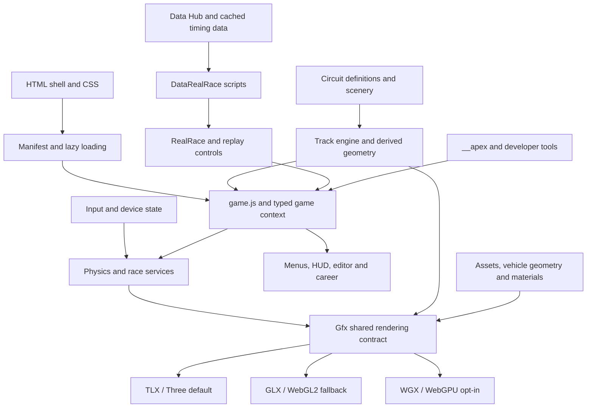

# Apex 26 project map

Apex 26 is a browser racing game built from static HTML, CSS and JavaScript. The runtime uses script-global IIFE modules and an injected game-context facade rather than a frontend framework or an application bundler. The principal engineering challenge is coordinating simulation, race/session state, procedural track/car geometry, three rendering backends, many UI surfaces and development evidence within that shared context.

This map describes the original tracked project snapshot ae73c6766. Runtime source was not changed by the mapping. The documentation index received one link to these reports; its current identity is explicitly recorded by the independent audit. New mapping artifacts are outside the original 5,109-entry inventory.

## Directory ownership

| Area | Responsibility and important boundary |
|---|---|
| index.html | Static document, menus, dialogs, HUD and application shell. |
| css | Shared styling, responsive menus, sheets, overlays and HUD. |
| js/game.js | Runtime entry and orchestration; constructs the shared game context and connects subsystem factories. |
| js/core and types | Boot/lazy loading, storage/platform/asset helpers and typed contracts such as game-ctx.d.ts. |
| js/input, js/physics, js/race | Human/device input, car simulation and race/session rules, including weather, pits, lap control and replay behavior. |
| js/track | Track engine: derived centerlines, coordinates, geometry, scenery helpers, surfaces and pit construction. |
| js/circuits | Authored circuit definitions and scenery data, distinct from the generic track engine. |
| js/render | Gfx facade, backend-independent helpers, TLX/Three default, explicit GLX/WebGL2 fallback and opt-in WGX/WebGPU. Backend initialization is lazy. |
| js/car, js/garage, js/camera | Procedural vehicle parts/materials/liveries, garage presentation and race/flyby/inspection cameras. |
| js/ui, js/editor | Menus, settings, HUD, sheets and the custom-track editor. Static DOM ownership remains with the shell; modules supply behavior. |
| js/data, js/career | Data Hub, cached external racing data, race-script construction, season/career progression and persistence. |
| js/net | Browser peer communication and rendezvous clients. The optional relay does not run race simulation. |
| js/audio, js/fx, js/lighting, js/perf | Audio scheduling/assets, visual effects, lighting profiles and telemetry/quality controls. |
| js/agent and related support | __apex inspection/staging API and supporting overlays, sharing, workers and XR integration. |
| assets and vendor | Runtime resources, generated packs/voice catalogs, licenses and shipped third-party code. Their provenance and binary/data read methods are preserved. |
| tests | Unit/VM/source-contract checks, browser specs, shared helpers, fixture/data catalogs, manual captures and test-only vendored XR emulation. A static or mocked check is not rendered-behavior evidence. |
| tools | Source generation, manifests, CI/gates, environment setup, MCP/LSP/debugging, screenshots, surveys, performance and asset/track/car verification. |
| docs | Current architecture/contracts plus plans, research, notes and historical audits. A historical SHIPPED label does not prove every proposed feature exists. |
| desktop | Electron application process, app-origin protocol, preload/permissions, packaging and native-shell tests. Packages the same web runtime. |
| mobile | Capacitor Android shell, native file/share bridges, Gradle configuration and staging. Packages the same web runtime. |
| worker | Optional Cloudflare Durable Object mailbox for sealed rendezvous offers/answers, expiry and bounded storage/rate accounting; not a gameplay server. |
| examples, sites, spike, design-preview | Demonstrations, design/prototype surfaces and retained investigations with explicit current/historical usage limits. |
| .claude, .agents, .cursor, .codex, .github, plugins, cursor-plugins, .githooks | Agent instructions/skills/hooks, canonical-skill mirrors, editor integration, CI/release workflows and project plugins. Instruction mirrors are symlinks, not independent source bodies. |
| icons and locales | Application/shortcut icon resources and the currently small English localization catalog/manifest. |
| artifacts and scratch | Generated evidence, retained experiments and recovery snapshots. Original tracked exceptions are mapped; untracked output receives separate provenance/identity treatment. |

## Runtime flow

The source roster and load order live in tools/manifest.cjs. The title picker uses generated circuit metadata; full circuit/scenery and renderer code hydrates when needed. js/core/log.js loads first. The game facade is specified by types/game-ctx.d.ts, and modules receive dependencies through factory calls. This architecture explains why LSP must understand script globals, aliases and the injected context, and why direct lookups of runtime-created __apex properties can fail despite real consumers.

Simulation and race services update the shared car/session state. Rendering, cameras, HUD and telemetry consume that state through their own contracts. The complete subsystem reports describe ownership, units, defaults, lifecycle and callers; this overview does not replace those per-file maps or imply perfectly isolated pure subsystems.

The Data Hub normalizes cached racing data into scripts used by the race/replay system. Its recorded timing/grid/stint/flag data and generated simulation are different evidence domains. Garage, photo/flyby and inspection tools likewise synthesize staged views: a saved capture or source-level camera check does not establish every player's live framing.

Desktop and Android staging reuse the web site. Their native process/origin/permission/filesystem boundaries are separate from browser gameplay. The optional Worker stores sealed signaling payloads with TTL; browser clients own sealing and peer setup. No second authoritative race engine exists in those packaging or relay directories.

## Verification and development structure

Tests combine direct Node behavior, VM-loaded production code, static source/configuration ratchets, browser interactions and manual visual evidence. The mapping records each case's actual assertions, fixture boundaries and production targets. Titles, comments, mocks, optional browser prerequisites, golden-image availability and capture-only suites are accounted separately.

The source-to-check relationship is driven by tests/groups.json and CI selection/generation tools. Agent skills and hooks route common work and enforce local policies; GitHub workflows own remote gate/release behavior. F1 tooling provides inspection/staging, debugger and LSP capabilities. Multiple Sol readers used those navigation tools concurrently; no shared browser was required for this source mapping.

A final local documentation check covers the prose/configuration changes. Passing that check or the draft fast CI tier is not evidence of native packaging, browser gameplay, real GPU behavior or a deployed build. None of those product claims is made here.

## Completion methods

The original inventory contains 5,109 entries: 4,672 fully raw-read files, 366 binary metadata entries, 38 symlink metadata entries, 32 completely traversed structured-data files and one mixed JavaScript-wrapper/embedded-binary vendor file. No original entry is unread or partial. These methods remain distinct; numeric table traversal is not presented as manual prose reading, and binary inspection is not presented as instruction-level semantic review.

Retained source is tracked separately: 463 historical identities have verified equal-line blocks plus raw reads of differing ranges, while 70 additional retained source/prose inputs have full assigned-byte ledgers. The frozen retained census classifies 5,776 entries. Canonical hash duplicates reuse the corresponding source/asset evidence. Generated diagnostics, logs, external tool dependencies, profiles and own analysis outputs retain explicit metadata/exclusion boundaries. No claim is made to have read every installed dependency, profile, secret or generated filesystem byte.

The independent audit verifies path rosters, hashes, bounds, interval unions, aliases and report existence, including original unit-read continuations. It cannot recover earlier model-visible tool responses; untruncated-read statements remain the source readers' recorded attestations. The central comment register independently checks 29 current candidates, preserves source locations and proposed wording, and rejects two unsupported earlier candidates. Source corrections are a separate task.
