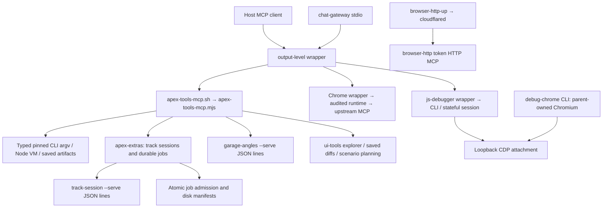

# tools/mcp complete source map — first half

Read date: 2026-10-27. Checkout HEAD at reading: `212adc24b985b120a63507c988abea69e7740e74`.
This is a source inspection, not runtime verification. No server, browser, probe, job, test or wrapped CLI was started by this lane. The parent owns checks. Only this document was written.

## Coverage and method

`git ls-files tools/mcp | sort` returned exactly **56 tracked paths** before reading. The split is ceil(56/2) = **28**: this half is `apex-extras.mjs` through `js-debugger-cli.mjs`, inclusive, **9,299 lines**. Every byte of these text files was presented and read, including schemas, comments, inline browser scripts, shell, JSON and Python. The final ledger records SHA-256 of working-tree bytes and exact inclusive read ranges; it does not claim the imported modules were fully read.

Read `AGENTS.md` and `.claude/skills/code-nav/SKILL.md` first. Attached `apex-lsp` was available: file-based outline of `apex-tools-mcp.mjs` returned 538 rows (first 5 requested). File-position semantic references worked for tooling ESM too:

| Query | Result, including declarations/imports |
|---|---|
| `job-admission.mjs:7:17` publishJobManifest | 4 references / 2 files: apex-extras 2, job-admission 2 |
| `catalog-discovery.mjs:97:17` discoverCatalog | 5 / 3: apex-tools-mcp 2, garage-plan 2, catalog-discovery 1 |
| `apex-extras.mjs:51:17` createExtras | 3 / 2: apex-tools-mcp 2, apex-extras 1 |
| `diagnostics-tools.mjs:36:17` createDiagnosticsHandler | 3 / 2: apex-tools-mcp 2, diagnostics-tools 1 |
| `garage-plan.mjs:17:17` createGaragePlanHandler | 3 / 2: apex-tools-mcp 2, garage-plan 1 |

An initial catalog reference lookup at line 109 hit punctuation and returned no symbol; corrected to line 97 above. String CLI routes, shell/Python callers, configuration, dynamic file loads and test imports were followed with source searches because they are not semantic JS references. A broad consumer search was truncated; bounded filename search and direct config read supplied the consumer evidence below. An oversized combined read of the final eight files was discarded as coverage evidence and all eight were reread in two complete, untruncated outputs.

## Route and ownership map

`.mcp.json` configures six stdio servers: apex-tools, playwright-official, chrome-devtools, js-debugger, apex-lsp and browserstack. Each passes through `output-level-mcp.sh` before its real wrapper. `.cursor/mcp.json`, `.codex/config.toml` and `.cursor/environment.json` mirror/allow these routes; configuration is not proof a host exposes them. `chat-gateway.mjs` deliberately aggregates five of the six (excludes BrowserStack), reads actual upstream tools/list pages and namespaces names as `<upstream_with_underscores>__<original>`. It adds `f1_gateway_browser_release` and injects the doctor host-catalog extension. `tools/env/chat-mcp-service.mjs` and `configure-chat-mcp.mjs`, environment preflight/install/bind scripts and the F1 plugins consume this gateway route.

The phone MCP is an independent optional endpoint, not one of `.mcp.json`'s servers and not guarded by apex-browser.lock in these files. The Python cdmcp clients also launch the Chrome wrapper independently. Their comments require one browser at a time; that is not equivalent to them acquiring the apex mutex.

## Apex server contracts

`apex-tools-mcp.sh` performs bounded npm preflight, forwards argv to Node, retains stderr loader diagnostics and returns the Node exit code. Main CLI: help/status/list-tools/call/smoke/serve/serve-http. `list-tools` prints full schemas; MCP tools/list publishes compact copies. The JSON manifest lists **39** names, version 1.17.0, prefix apex_, stdio serve and loopback HTTP 3713. The in-source CATALOG includes the diagnostics entry by spread and defines the same surface; no catalog program was executed for this map.

The server implements MCP protocol 2025-06-18 directly: initialize, ping, tools/list/call, resources/list/read; non-object/batched envelopes are rejected. `notifications/cancelled` aborts the matching inflight call and suppresses its final reply. Stdio accepts newline-delimited JSON and dispatches asynchronous requests concurrently. EOF waits for pending calls and closes persistent sessions. Signal handlers exit through process exit hooks to reap owned child work.

HTTP binds only 127.0.0.1; port override APEX_MCP_HTTP_PORT. GET /healthz reports server/version/count, GET /tools or /mcp/tools lists tools, POST / or /mcp dispatches RPC. Host must be loopback; supplied Origin must be loopback http(s); POST requires application/json. Body cap 1 MiB; malformed JSON 400, oversized 413, origin/host/content refusal 403, unknown route 404, notifications 204. It is JSON HTTP with these routes, not a claim of SSE/session transport support.

Full CATALOG input schemas are enforced before expensive work/occupancy. Top-level unknown keys fail with nearest-key advice; string default length 4096 (expr 65536), arrays default cap 256; numeric/integer/enum/const/required/anyOf/type/bounds checks are implemented. Source validator does not implement every JSON Schema keyword: for example published `pattern` and `uniqueItems` are not checked by validateValue itself, although route-specific validators enforce many shapes. Aliases translate HUD viewport names to device IDs and image/inlineImage for supported tools. CLI flag-like values are refused for positional-sensitive fields. Nested garage design/frame objects remain delegated contracts.

Published compact schemas preserve every top-level accepted key, remove nested object bodies and long enums/prose/bounds when dense; apex_help returns full description and input schema, apex_catalog returns canonical IDs. Consumers must use full help before relying on hidden nested constraints. Output normally includes text JSON plus structuredContent. Wrappers that rewrite text are synchronized in RPC via syncStructured. CLI `call` prints only first JSON text and uses isError for exit. runSpawn envelopes carry ok/exit/argv/env/stdout/stderr/out/durationMs. splitOut parses an entire JSON value or final column-zero object/array block without returning it twice. Streams cap at 8 MiB each and truncation makes the verdict fail. Timeout/cancel snapshots and kills the entire process tree before resolving; allowExit supports classified verdicts such as verify fast exit 2. Thumbnail images use lazily imported sharp; HUD returns richer structured findings and resource_links.

Browser admission checks lock owner/staleness, durable browser jobs, shared debug Chrome, probe daemon /healthz, test-bg and busy Playwright Chromium. Idle Playwright MCP servers do not occupy the browser. `scratch/apex-browser.lock` is an exclusive wx file; only its owner PID releases it. `target:deploy`, github.io and non-loopback URL targets are rejected; browser URL arguments are refused even for loopback because the harness boots its own page. VM apex_eval uses the same entry with --vm and rejects backend, but CATALOG still classifies apex_eval as browser for wrapper admission.

### Tool → implementation/CLI seam

| Tool family | Downstream contract |
|---|---|
| apex_status | Lock/daemon/debug endpoint/test-bg/Playwright/load/freshness/sessions; next action is advice, not an admission grant |
| apex_catalog, apex_help, apex_locations | Schema enums/UI menu catalogs, focused discovery, authored survey locations/custom JSON; no browser |
| apex_doctor | check/doctor.mjs --tree --json; slim non-pass checks by default |
| apex_pick_tests / select_specs | ci/pick-tests --json (never --bg); ci/select-specs --since --json and budget; plan only |
| apex_bump_cache_check / rotate_markings_check | ci/bump-cache --check --json (never --apply); track/rotate-markings --check (never --write) |
| apex_verify_change_fast | ci/verify-change --fast --json, never --wait; default durable job, sync:true cap 600 s; exit 2 means partial |
| apex_graph_parity | track/graph-parity.cjs, BASE via env required; one ID synchronous, all:true durable graph_parity_all |
| apex_frame_report | shot/frame-report --track; no fleet/diff/pose/out; JSON shot-list input only, <=1 MiB/256 entries and shotErrors validation |
| apex_eval / apex_agent / apex_shot | shot/apex-eval, agent, shot; typed flags; describe needs ID preboot; browser cap 180 s, weather/tod agent 420 s |
| apex_garage | shot/garage-angles --serve, persistent JSON-line child, op open first; design → frame → shot composition, event lines retained |
| apex_track / apex_shot_survey | shot/track-session --serve; survey runner/shot-survey share plans and receipts; named/profile/seed/resume/custom routes async |
| apex_profile / profile_query | perf/profile durable browser job modes spans/cpu/hitch/trace; perf/query reads bounded artifacts, never raw profile output |
| apex_hud_shot / survey / mock | shot/hud-survey or hud-mock; default jobs with server-pinned Symbol argv; explicit async:false synchronous lock path |
| apex_ui_fit / shot | ui/layout-audit one validated catalog screen × viewport; geometry row or PNG/DOM; complete matrix/gallery jobs separate |
| apex_car_audit / track_audit | parts-ladder/crest-sweep; verify+float default or audit-circuit checks verify/float/clip/coplanar/props/ground; exit 1 classified as finding verdict where allowed |
| apex_unit_test / viewer | Exactly one tests/unit/*.test.mjs via node --test; viewer/build-viewer --json has no screenshot flags |
| apex_cursor_agents | ci/cursor-agents typed verb/options mapping, env-name allowlist, scratch/artifacts files, spending actions delegated to CLI ownership rules; confirm ID for cancel/delete |
| apex_garage_plan | garage-angles --plan, max 4 frames × 4 options <= maxShots 16, budget 30..180 s; canonical enum values only |
| apex_diagnostics | perf/diagnostics diagnosticPlan/query; capabilities/read saved reports or typed durable jobs; GPU allocation estimates are not residency/timing |
| apex_ui_mission_plan / inspect / diff | createUITools imported from ui-tools; own explorer browser ownership and artifact contracts, covered in second-half map |

Path bounds use both lexical containment and realpath/nearest existing ancestor to prevent symlink escapes from artifacts/ and scratch/. Input files must exist, be regular and stay inside those real roots. Cursor file validation is a separate lexical contract, and the downstream CLI performs its own security checks.

### Session and durable job lifecycle

Track session: one detached child, readiness JSON within 180 s; correlated monotonically increasing id request/reply JSON lines, per-operation 240 s timeout; abort closes session; shot/track replies update counters/active track; close rejects pending requests, EOFs child, waits 8 s then kills tree and releases lock only after cleanup. Garage differs: readiness timer and stream handlers are owned by garage state; close EOFs and schedules TERM after 8 s, waits at most 60 s for exit, reports settled, and releases only at exit. One-shot CLI cannot preserve either session.

`createExtras` accepts injected spawn/kill/surveyHost seams for tests, ctx server helpers for refusal, result, lock, known circuits, splitOut and runSpawn. Job kinds are diagnostic kinds plus survey_track, shot_survey, HUD kinds, profile, UI gallery/matrix, flicker_gate, frame_fleet, parts_sweep, livery_contrast, verify_all, float_all, graph_parity_all, verify_change_fast. Plans construct pinned argv; arbitrary JSON cannot supply HUD argv because that seam is a Symbol.

At most two active/cleanup-pending jobs across memory+disk. Browser plans take the shared lock. `job-admission.mjs` publishes complete manifests through temporary-file rename; admission is an immutable numbered epoch acquired via atomic hard link with token/owner birth identity. Stale/reused PID identity is compared only under matching birth schemes, avoiding uncertain ownership claims. Start writes state starting with owner then spawns a gated detached sh; workload receives `go` only after running manifest publication succeeds. Wrapper records .exit even after a one-shot parent exits. States starting/running/done/failed/cancelled; verify_change_fast exit 2 is done. Persistent server exit reaps owned jobs; one-shot `call` leaves durable jobs alive. Cancellation snapshots the tree and birth identities to a durable .cancelled marker, kills only proven owned identities, records incomplete cleanup, and keeps lock/slot until cleanup completes. Status can read other owners' manifests, wait <=300 s, return bounded tails/full parsed result; >20k result keeps headlines and top findings, points to log. Terminal manifests older than seven days are pruned with sidecars. Survey progress/findings/gallery are separate outputs; resume requires matching source/settings/custom identity rather than mere file existence.

## Remaining first-half files

| File(s) | Role, dependencies, consumer boundary |
|---|---|
| apex-report.js | Browser-paste IIFE, installs apexReport and immediately runs; collects __apex diag/info/warn logs, errors, GL context, served version, allowlisted non-secret preferences; temporarily wraps rAF to sample real frames and restores after count/4 s. Distinguishes picture vs clear alpha, embeds optional PNG; posts to relative apex-report then download fallback; full rep on window.__apexReport. Consumed with report-server workflow, not Node CLI. Query/fragment omitted from location evidence. |
| browser-http.mjs | Exports startBrowserMcp; harness launch/static server + probe-page GLX init. browser_open/eval/shot/status. Phone landscape 852×393 or portrait 393×852, touch/iPhone UA. Token timing-safe compare, Bearer or query token; /healthz public, /mcp token required, POST only, 64,000-byte cap, JSON-RPC validation. close interrupts uploads, awaits dispatched calls, closes browser/static server/connections. No schema argument validation beyond RPC envelope in this implementation. |
| browser-http-up.mjs | Exports tunnelUrlFromLog/decide/bringUp; local health and prior public health decide reuse/start-both/start-tunnel. Optional cloudflared binary download to scratch/browser-http, detached browser HTTP port 3001 and tunnel, waits readiness, persists token/url/host state; prints capability URL. Independent operational helper, tests cover pure decisions. |
| browserstack-mcp.sh | help/status/run; exact npm @browserstack/mcp-server@2.2.4; requires BROWSERSTACK_USERNAME/ACCESS_KEY env only before preflight, execs npx; hosted OAuth alternative is separate. Direct config consumers and agent-config/output-config tests. |
| catalog-discovery.mjs | Lazy loadParts/loadAtlas plus customizationEnums and garage camera catalog. discoverCatalog parts/liveries/garage, literal filter and offset/limit <=100, plain JSON clone; carFilterArgv validates canonical category/team. Parts availability excludes career ownership/research; livery rows exclude runtime Legends/custom/saved additions. Used by main catalog, extras audits/jobs, garage planner and catalog-discovery unit tests. |
| cdmcp-bg.mjs | Detached Python measure wrapper, registry/log/JSON under artifacts/logs, status/wait/stop; --force TERM prior group; alive uses kill(pid,0), no birth scheme. Outcome uses last '= run' marker, wait errors on failure. Plain command, not shared admission job. Help without args exits 2 and never starts work. |
| cdmcp-cli.py | McpClient launches Chrome shell stdio, root requests, pageId auto-discovery for required-page tools; initialize/roots notifications, tools/list, call error checking, 180 s request timeout. list-tools/call/survey-title/measure delegate/apex-shot/slider-ab/look-survey. Local static server reuse/start, own-server cleanup. Orbit screenshot path; slider-ab uses stable player-relative camera, before/after eye/tgt check and optional PIL/numpy diff/noise-floor advice. Look survey boots once per track, sorts day-vs-dark to minimize rebuilds, waits presentation, merges state.json; --plan skips existing PNGs. probe-mcp.py dynamically loads this client; lamps scripts load same file via importlib. |
| cdmcp-lamps.py | Six fixed Qatar/Singapore/Bahrain/Monza night samples; filter/limit, bg/status/port/url. screenshot nonblank heuristic >=5 KiB, same-track density 2 must bake more lights than 1 when both observed. scratch captures/report.json plus log/PID/status sidecars, timestamped '= run' terminal line. |
| cdmcp-lamps-tune.py | Monza night instrument: density .5 vs 2.5 baked counts/posts, warm -2 vs cool +2 RGB ratio, pool .04 vs 2 energy magnitude >1.5×; optional/default evidence screenshots; writes JSON failures and terminal status. Reasserts lightTune around day/night rebuilds. Does not prove final image appearance. |
| cdmcp-measure.py | Independent locked-thread stdio client (not cdmcp-cli class); boot network/console/performance trace+insights+Lighthouse; ui settings at90 small text and suspension at115 truncation; full adds fresh heap snapshot summary/dups after new nav. Captures report under artifacts/logs with 0600 complete JSON. UI checks/hard boot absence determine verdict, Lighthouse/console metrics mostly observational. bg mode shares cdmcp-bg registry. |
| chat-gateway.mjs | MCP SDK Server/Client stdio transports; lazy cached upstream clients and paged catalogs (repeated cursor/duplicate names fail), warm catalog on entry. Serial queue for every call; one browser owner per gateway; debugger attach blocks release until detach. Browser classification uses upstream or /^Browser/ description, so mixed tree/browser diagnostic entry relies on underlying lock. Release closes upstream client; browser_close clears Playwright ownership. No claim of process-wide serialization across separate gateways. |
| check-chat-browser.mjs | Operational local smoke script (top-level execution); creates gateway, discovers pageId, navigates loopback game, awaits agentHelp, injects F1Dev helper from canonical absolute path, calls diagnose, parks/release/closes; writes environment-repair-browser.json. Explicit hosted:false. |
| check-chat-contract.mjs | Exports host-name normalization/checkCatalog/main; optional actual host-name JSON, verifies five prefixes/release/unique/object schema routes, launches disposable gateway SDK client and calls status; marks host snapshot absent when omitted. No browser actions in this script, but starts upstream protocol catalogs. |
| check-doctor-catalog.mjs | Operational SDK client, exact one host snapshot argument; validates injected hostToolNames and doctor runtime.dependencies/session.catalog passes; canonical absolute cwd. Local protocol evidence only, hostedCall:false. |
| chrome-devtools-mcp.sh | clone/build/status/chrome-path/help/run/verify; audited pin chrome-devtools-mcp@1.11.0, optional exact clone; shared Chromium discovery/bounded wait; --headless --isolated --memoryDebugging 844×390 and canonical WebGPU/SwiftShader args or APEX_CDT_BROWSER_URL attach. Pinned npm exec --prefer-offline resolves real bin, passes runtime gate, execs Node. Clone/build are explicit mutating commands; status uses read-only discovery. |
| chrome-devtools-runtime.mjs | Exports materializeRuntime, version/patch/hash guards. 1.11.0 returns existing bin unpatched; legacy 1.7.0 requires two exact SHA256 guards and single-occurrence source transforms (dialog click race and close-page snapshot refresh). Cache key covers patch/source/dependency identity; validates manifest/patched bytes/dependency symlink; atomic lock/owner recovery and staged rename. Unknown versions fail. Called by shell wrapper; chrome-server-fixes tests. |
| debug-chrome.mjs | Shared parent-owned browser CLI start/status/stop/_hold with native Node fetch/WebSocket CDP, chromiumPath and live-run.py. 3456 static server reused/owned, CDP 9222 default, phone844×390 DPR2 touch/iPhone UA (desktop1280×720). Holder keeps CDP metrics/focus/touch session alive. PID marker checks from /proc prevent reused PID kills; writes artifacts/debug-chrome state/logs and browser-use DevToolsActivePort (XDG absolute config honored). Stop TERM then KILL proven markers, removes discovery only matching own port. start --headless-game navigates blank then game and disables rendering; load/test admission. Consumers main apex status/start, debugger session/workflow/CLI, opt-in PW/DevTools. |
| diagnostics-tools.mjs | Typed capabilities/run/query handler and diagnosticsJobSpec; imports perf/diagnostics pure planning/query; caps tracks/visits/cycles/settle/warm/growth/seed; execution delegated durable startJob, no arbitrary argv. tests/unit/diagnostics-tools. |
| doctor-catalog.mjs | Host snapshot schema <=2000 bounded names; rejects unknown doctor args and invalid types, loads checkout's diagnose dynamically, records caller-supplied catalog source/time/checkout; full or outputLevel full retains passes, otherwise retains session.catalog and non-passes. Consumed gateway and free-design-tools tests. |
| garage-plan.mjs | Canonical camera/part/livery plan with validateCarFilters/discoverCatalog; defaults mclaren/spineTop, max 4×4, --preset=none and budget; requires field/options together, computes maxShots, 30 s subprocess timeout and numeric plan.shotCount, reports withinBudget. Declared bounds are defaults when omitted, despite prose saying explicit. |
| job-admission.mjs | Complete atomic publish and immutable epoch cross-owner admission primitives described above; only proven retired history pruned; consumer extras and server-fix tests. |
| js-debugger-boot.cjs | NODE_OPTIONS --require bootloader for Node descendants. With APEX_DBG_CHILDREN, skips existing inspector/dead owner, opens loopback free port, appends PID/PPID/url/argv JSON line then waitForDebugger. Consumer js-debugger-node.mjs (second half), never standalone browser launch. |
| js-debugger-cdp.mjs | Exports localUrl, TARGET_TYPES, targets and Cdp EventEmitter. HTTP/WS loopback only, no auth/query/fragment; discovery endpoint origin only, redirect:error/5 s/1 MiB/100 rows; default page+node, workers opt-in. WebSocket text limit8 MiB, per-request IDs/timers, late response seam, disconnect rejects pending. Consumers js-debugger-session/node and debugger transport/tracks/node/mcp unit tests. |
| js-debugger-cli.mjs | Imports serve/TOOLS, HTTP daemon request/start and DebugSession; help/list-tools/serve/serve-http/call/status/smoke/profile. call talks to existing daemon, never starts session; serve-http port3714 default. profile attaches existing Chrome/Node target, bounded100..30000 ms CPU/heap or hitch, detaches on success/failure. Stdio and HTTP independent session ownership; smoke parent-only native workflow. |

## Proven stale or narrower-than-advertised comments

These are source discrepancies, not runtime test failures; no source fix was made.

1. `apex-tools-mcp.mjs:8` says one of FOUR configured servers and omits apex-lsp/BrowserStack; actual `.mcp.json` has six above. Header line9 says catalog serves40; JSON names count39 and source CATALOG spans one imported diagnostics plus38 named entries. Historical count commentary must not be used as catalog authority.
2. `chrome-devtools-mcp.sh:73` refers to the former shell-script debug launcher; tracked helper is `debug-chrome.mjs` (no .sh in the 56-path roster). Same typo occurs in second-half playwright wrapper search evidence.
3. `cdmcp-cli.py` look-survey example around line828 says “All 20 conditions” for a bare `look-survey monaco --frac .45`; parser default at line848 is only `day|dry,night|dry,day|rain,dawn|fog`. DEFAULT_LOOK_COMBOS is24 with storm and is used for plan defaults, not the bare invocation. The implementation and other prose explicitly support24, so the example is stale.
4. `apex-tools-mcp.mjs` garage-plan description says explicit maxShots/time budget; `garage-plan.mjs` defaults them to16/180 and schema does not require them. This is narrower prose than the accepted contract; callers should choose explicit bounds but omissions are valid source behavior.
5. `syncStructured` commentary still names ci_status among refiners, while current CATALOG and header document its removal. This is a stale example only; sync behavior is generic.

## Validation handoff

No runtime assertions are claimed. Parent docs-only checks should cover this prose addition. Existing targeted suites provide implementation coverage when code changes: apex-tools-mcp, apex-server-fixes, agent-surface/config/output-config, browser-http-mcp/up, cdmcp-measure, chrome-server-fixes, catalog-discovery, diagnostics-tools, free-design-tools, debug-chrome and js-debugger transport/node/tracks/mcp. Some tests start servers/browsers; this lane did not run them.

## Full-read ledger

Ranges are inclusive and cover each file without gaps. “whole” means the entire bounded file was read in a combined output that was confirmed untruncated. SHA-256 is of working-tree bytes at end of reading.

| # | Path | Lines | Read ranges | SHA-256 |
|---|---|---:|---|---|
| 1 | `tools/mcp/apex-extras.mjs` | 1073 | 1–360; 361–720; 721–1073 | `0d1fb106c630a0b95b6f3d09f3af8dd941154a3ab69b1d1383c8b48b0a570d4f` |
| 2 | `tools/mcp/apex-report.js` | 334 | 1–334 (whole) | `dca19541c55d170c43718f572187806ac634c77a8473aab7303c8907171a750f` |
| 3 | `tools/mcp/apex-tools-mcp.json` | 66 | 1–66 (whole) | `bf44bf8c4d1d5888d28bd45f32def2a37837e7017d9d8eeaa63ff5fb298f529e` |
| 4 | `tools/mcp/apex-tools-mcp.mjs` | 3376 | 1–360; 361–760; 761–1160; 1161–1560; 1561–1960; 1961–2360; 2361–2760; 2761–3160; 3161–3376 | `06536ec0f59f9e2d49231db8832aea282980b54f45b28d511f3fc67612f33ecf` |
| 5 | `tools/mcp/apex-tools-mcp.sh` | 20 | 1–20 (whole) | `371bdb3b0e719418d00bc9ee8f1d552cb8149875ecf9136c2a94bb5463541527` |
| 6 | `tools/mcp/browser-http-up.mjs` | 124 | 1–124 (whole) | `86edbe2350549e8b0f9f0c73ed2354c3b589979e69d82bdc473cf615ac949f18` |
| 7 | `tools/mcp/browser-http.mjs` | 312 | 1–312 (whole) | `f56076f597bb09f0ef3aaba80df200e0c4c53f89f603d05028e96f7c364fe6e2` |
| 8 | `tools/mcp/browserstack-mcp.sh` | 106 | 1–106 (whole) | `5415a2c7d1a0a8fb176576d3e779311cc66448ec8d78066a7fa4a32ab60cb1b7` |
| 9 | `tools/mcp/catalog-discovery.mjs` | 114 | 1–114 (whole) | `9d49932ab59ef8ae37b7f7c84feea5e468f7da9a03fdce09593636bdf70a2492` |
| 10 | `tools/mcp/cdmcp-bg.mjs` | 155 | 1–155 (whole) | `e1b1633ed4bc4bcd0ffa2badc240646286ebf41fb6a75435d6fb594ef2362171` |
| 11 | `tools/mcp/cdmcp-cli.py` | 962 | 1–320; 321–640; 641–962 | `ff4d32bf3420f382635e5aa007f6c6f9bfd37179af021785e7098231e444c8d3` |
| 12 | `tools/mcp/cdmcp-lamps-tune.py` | 418 | 1–220; 221–418 | `c21ab514ed59e89364802e5acf70357522bd6e69ea9f7fb63a441893871a341b` |
| 13 | `tools/mcp/cdmcp-lamps.py` | 354 | 1–354 (whole) | `863d729ac50a12f9e5d60b5b1dc86db9a3d085f1d2ddd165f5c3c1cee3b8e7c6` |
| 14 | `tools/mcp/cdmcp-measure.py` | 543 | 1–280; 281–543 | `324e6b03591afadd5fc8f6a6fbd44755fcfa97d96b5397ccf9f1b9ca6e6e5b7f` |
| 15 | `tools/mcp/chat-gateway.mjs` | 89 | 1–89 (whole) | `5995327b2f26508bfb261a0114ec6b0b33f6e25ec81492ee0a1fff469fc83cd3` |
| 16 | `tools/mcp/check-chat-browser.mjs` | 46 | 1–46 (whole) | `1eb490e141ca9f26a80a7e5bb40099a2efcdd377c3b9b23fca4ff794c93f1d4c` |
| 17 | `tools/mcp/check-chat-contract.mjs` | 35 | 1–35 (whole) | `64fa36a63669afa14de9d170e34ddcfd5cb4c015dba6a86191401f1059a10347` |
| 18 | `tools/mcp/check-doctor-catalog.mjs` | 23 | 1–23 (whole) | `6bfc73a0dccf436a36cc83b1c3ec5233b8055609c5487a9b5e1e7b6b34c629ef` |
| 19 | `tools/mcp/chrome-devtools-mcp.sh` | 308 | 1–308 (whole) | `b9b3ff572a5761477ffbe0edd6c731777b8ea5e558702bb99b72334fa01a8f23` |
| 20 | `tools/mcp/chrome-devtools-runtime.mjs` | 220 | 1–220 (whole) | `6b4b87c5ad687844ad407ddacd780582d42ab8816bbbfc7c80ecfdbe53f2527a` |
| 21 | `tools/mcp/debug-chrome.mjs` | 205 | 1–205 (whole) | `4f82da767814ac91ac4ab2cea87d77515c344a052a8a63df9ffeef7390772eb6` |
| 22 | `tools/mcp/diagnostics-tools.mjs` | 56 | 1–56 (whole) | `9f09e2e84b1e99e47d6d8e5324f43fdbb6b8f5f8f1417017be895713518d4659` |
| 23 | `tools/mcp/doctor-catalog.mjs` | 34 | 1–34 (whole) | `39a66e2b0d8aff3d3186aac3190e07bb94b82ae429e18b6e76cc311acf3da097` |
| 24 | `tools/mcp/garage-plan.mjs` | 51 | 1–51 (whole) | `7ef8fd671900b790f521a84a3347f6067798f1cc535bcadbc367e932c1ccd48e` |
| 25 | `tools/mcp/job-admission.mjs` | 60 | 1–60 (whole) | `cd369afe27d4b006923225c9008aff570068097896207ffb82e40c0b7db98d90` |
| 26 | `tools/mcp/js-debugger-boot.cjs` | 20 | 1–20 (whole) | `00e7a987d38b242db3da74a0d0d068e29e7a188cf7b66568f85ecbc798bca7b8` |
| 27 | `tools/mcp/js-debugger-cdp.mjs` | 101 | 1–101 (whole) | `4d498967cd1fe43943a8fbc3c852d2e754406859bc0682d1e96f3a086ff12b29` |
| 28 | `tools/mcp/js-debugger-cli.mjs` | 94 | 1–94 (whole) | `c868fba6ebf0801ba79da27bf8f65f5e13998ba1c55db86c69a01c53115a7990` |
