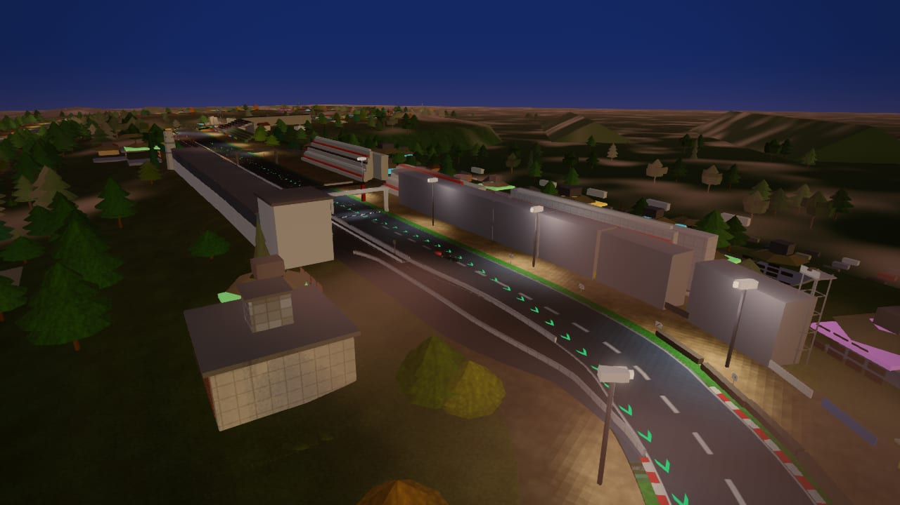
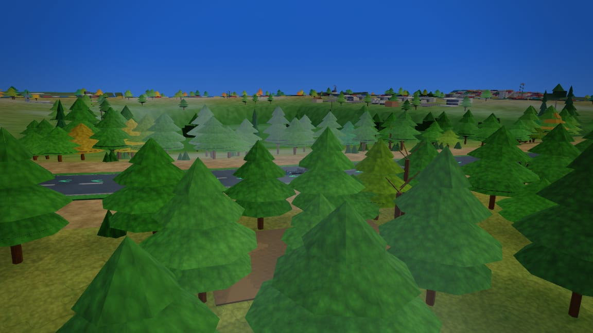
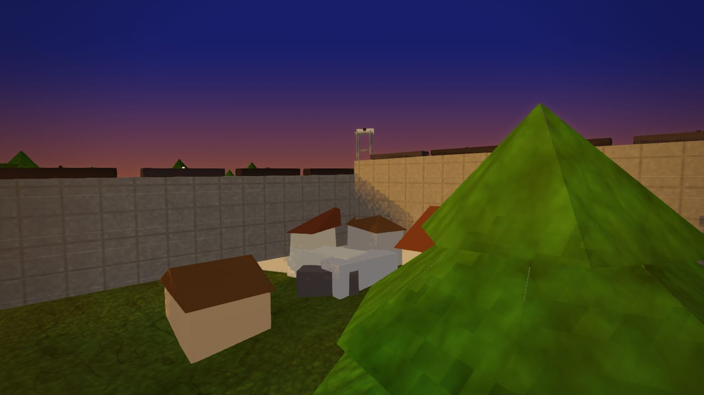

# Brands Hatch — circuit survey (2026-10-14)

**Circuit id:** `brands_hatch` · **Theme:** `green` (Kent chalk downland) · **Length:** 3.899 km GP · **Laps:** clockwise, 11 turns  
**Brief:** [`docs/tracks/brands_hatch.md`](../brands_hatch.md) · **Data:** `js/circuits/brands_hatch.js` · **Scenery:** `js/circuits/scenery/brands_hatch.js`

## Code map

| Layer | Role |
|---|---|
| `js/circuits/brands_hatch.js` | OSM centreline (`path.len` 3899 m), `startFrac` 0.1226, `sceneryStartFrac` 0, `terrainOuter` 110, sectors `[0.27, 0.703]`, `furniture.lamp: "none"`, `night: false` |
| `js/circuits/scenery/brands_hatch.js` | Seven blocks: bowl banking, Brabham frontage + required stands, infield (pits/Kentagon), Druids/Pilgrims footbridges, GP woods (`WOODS_A` 0.378–`WOODS_B` 0.845), furniture, Kent backdrop (`ridge` + `mountain`) |
| `js/track/tracks.js` | Lazy `scenery(api)` via `TrackScenery["brands_hatch"]` (no inline scenery in def) |
| `tests/data/landmarks/brands_hatch.json` | Required `modelGroup` ids: pit straight, Desire Wilson, Paddock Hill, Hailwoods, Kentagon |

**Frame debt:** Hero stands on the start complex use `sl()` (start-line frame); bowl/woods use authored `K(s)` / `ID`. Do not pre-shift `K()`.

**Models / kits:** `standSet` steel/concrete/darkSteel; marshal `cabin`, armco/mesh barriers; no baked lamp kit (`lamp: "none"`).

## Capture method

36 headless JPEG frames (1280 px wide, q≈80) under `artifacts/shots/tracks/brands_hatch/`, captured via `scratch/brands-hatch-capture.mjs` + `track-session.mjs`. Weather via `__apex.race(track, tod, wx)`.

---

## Sector coverage (day / dry)

Sector splits from def: S1 `s` 0–27%, S2 27–70.3%, S3 70.3–100%.

### Sector 1 — Brabham, Paddock Hill, Druids

| | | |
|---|---|---|
| <br>**Pit straight** · orbit · day · dry | <br>**Paddock Hill** · trackside · day · dry | <br>**Kentagon (+1)** · orbit · day · dry |
| <br>**Druids** · orbit · day · dry | <br>**Druids footbridge** · cinematic · day · dry | <br>**Hailwoods dip** · trackside · day · dry |

### Sector 2 — Cooper, Surtees, woods

| | | |
|---|---|---|
| <br>**Graham Hill** · trackside · day · dry | <br>**Cooper Straight** · orbit · day · dry | <br>**Surtees exit** · trackside · day · dry |
| <br>**Pilgrims Drop** · orbit · day · dry | <br>**Hawthorns (woods)** · eye · day · dry | <br>**Westfield** · trackside · day · dry |
| <br>**Dingle Dell** · cinematic · day · dry | | |

### Sector 3 — Sheene, Stirlings, Clark

| | | |
|---|---|---|
| <br>**Sheene** · orbit · day · dry | <br>**Stirlings** · trackside · day · dry | <br>**Clark Curve** · trackside · day · dry |
| <br>**Race control / gantry** · orbit · day · dry | | |

---

## Weather & lighting (hero views)

Hero landmarks with alternate **time of day** and **weather**. Circuit `night: false`, `lamp: "none"` — night frames use default sky only.

### Pit straight / Brabham

| | | |
|---|---|---|
| <br>**Pit straight** · orbit · dusk · dry | <br>**Pit straight** · orbit · dawn · dry | <br>**Pit straight** · orbit · night · dry |
| <br>**Pit straight** · orbit · day · overcast | <br>**Pit straight** · orbit · day · rain | <br>**Pit straight** · orbit · day · fog |

### Paddock Hill

| | | |
|---|---|---|
| <br>**Paddock Hill** · trackside · dusk · dry | <br>**Paddock Hill** · trackside · night · dry | <br>**Paddock Hill** · trackside · day · rain |
| <br>**Paddock Hill** · trackside · day · overcast | | |

### Druids & Dingle Dell

| | | |
|---|---|---|
| <br>**Druids** · orbit · dusk · dry | <br>**Druids** · orbit · night · dry | <br>**Druids** · orbit · day · fog |
| <br>**Dingle Dell** · cinematic · dusk · dry | <br>**Dingle Dell** · cinematic · night · dry | <br>**Dingle Dell** · cinematic · day · rain |
| <br>**Dingle Dell** · cinematic · day · overcast | | |

### Clark Curve

| | | |
|---|---|---|
| <br>**Clark Curve** · trackside · dusk · dry | <br>**Clark Curve** · trackside · day · rain | |

---

## Findings

| ID | Severity | Topic | Evidence |
|---|---|---|---|
| F1 | Low | Car park cars buried on steep banking | `ground-audit` had 2× buried @ `carPark` line 113 (≤1.3 m); tightened `terrainYAt` skip to 0.28 m |
| F2 | Low | Kentagon terrace hut buried | `house` @ `sl(0.008)`; added grade check before emit |
| F3 | Low | Chalk/worn patch overlap | Duplicate chalk @ `s=0.030` overlapped worn path @ 0.030/22 m; removed chalk row |
| F4 | Baseline | Prop clip ≥1 m | `clip-audit`: 1 severe @ frac ~0.943 (`addFrustum` pair) — at retail/entrance frontage; unchanged (at cap) |
| F5 | Baseline | Coplanar ground patches | 3 flatCoplanar spots (worn vs bar decking); within baseline |
| F6 | Info | Tree guard drops | `verify-track`: 339 trees + 1 mountain suppressed (tight bowl / cross-loop clearance) |
| F7 | Weather | Night lighting | `night: false`, no lamp furniture — night shots read as unlit bowl; expected until lighting pass |
| F8 | Weather | Rain/fog | Wet road + particles OK; no circuit-specific night lamps to validate |
| F9 | Perf | Prop budget | ~326k prop tris post-strip; heavy but within fleet ratchet; SwiftShader ~15–25 s/frame |

**Visual read (day dry):** Bowl amphitheatre, named stands, Kentagon silhouette, woods contrast on GP loop, Paddock Hill drop reads well. No road surface folds. Minor z-fight risk on overlapping asphalt patches at Paddock Hill bar (F5).

---

## Ranked improvements (backlog)

1. **Clip at Clark/pit frontage (~0.943)** — triage severe pair; likely trim tree belt or shift entrance `building` @ `sl(1.014)` (engine-safe spacing).
2. **Night / lamps** — if MSV night events matter, enable `night: true` + targeted `lampPost` on pit straight only (needs lighting-tuner; def change).
3. **Coplanar worn vs decking** — merge `groundPatch` spans @ Paddock Hill bar (`0.030`/`0.042`) into one patch.
4. **Woods thinning at Stirlings** — optional density tweak in `every(14)` fourth rank as bowl reopens (visual only).

---

## Fixes applied (this PR)

- `carPark`: stricter slope filter (`0.35` → `0.28` m) — **buried/unsupported car clusters 0**.
- Kentagon terrace `house`: `terrainYAt` footing guard.
- Removed redundant chalk `groundPatch` at `s=0.030` (overlap with worn path).

## Verification

```
node tools/track/verify-track.cjs brands_hatch   → OK
node tools/track/audit-circuit.cjs brands_hatch → ok (6 checks); ground buried 0 unsupported 0
```

Foundation spec not run this session (scenery-only); run `node tools/ci/pick-tests.mjs` before ready.
