# Buddh International Circuit — survey (2026-10-14)

**Circuit id:** `buddh`  
**Branch:** `cursor/buddh-survey-b345`  
**Live:** [brycejmurrin.github.io/f1-game](https://brycejmurrin.github.io/f1-game/)  
**Design brief:** [`docs/tracks/buddh.md`](../buddh.md)

## Code map

| Layer | Path | Role |
|-------|------|------|
| Circuit def | `js/circuits/buddh.js` | OSM centreline (`path.pts`), `theme: "green"`, `terrainOuter: 110`, sectors/turns, furniture/kit |
| Scenery | `js/circuits/scenery/buddh.js` | Lazy `scenery(api)` — 18 lap blocks + farmland scatter + rural depth |
| Engine | `js/track/tracks.js` | `Tracks.build()` / centreline spline |
| Meta | `js/track/circuit-meta.js` | Picker (`classic: true`, Indian GP) |
| Elevation | `js/track/circuit-elevations.js` | Engineered drop into T10–12 |
| Landmarks | `tests/data/landmarks/buddh.json` | `buddh-main-grandstand`, `buddh-pit-complex`, `buddh-temple-hill` |

Centreline: OpenStreetMap stitch; ~5138 m; `reverse: false` (projected CCW for real CW lap).

## Theme and models

- **Theme:** `green` — Greater Noida plain (not urban `modern` skyline).
- **Hero models:** sea-wave main grandstand, closed pit complex, temple-hill silhouette (invented outfield cue).
- **Invalid on this def:** `groundPatch`, `motorhome`, `backdrop` — scenery uses `runoffApron`, `place`, chained `ridge`.

**Re-capture (2026-10-15):** **34** JPEGs — `node tools/shot/shot.mjs --batch artifacts/shots/tracks/buddh/capture-jobs.jsonl --jpeg --present-timeout 90 --capture-retries 4 --wait 120` (shared shot tooling #1862, SwiftShader).

## Panel grid (34 frames)

|  |  |  |
| **overview track picker** · wx=dry · tod=day | **s1 grandstand** · wx=dry · tod=dawn | **s1 grandstand** · wx=dry · tod=day |

| 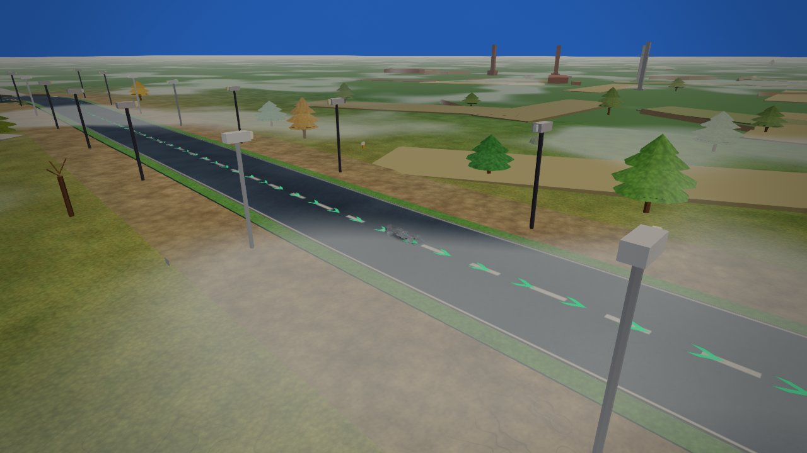 | 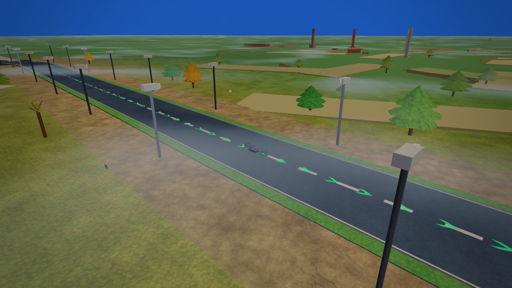 | 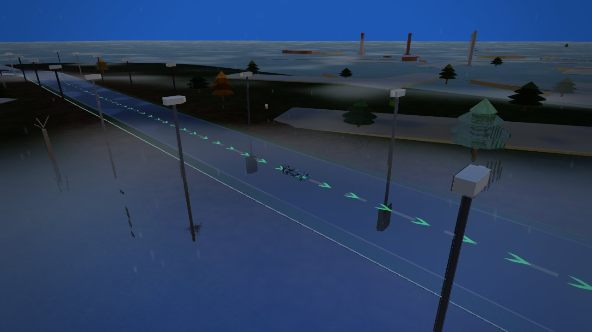 |
| **s1 grandstand** · wx=fog · tod=day | **s1 grandstand** · wx=overcast · tod=day | **s1 grandstand** · wx=rain · tod=day |

| 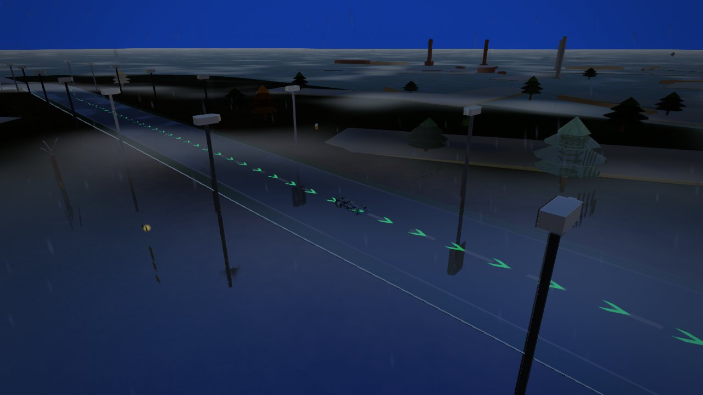 |  |  |
| **s1 grandstand** · wx=storm · tod=day | **s1 grandstand** · wx=dry · tod=dusk | **s1 grandstand** · wx=dry · tod=night |

|  | 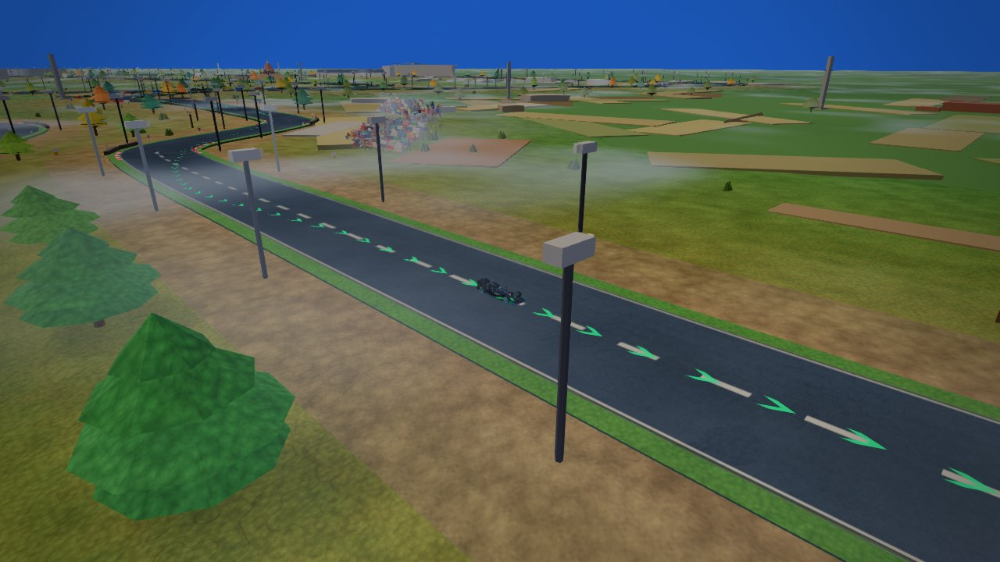 | 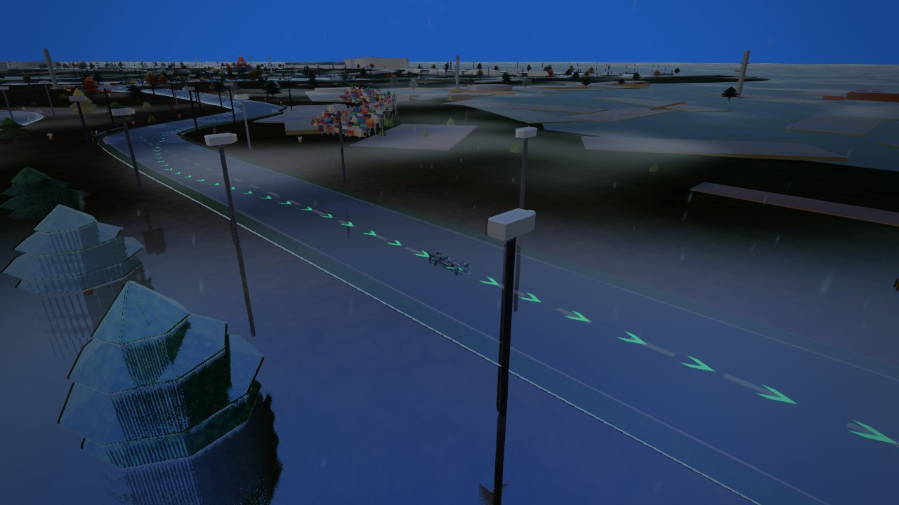 |
| **s1 t1 brake** · wx=dry · tod=day | **s1 t1 brake** · wx=overcast · tod=day | **s1 t1 brake** · wx=rain · tod=day |

| 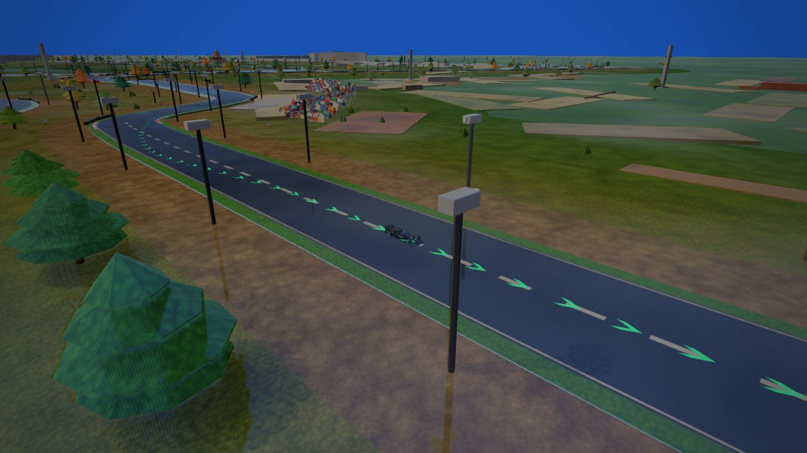 |  |  |
| **s1 t1 brake** · wx=wet · tod=day | **s1 t1 brake** · wx=dry · tod=dusk | **s1 t1 brake** · wx=dry · tod=night |

|  | 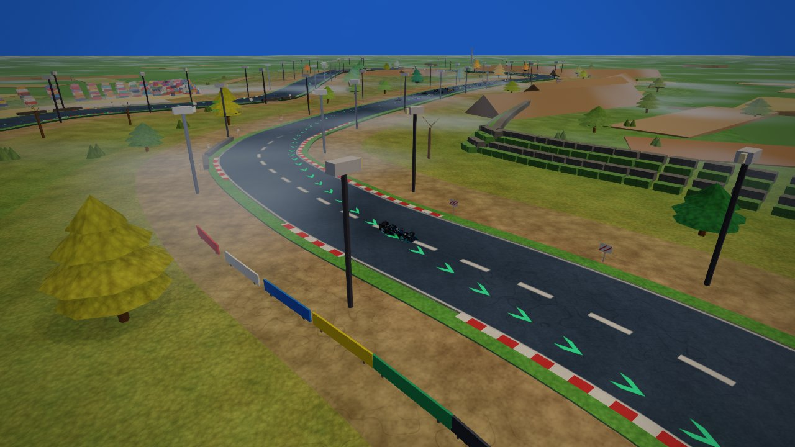 | 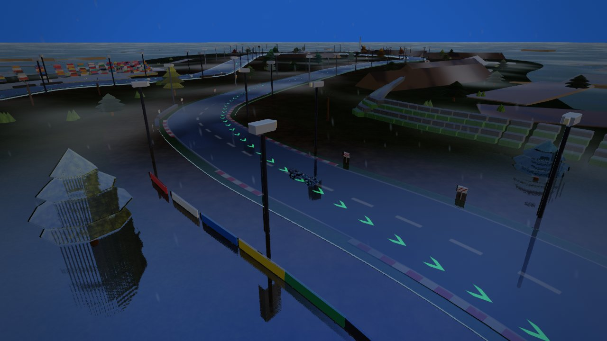 |
| **s2 double apex** · wx=dry · tod=day | **s2 double apex** · wx=overcast · tod=day | **s2 double apex** · wx=rain · tod=day |

| 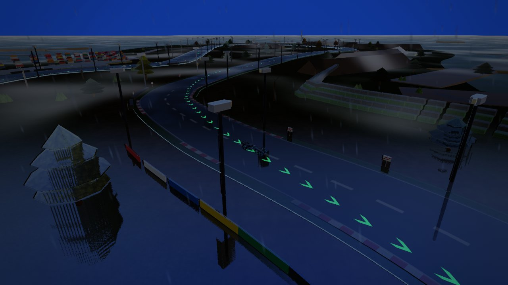 | 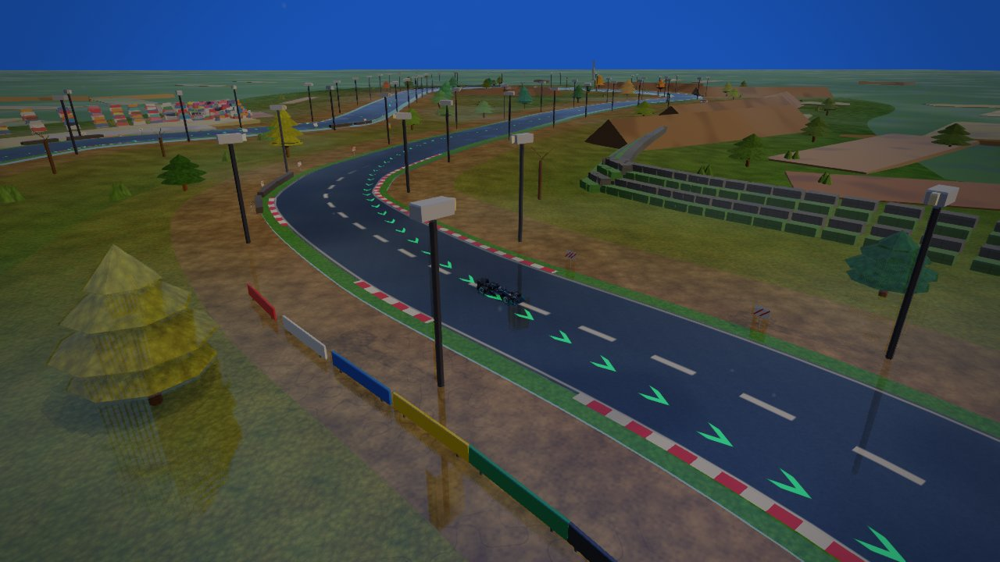 |  |
| **s2 double apex** · wx=storm · tod=day | **s2 double apex** · wx=wet · tod=day | **s2 double apex** · wx=dry · tod=dusk |

|  |  | 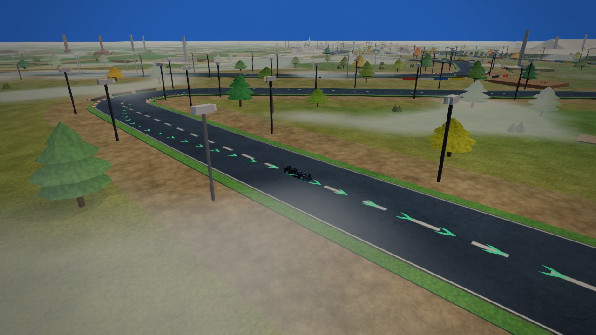 |
| **s2 double apex** · wx=dry · tod=night | **s3 east stands** · wx=dry · tod=day | **s3 east stands** · wx=fog · tod=day |

| 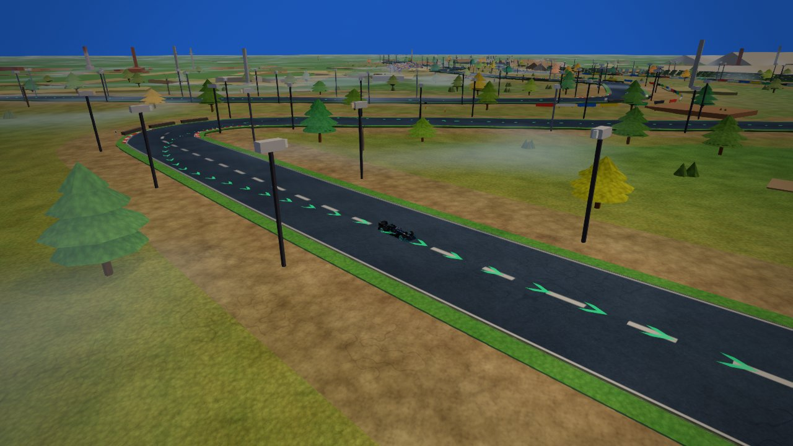 | 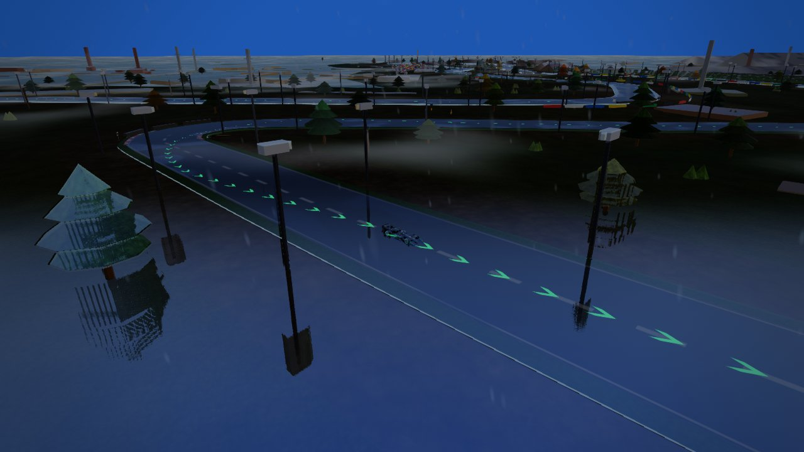 |  |
| **s3 east stands** · wx=overcast · tod=day | **s3 east stands** · wx=rain · tod=day | **s3 east stands** · wx=dry · tod=dusk |

|  |  | 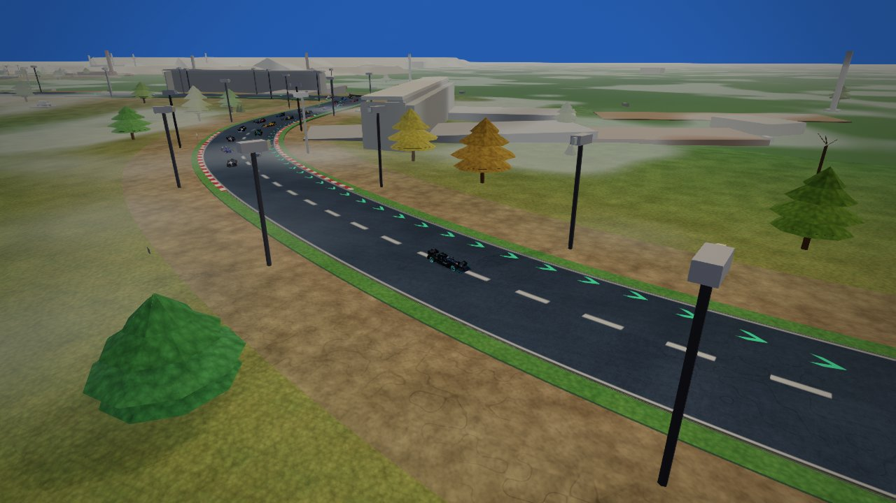 |
| **s3 east stands** · wx=dry · tod=night | **s3 final** · wx=dry · tod=day | **s3 final** · wx=fog · tod=day |

| 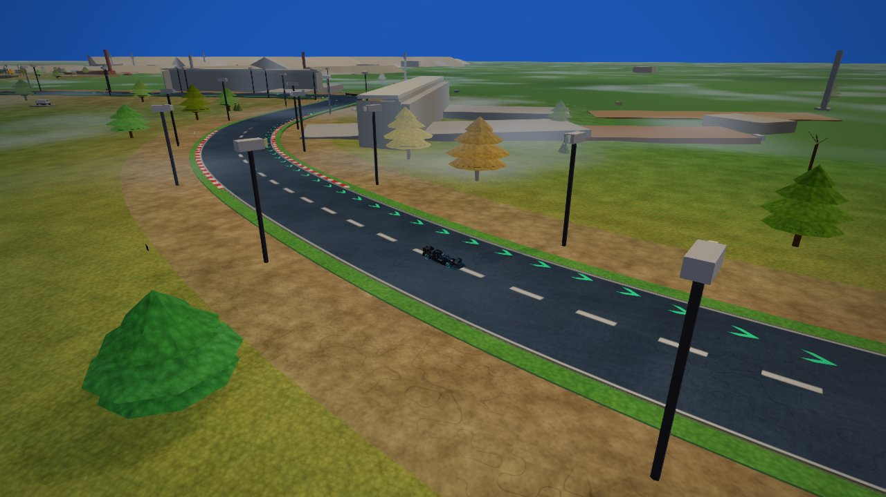 | 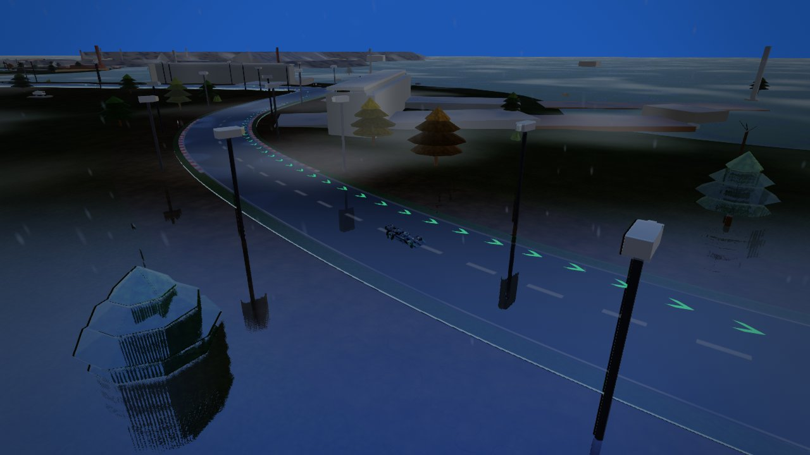 |  |
| **s3 final** · wx=overcast · tod=day | **s3 final** · wx=rain · tod=day | **s3 final** · wx=dry · tod=dusk |

|  |
| **s3 final** · wx=dry · tod=night |


## Verification

```text
node tools/track/verify-track.cjs buddh
```
