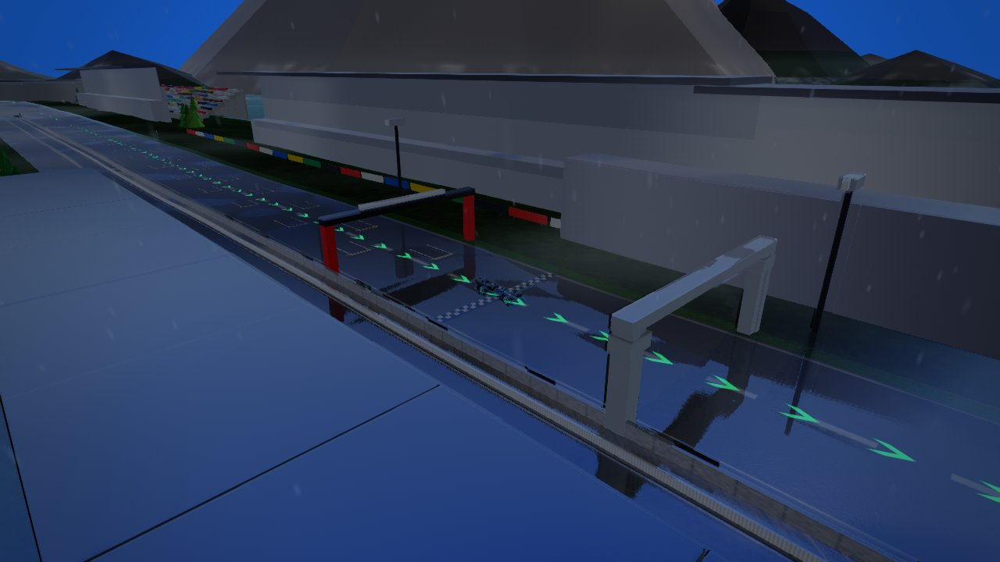
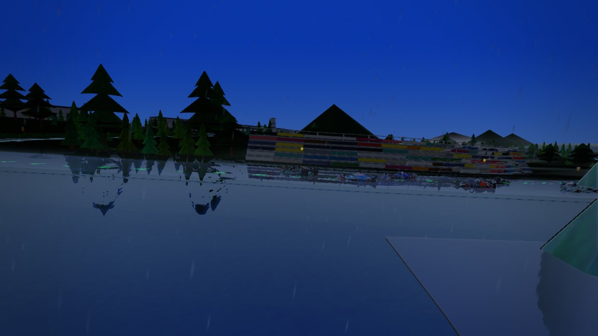

# Fuji Speedway — circuit survey (2026-10-14)

**Branch:** `cursor/fuji-survey-fixes-17d3` · **Shots:** 36 committed JPEGs (`git add -f` under `artifacts/shots/tracks/fuji/`).

Captured with shared `shot.mjs`: `--jpeg --present-timeout 90 --capture-retries 4 --wait 120` (SwiftShader).

## Fixes (scenery)
- `fuji-mount-fuji` distance **2.5 km** / height **900 m** (snow cap in fog).
- **R3:** `surface folds 0` — no `path.pts` edits.

## Panel grid (36 frames)

|  |  |  |
| **s01 pit straight orbit** · wx=dry · tod=day | **s01 pit straight orbit** · wx=dry · tod=dusk | **s01 pit straight orbit** · wx=overcast · tod=day |

|  |  |  |
| **s01 pit straight orbit** · wx=rain · tod=day | **s02 mount fuji west** · wx=dry · tod=day | **s02 mount fuji west** · wx=dry · tod=dusk |

|  |  |  |
| **s02 mount fuji west** · wx=dry · tod=night | **s02 mount fuji west** · wx=fog · tod=day | **s02 mount fuji west** · wx=storm · tod=day |

|  |  |  |
| **s03 driver straight** · wx=dry · tod=day | **s03 driver straight** · wx=dry · tod=dusk | **s03 driver straight** · wx=dry · tod=night |

|  |  |  |
| **s03 driver straight** · wx=rain · tod=day | **s03 driver straight** · wx=wet · tod=day | **s04 hotel paddock** · wx=dry · tod=day |

|  |  |  |
| **s04 hotel paddock** · wx=dry · tod=dusk | **s04 hotel paddock** · wx=overcast · tod=day | **s04 hotel paddock** · wx=storm · tod=day |

|  |  |  |
| **s04 hotel paddock** · wx=wet · tod=day | **s05 tgr turn1** · wx=dry · tod=day | **s07 coca cola** · wx=dry · tod=day |

|  |  |  |
| **s09 advan** · wx=dry · tod=day | **s10 120r forest** · wx=dry · tod=day | **s10 120r forest** · wx=dry · tod=dusk |

|  |  |  |
| **s12 300r** · wx=dry · tod=day | **s12 300r** · wx=dry · tod=dusk | **s12 300r** · wx=dry · tod=night |

|  |  |  |
| **s12 300r** · wx=fog · tod=day | **s12 300r** · wx=wet · tod=day | **s13 dunlop hairpin** · wx=dry · tod=day |

|  |  |  |
| **s13 dunlop hairpin** · wx=dry · tod=night | **s13 dunlop hairpin** · wx=rain · tod=day | **s13 dunlop hairpin** · wx=storm · tod=day |

|  |  |  |
| **s13 dunlop hairpin** · wx=wet · tod=day | **s14 flick** · wx=dry · tod=day | **s15 panasonic** · wx=dry · tod=day |


## Verification

```text
node tools/track/verify-track.cjs fuji
```
