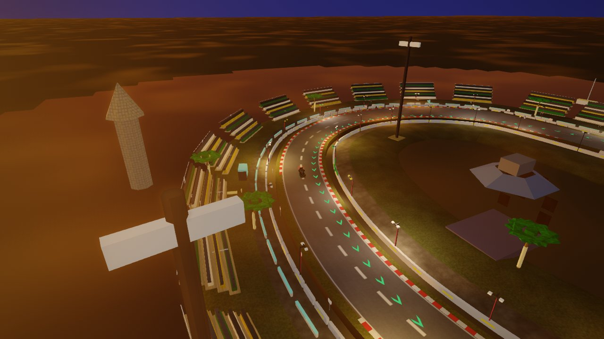
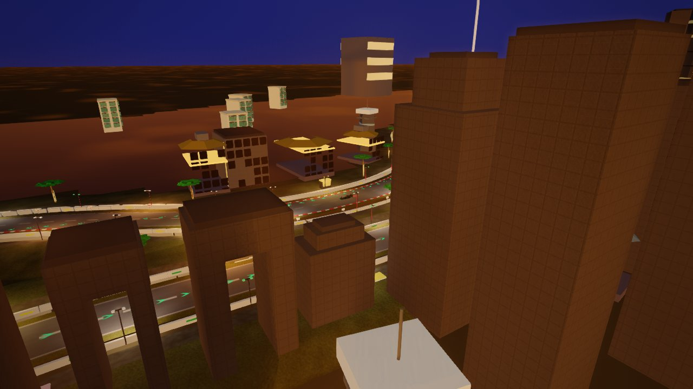
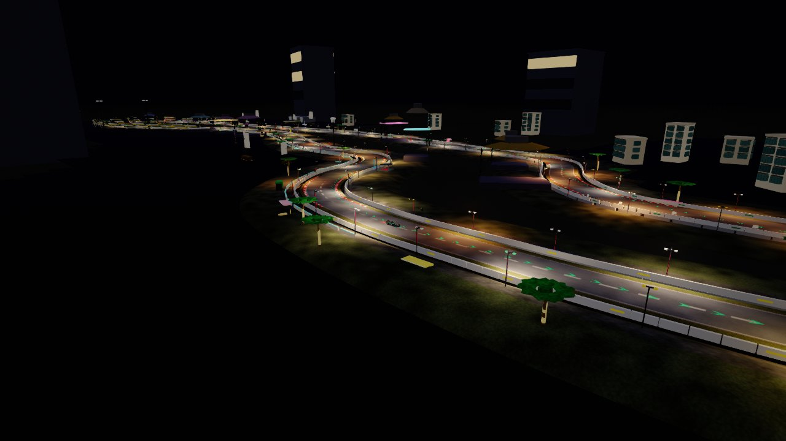
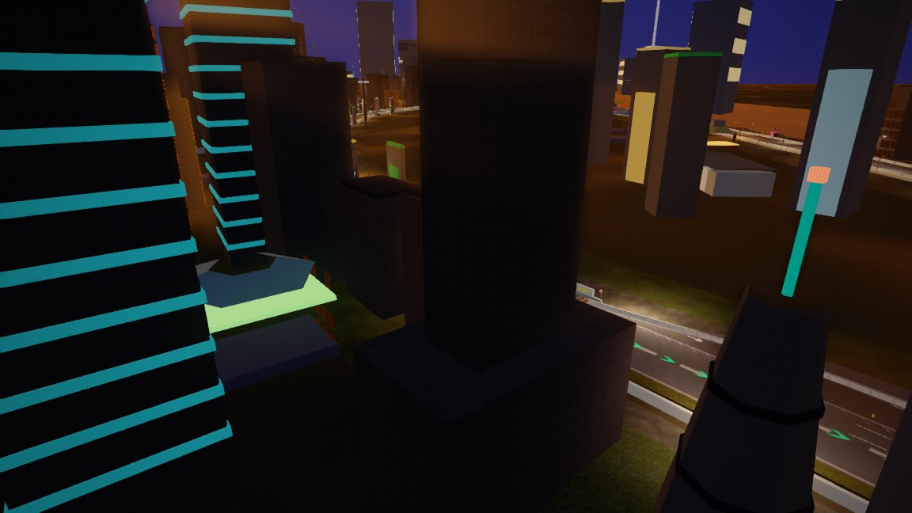
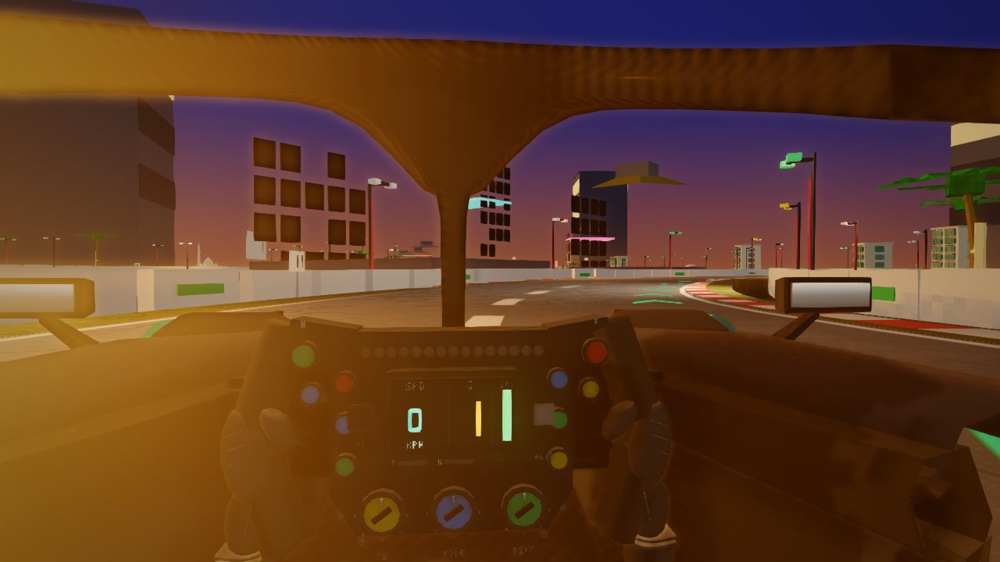
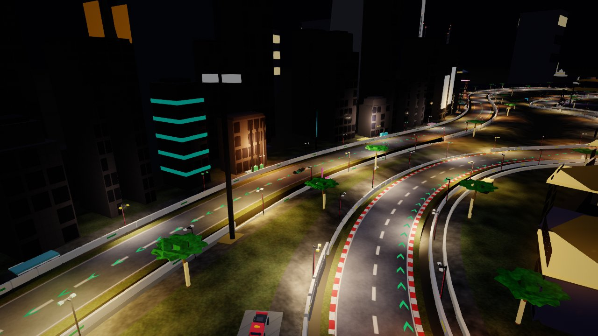
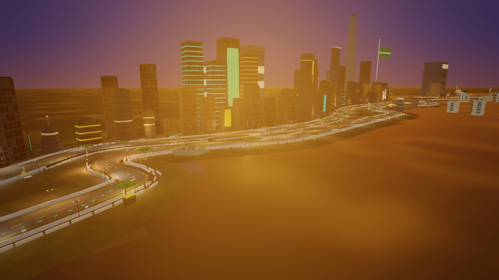
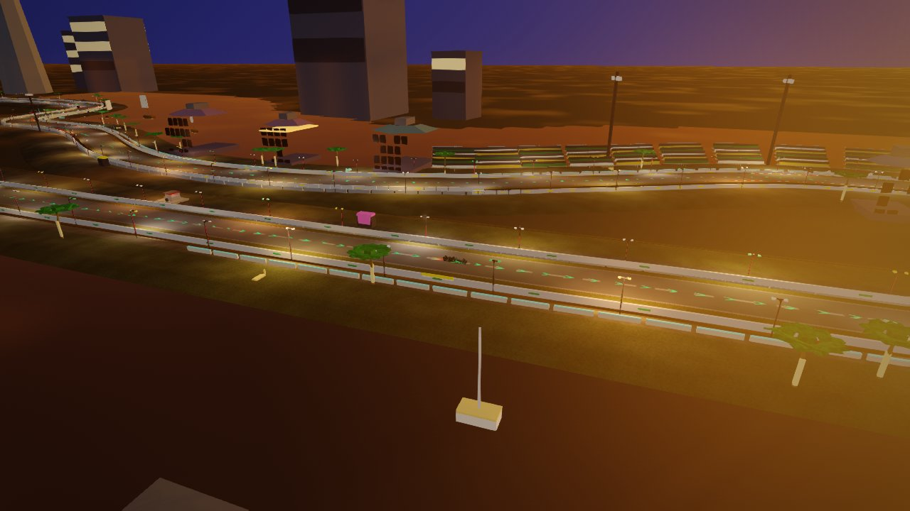
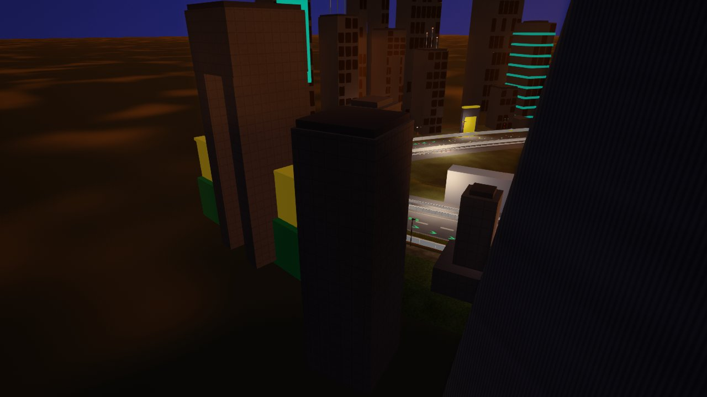
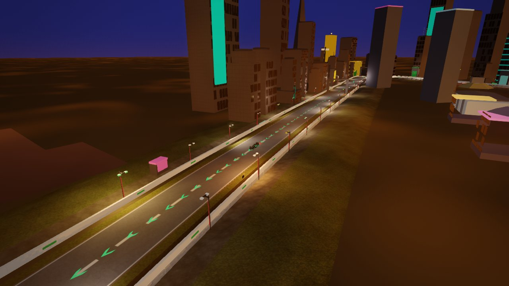

# Jeddah Corniche — circuit survey (2026-10-14)

**Circuit id:** `jeddah` · **Theme:** `street_night` (`night: true`) · **Live:** https://brycejmurrin.github.io/f1-game/

**Capture status:** **36 JPEGs** committed at `artifacts/shots/tracks/jeddah/` (≤1280 px wide, q≈80, &lt;300 KB). Lighting: `day` / `dusk` / `night` on 12 sectors; **weather: `dry` only** (wet/rain/overcast/fog deferred until shared batch `weather` lands).

## Code map

| Layer | Path | Role |
|--------|------|------|
| Def | `js/circuits/jeddah.js` | OSM centreline, `startFrac` 0.9625, street pit (`bays: false`), `bankZones` (T13 7°), `dressingExclusions` for hand scenery |
| Scenery | `js/circuits/scenery/jeddah.js` | Canyon, LEDs, sea/marina, heroes, Al-Balad roshan, neon fascia |
| Brief | `docs/tracks/jeddah.md` | Lap-position landmark table |
| Landmarks | `tests/data/landmarks/jeddah.json` | fountain, floating mosque, blue sail, golden twins, golden-tower hotel, flagpole |

**Sectors (racing `s`):** S/F 0 · T1 ~0.05 · Red Sea 0.15–0.20 · skyline ~0.28 · esses ~0.35 · marina ~0.45 · T13 ~0.50 · lagoon ~0.62 · hotels ~0.70 · technical ~0.78–0.86 · DRS ~0.96.

## Survey panels — by sector

Panel grid (3 per row). Paths relative to this file.

<!-- sector panels -->
### Banked T13

|  |  |  |
| **Banked T13 orbit** · day · dry | **Banked T13 orbit** · dusk · dry | **Banked T13 orbit** · night · dry |
| `s50-t13_orbit_day_dry.jpg` | `s50-t13_orbit_dusk_dry.jpg` | `s50-t13_orbit_night_dry.jpg` |


### Blue Sail skyline

|  |  |  |
| **Blue Sail skyline orbit** · day · dry | **Blue Sail skyline orbit** · dusk · dry | **Blue Sail skyline orbit** · night · dry |
| `s28-skyline_orbit_day_dry.jpg` | `s28-skyline_orbit_dusk_dry.jpg` | `s28-skyline_orbit_night_dry.jpg` |


### Corniche lagoon

|  |  |
| **Corniche lagoon orbit** · day · dry | **Corniche lagoon orbit** · night · dry |
| `s62-lagoon_orbit_day_dry.jpg` | `s62-lagoon_orbit_night_dry.jpg` |


### DRS straight

|  |  |  |
| **DRS straight orbit** · day · dry | **DRS straight orbit** · dusk · dry | **DRS straight orbit** · night · dry |
| `s96-drs_orbit_day_dry.jpg` | `s96-drs_orbit_dusk_dry.jpg` | `s96-drs_orbit_night_dry.jpg` |


### Floating mosque

|  |  |  |
| **Floating mosque orbit** · day · dry | **Floating mosque orbit** · dusk · dry | **Floating mosque orbit** · night · dry |
| `s50-mosque_orbit_day_dry.jpg` | `s50-mosque_orbit_dusk_dry.jpg` | `s50-mosque_orbit_night_dry.jpg` |


### Flowing esses

|  |  |  |
| **Flowing esses park** · day · dry | **Flowing esses park** · dusk · dry | **Flowing esses park** · night · dry |
| `s35-esses_park_day_dry.jpg` | `s35-esses_park_dusk_dry.jpg` | `s35-esses_park_night_dry.jpg` |


### Hotel cluster

|  |  |
| **Hotel cluster orbit** · day · dry | **Hotel cluster orbit** · night · dry |
| `s70-hotels_orbit_day_dry.jpg` | `s70-hotels_orbit_night_dry.jpg` |


### King Fahd Fountain

|  |  |  |
| **King Fahd Fountain orbit** · day · dry | **King Fahd Fountain orbit** · dusk · dry | **King Fahd Fountain orbit** · night · dry |
| `s20-fountain_orbit_day_dry.jpg` | `s20-fountain_orbit_dusk_dry.jpg` | `s20-fountain_orbit_night_dry.jpg` |


### Marina

|  |  |  |
| **Marina orbit** · day · dry | **Marina orbit** · dusk · dry | **Marina orbit** · night · dry |
| `s45-marina_orbit_day_dry.jpg` | `s45-marina_orbit_dusk_dry.jpg` | `s45-marina_orbit_night_dry.jpg` |


### Red Sea corridor

|  |  |
| **Red Sea corridor orbit** · day · dry | **Red Sea corridor orbit** · night · dry |
| `s15-sea_orbit_day_dry.jpg` | `s15-sea_orbit_night_dry.jpg` |


### Start/finish

|  |  |  |
| **Start/finish orbit** · day · dry | **Start/finish orbit** · dusk · dry | **Start/finish orbit** · night · dry |
| `s00-sf_orbit_day_dry.jpg` | `s00-sf_orbit_dusk_dry.jpg` | `s00-sf_orbit_night_dry.jpg` |


### T1 complex

|  |  |  |
| **T1 complex orbit** · day · dry | **T1 complex orbit** · dusk · dry | **T1 complex orbit** · night · dry |
| `s05-t1_orbit_day_dry.jpg` | `s05-t1_orbit_dusk_dry.jpg` | `s05-t1_orbit_night_dry.jpg` |


### Technical sector

|  |  |  |
| **Technical sector park** · day · dry | **Technical sector park** · dusk · dry | **Technical sector park** · night · dry |
| `s81-technical_park_day_dry.jpg` | `s81-technical_park_dusk_dry.jpg` | `s81-technical_park_night_dry.jpg` |


## Survey panels — by time of day (weather: dry)


### Lighting: day (weather: dry)

|  |  |  |
| **Start/finish orbit** · day · dry | **T1 complex orbit** · day · dry | **Red Sea corridor orbit** · day · dry |
| `s00-sf_orbit_day_dry.jpg` | `s05-t1_orbit_day_dry.jpg` | `s15-sea_orbit_day_dry.jpg` |

|  |  |  |
| **King Fahd Fountain orbit** · day · dry | **Blue Sail skyline orbit** · day · dry | **Flowing esses park** · day · dry |
| `s20-fountain_orbit_day_dry.jpg` | `s28-skyline_orbit_day_dry.jpg` | `s35-esses_park_day_dry.jpg` |

|  |  |  |
| **Marina orbit** · day · dry | **Floating mosque orbit** · day · dry | **Banked T13 orbit** · day · dry |
| `s45-marina_orbit_day_dry.jpg` | `s50-mosque_orbit_day_dry.jpg` | `s50-t13_orbit_day_dry.jpg` |

|  |  |  |
| **Corniche lagoon orbit** · day · dry | **Hotel cluster orbit** · day · dry | **Technical sector park** · day · dry |
| `s62-lagoon_orbit_day_dry.jpg` | `s70-hotels_orbit_day_dry.jpg` | `s81-technical_park_day_dry.jpg` |

|  |
| **DRS straight orbit** · day · dry |
| `s96-drs_orbit_day_dry.jpg` |


### Lighting: dusk (weather: dry)

|  |  |  |
| **Start/finish orbit** · dusk · dry | **T1 complex orbit** · dusk · dry | **King Fahd Fountain orbit** · dusk · dry |
| `s00-sf_orbit_dusk_dry.jpg` | `s05-t1_orbit_dusk_dry.jpg` | `s20-fountain_orbit_dusk_dry.jpg` |

|  |  |  |
| **Blue Sail skyline orbit** · dusk · dry | **Flowing esses park** · dusk · dry | **Marina orbit** · dusk · dry |
| `s28-skyline_orbit_dusk_dry.jpg` | `s35-esses_park_dusk_dry.jpg` | `s45-marina_orbit_dusk_dry.jpg` |

|  |  |  |
| **Floating mosque orbit** · dusk · dry | **Banked T13 orbit** · dusk · dry | **Technical sector park** · dusk · dry |
| `s50-mosque_orbit_dusk_dry.jpg` | `s50-t13_orbit_dusk_dry.jpg` | `s81-technical_park_dusk_dry.jpg` |

|  |
| **DRS straight orbit** · dusk · dry |
| `s96-drs_orbit_dusk_dry.jpg` |


### Lighting: night (weather: dry)

|  |  |  |
| **Start/finish orbit** · night · dry | **T1 complex orbit** · night · dry | **Red Sea corridor orbit** · night · dry |
| `s00-sf_orbit_night_dry.jpg` | `s05-t1_orbit_night_dry.jpg` | `s15-sea_orbit_night_dry.jpg` |

|  |  |  |
| **King Fahd Fountain orbit** · night · dry | **Blue Sail skyline orbit** · night · dry | **Flowing esses park** · night · dry |
| `s20-fountain_orbit_night_dry.jpg` | `s28-skyline_orbit_night_dry.jpg` | `s35-esses_park_night_dry.jpg` |

|  |  |  |
| **Marina orbit** · night · dry | **Floating mosque orbit** · night · dry | **Banked T13 orbit** · night · dry |
| `s45-marina_orbit_night_dry.jpg` | `s50-mosque_orbit_night_dry.jpg` | `s50-t13_orbit_night_dry.jpg` |

|  |  |  |
| **Corniche lagoon orbit** · night · dry | **Hotel cluster orbit** · night · dry | **Technical sector park** · night · dry |
| `s62-lagoon_orbit_night_dry.jpg` | `s70-hotels_orbit_night_dry.jpg` | `s81-technical_park_night_dry.jpg` |

|  |
| **DRS straight orbit** · night · dry |
| `s96-drs_orbit_night_dry.jpg` |


## Weather variants (backlog)

| Condition | Status | Notes |
|-----------|--------|--------|
| `wet` / `rain` / `overcast` / `fog` | Not captured | Requires shared `shot.mjs` batch `weather`; 4–6 hero views planned post-rebase |

## Audit (node VM)

```text
verify-track jeddah: OK — surface folds 0
audit-circuit: float 0, clip 0, coplanar 3 (baseline), ground within baseline, flatCoplanar 2
```

## Findings backlog

| P | Issue | Sector | Weather-specific? |
|---|--------|--------|-------------------|
| 1 | King Fahd Fountain weak in **day** orbit | s≈0.20 | **night** frames stronger; plume still easy to miss |
| 1 | Floating mosque lap position | — | **Fixed** → s≈0.498 (`s50-mosque_*` panels) |
| 2 | Technical sector thin inland façade | s≈0.81 | **Fixed** — `cityFront` gap 64 m |
| 2 | Mosque plinth coplanar | hero | **Fixed** — deck +0.05 m |
| 3 | T13 offshore monument reads floating | s≈0.50 R | Visible in `s50-t13_orbit_*` over water |
| 3 | S/F inland `cityFront` terrain gap | s≈0 | `s00-sf_orbit_day_dry` |
| 4 | Pit building vs real media centre scale | S/F | Def `bays: false` / 190 m window |

## Fixes in this PR (circuit files only)

1. `floatingMosque(K(0.498), 215)` — north-loop / marina sightline.
2. `cityFront(0.78, 0.86, -1, 64, …)` — technical sector inland row.
3. Mosque plinth/deck coplanar separation.

## Verification

```sh
node tools/track/verify-track.cjs jeddah
node tools/track/audit-circuit.cjs jeddah
```
