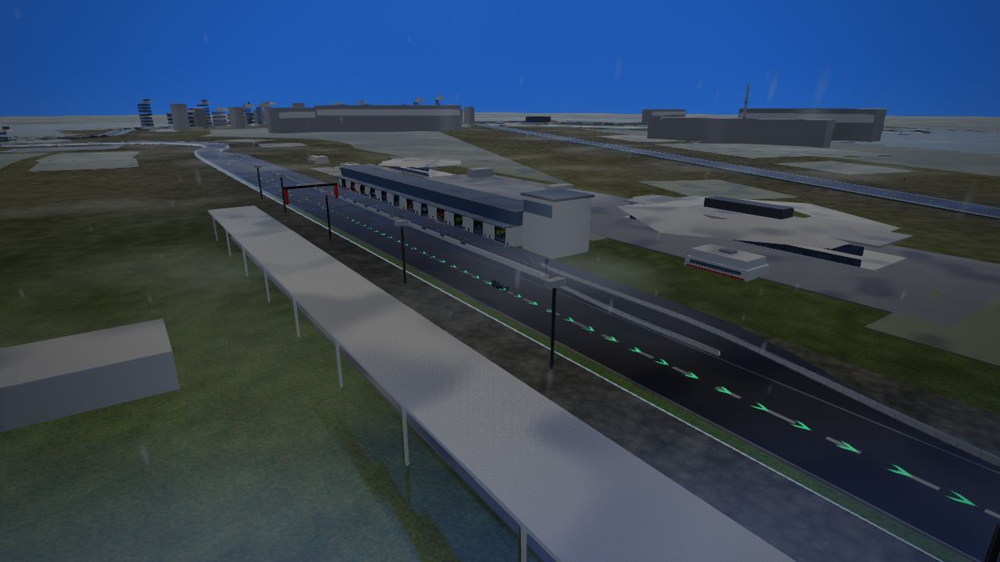
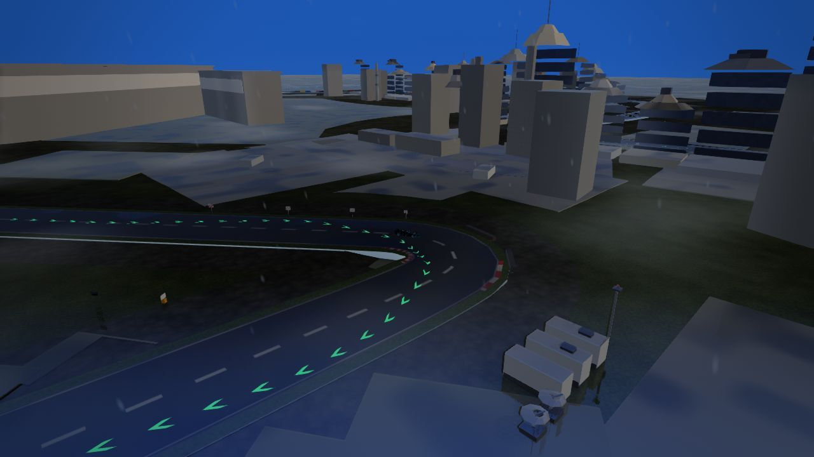
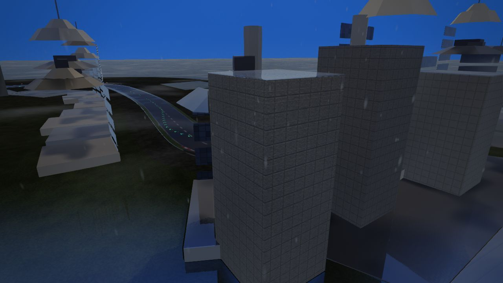
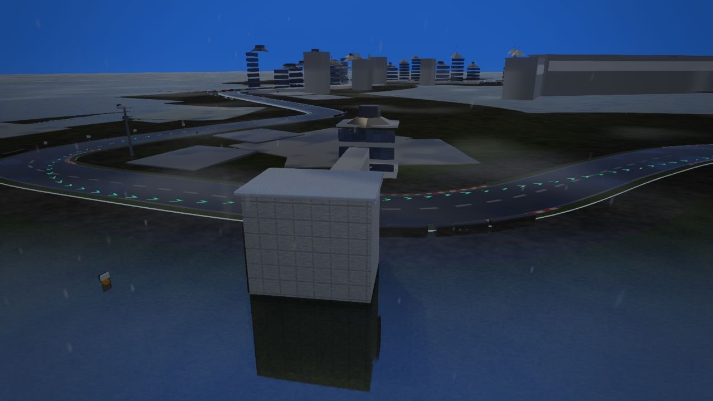
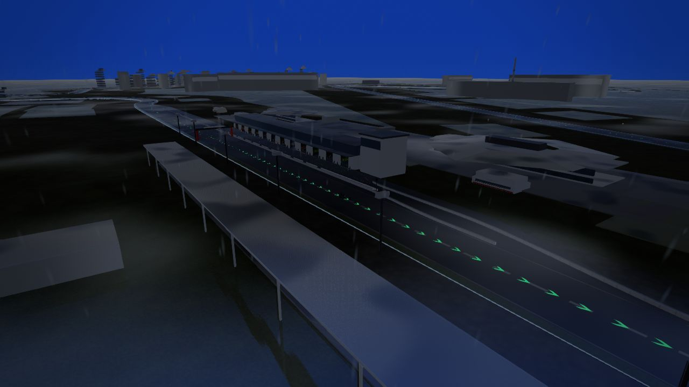
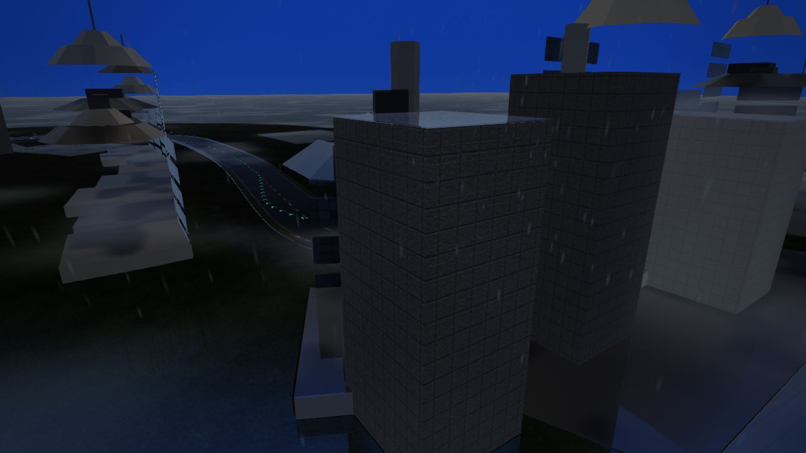

# Korea International Circuit — survey (2026-10-15)

**Circuit id:** `korea`  
**Brief:** `docs/tracks/korea.md`  
**Data:** `js/circuits/korea.js`, `js/circuits/scenery/korea.js`  
**Shots:** `artifacts/shots/tracks/korea/` (**36** JPEGs, force-added; `shot.mjs --batch` after merge with `cursor/shared-shot-tooling-5b45`)

## Code map

| Layer | Role |
|---|---|
| `js/circuits/korea.js` | OSM centreline, `undulate: false`, `pit: { side: -1 }`, palette, `furniture.lamp: "none"`. |
| `js/circuits/scenery/korea.js` | Pit / grandstand / marina shells / footbridge models; split guardrails (road-occupied bands). |
| `tests/data/landmarks/korea.json` | Required `modelGroup` ids for pit, main stand, marina shells, footbridge. |

**Centreline (2026-10-14):** min node radius **8.03 m** (hw 8 m) at s≈0.665; **surface folds 0**; off `KNOWN_TARMAC_FOLDS`.

## Capture

| Set | Count | Tooling |
|---|---|---|
| Sector landmarks | 8 | `day` / `dry` |
| Hero anchors | 6 | `day` / `dry` |
| Hero weather / TOD | 22 | `shot.mjs --jpeg --present-timeout 90 --capture-retries 4 --wait 120` (SwiftShader default) |

Weathers used: `dry`, `wet`, `rain`, `overcast`, `fog`, `storm`. TOD: `day`, `dawn`, `dusk`, `night`. Filenames: `<view>__<tod>-<weather>.jpg` (e.g. `key-pit__dusk-dry.jpg`).

---

## Sector coverage — day / dry

| | | |
|---|---|---|
|  |  |  |
| Pit straight orbit · day · dry | Main grandstand · day · dry | Turn 3 braking · day · dry |
|  |  |  |
| Turn 7 seawall · day · dry | Marina shells · day · dry | Footbridge · day · dry |
|  |  | |
| Map park cam · day · dry | Sector 1 overview · day · dry | |

---

## Hero anchors — day / dry

| | | |
|---|---|---|
|  |  |  |
| Key pit orbit · day · dry | Key Turn 3 orbit · day · dry | Key marina orbit · day · dry |
|  |  |  |
| Key stadium orbit · day · dry | Key seawall orbit · day · dry | Key footbridge cinematic · day · dry |

---

## Hero — dusk / dry

| | | |
|---|---|---|
|  |  |  |
| Key pit orbit · dusk · dry | Key Turn 3 orbit · dusk · dry | Key marina orbit · dusk · dry |
|  | | |
| Key footbridge cinematic · dusk · dry | | |

---

## Hero — night / dry

| | | |
|---|---|---|
|  |  |  |
| Key pit orbit · night · dry | Key Turn 3 orbit · night · dry | Key marina orbit · night · dry |
|  | | |
| Key footbridge cinematic · night · dry | | |

---

## Hero — dawn / dry

| | | |
|---|---|---|
|  | | |
| Key pit orbit · dawn · dry | | |

---

## Hero — day / rain

| | | |
|---|---|---|
|  |  |  |
| Key pit orbit · day · rain | Key Turn 3 orbit · day · rain | Key marina orbit · day · rain |
|  | | |
| Key footbridge cinematic · day · rain | | |

---

## Hero — day / fog

| | | |
|---|---|---|
|  |  |  |
| Key Turn 3 orbit · day · fog | Key marina orbit · day · fog | Key footbridge cinematic · day · fog |

---

## Hero — day / overcast & wet

| | | |
|---|---|---|
|  |  |  |
| Key seawall orbit · day · overcast | Key stadium orbit · day · overcast | Key seawall orbit · day · wet |
|  | | |
| Key stadium orbit · day · wet | | |

---

## Hero — day / storm

| | | |
|---|---|---|
|  |  | |
| Key pit orbit · day · storm | Key marina orbit · day · storm | |

---

## Findings (ranked)

| ID | Severity | Topic | Notes |
|---|---|---|---|
| K1 | Fixed | Legacy R3 fold | Chord inserts + fold clamp; 0 surface folds; min R 8.03 m. |
| K2 | Low | Road-occupied bands | Keep split guardrails (scenery header). |
| K3 | Info | Night lighting | `lamp: "none"` — night frames are dark; city glow only (see night/dry row). |
| K4 | Watch | Storm / rain | Falling rain visible on hero frames; no extra circuit edits. |
| K5 | Watch | Wet vs rain | Wet = damp road without heavy rain particles; labels match `weather()` mode. |

## Verified

- `node tools/track/verify-track.cjs korea` — OK  
- `node tools/track/audit-circuit.cjs korea` — OK  
