# Mexico City (Hermanos Rodríguez) — circuit survey

**Branch:** `cursor/mexico-survey-76c5` · **Brief:** `docs/tracks/mexico.md`  
**Shots:** 35 JPEGs (`artifacts/shots/tracks/mexico/`, `git add -f`). Captured with shared `shot.mjs` (`--weather`, `--jpeg`, `--present-timeout 90`, `--capture-retries 4`).

### Code map & fixes

| Layer | Path |
|-------|------|
| Def | `js/circuits/mexico.js` |
| Scenery | `js/circuits/scenery/mexico.js` — Horquilla `SOLID` 0.38–0.46; Peraltada terrace gap 16 / 3 rows |

**Lighting / weather notes:** Night Foro reads dim (generic lamps excluded 0.70–0.89). Fog/overcast thicken authored `fogDensity`; rain particles visible on hero wet/rain frames. Storm frame is S/F orbit only.

## Sector tour (day · dry)

| Start / S-F · orbit · day · dry | Main straight · park · day · dry | Turn 1 · orbit · day · dry |
|:---:|:---:|:---:|
|  |  |  |

| Esses · eye · day · dry | Volcanoes · orbit · day · dry | Horquilla · trackside · day · dry |
|:---:|:---:|:---:|
|  |  |  |

| Palacio · orbit · day · dry | Foro entry · eye · day · dry | Inside Foro · park · day · dry |
|:---:|:---:|:---:|
|  |  |  |

| Foro exit · eye · day · dry | Peraltada · orbit · day · dry | Final corner · park · day · dry |
|:---:|:---:|:---:|
|  |  |  |

## Time of day (dry)

| foro · dusk · dry · park | foro · night · dry · park | horquilla · night · dry · trackside |
|:---:|:---:|:---:|
|  |  |  |

| peraltada · night · dry · orbit | start · dusk · dry · orbit | start · night · dry · orbit |
|:---:|:---:|:---:|
|  |  |  |

## Weather on hero views (day)

| foro · day · fog · park | foro · day · overcast · park | foro · day · rain · park |
|:---:|:---:|:---:|
| 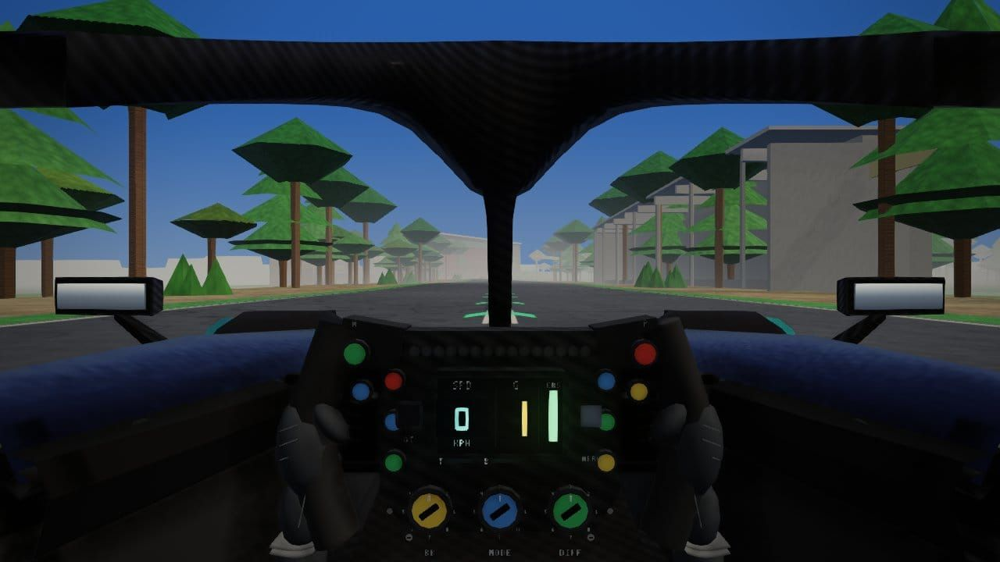 | 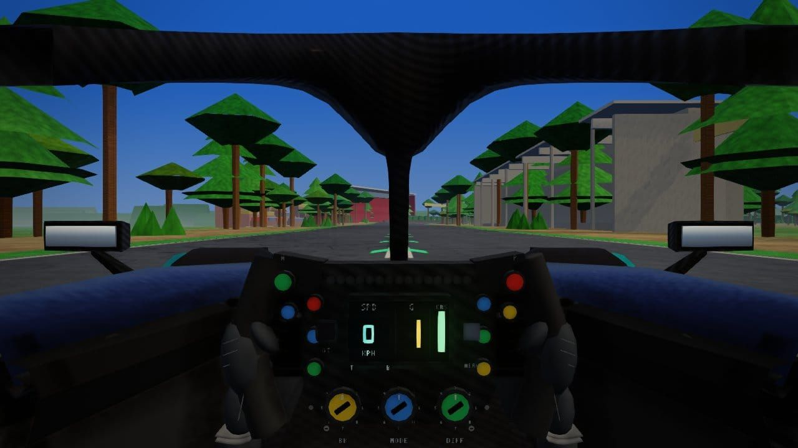 | 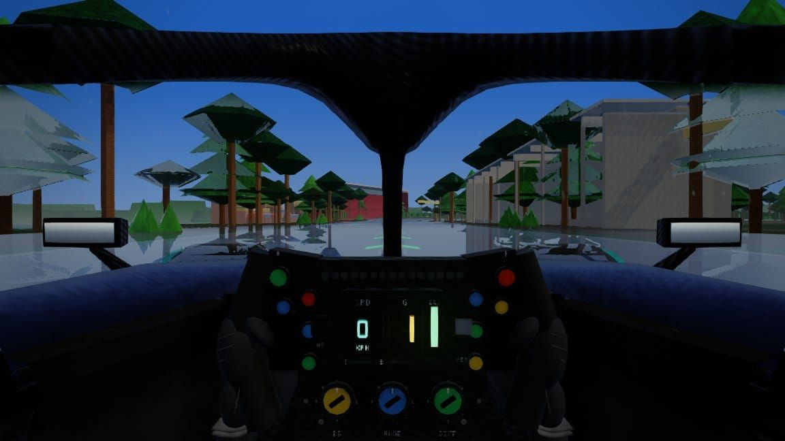 |

| foro · day · wet · park | horquilla · day · fog · trackside | horquilla · day · overcast · trackside |
|:---:|:---:|:---:|
| 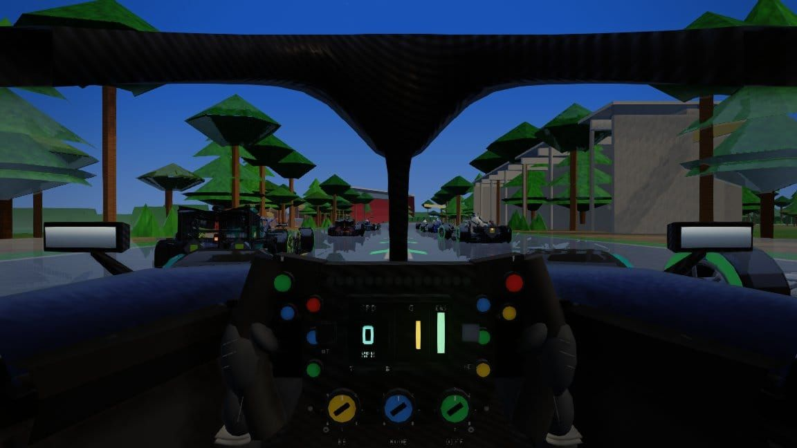 | 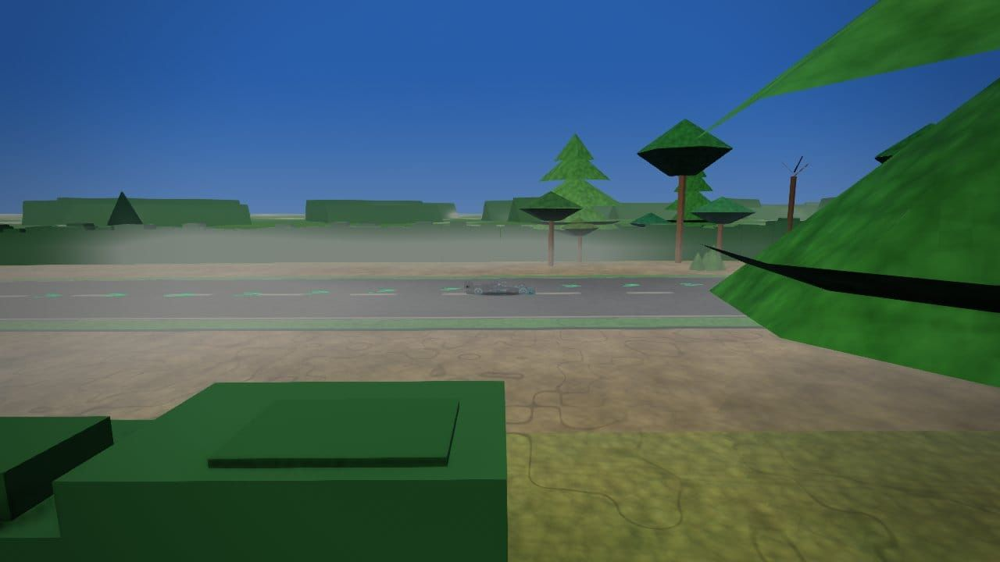 | 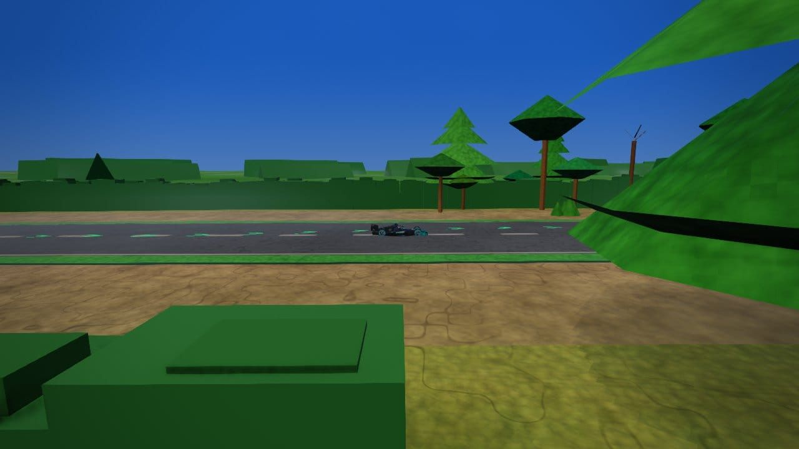 |

| horquilla · day · rain · trackside | horquilla · day · wet · trackside | peraltada · day · fog · orbit |
|:---:|:---:|:---:|
| 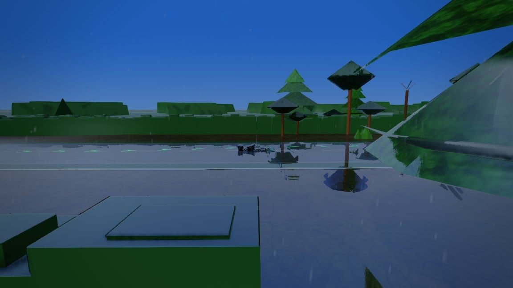 | 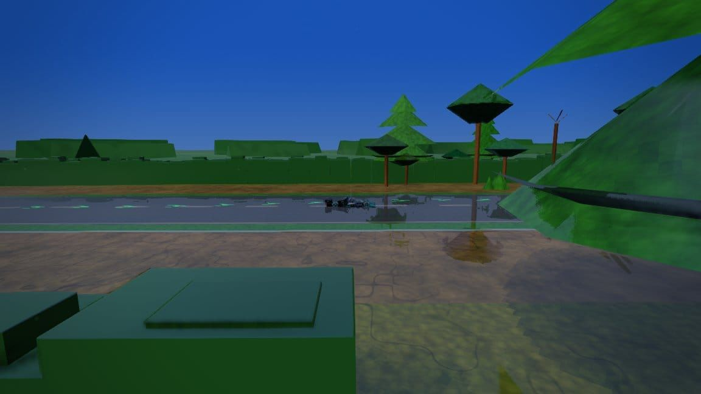 | 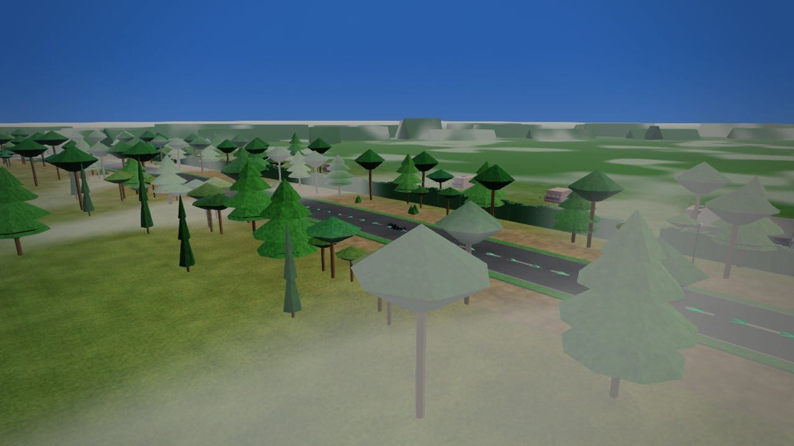 |

| peraltada · day · overcast · orbit | peraltada · day · rain · orbit | peraltada · day · wet · orbit |
|:---:|:---:|:---:|
| 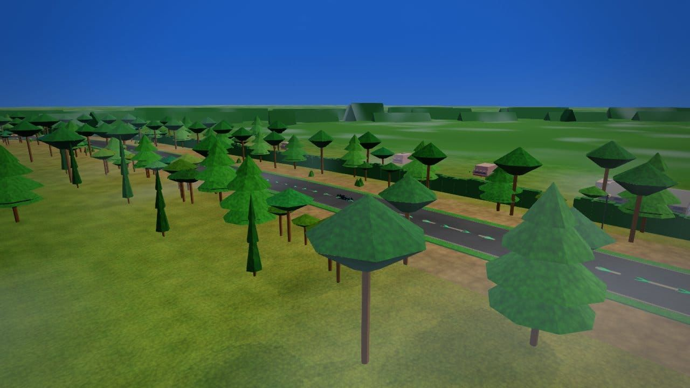 | 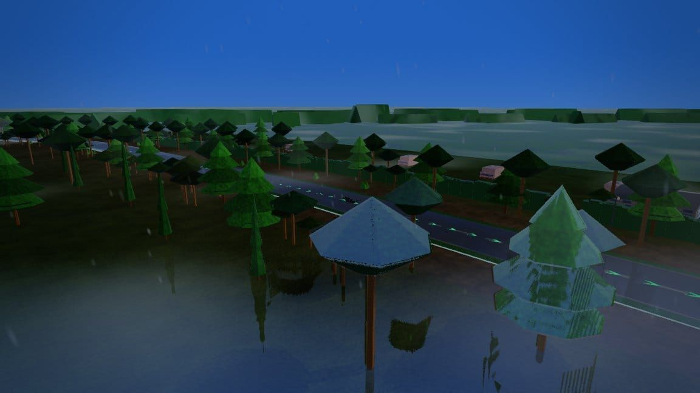 | 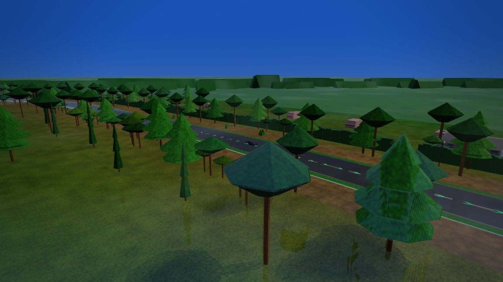 |

| start · day · fog · orbit | start · day · overcast · orbit | start · day · rain · orbit |
|:---:|:---:|:---:|
| 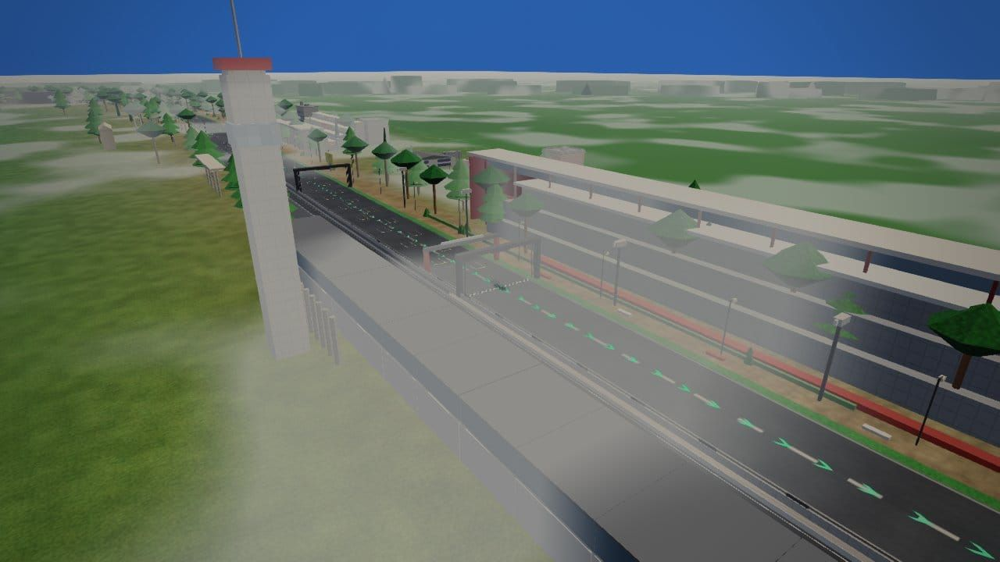 | 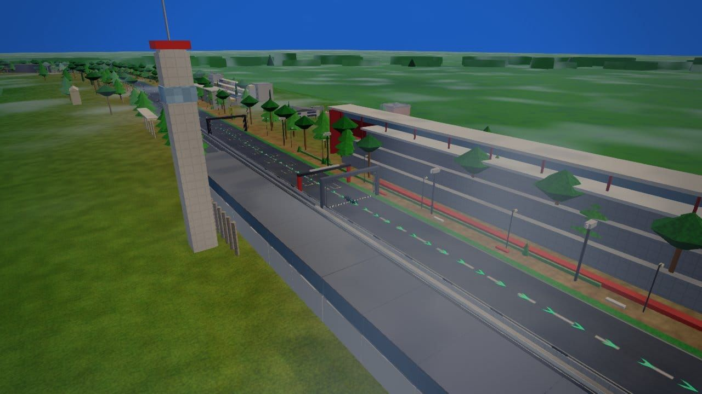 | 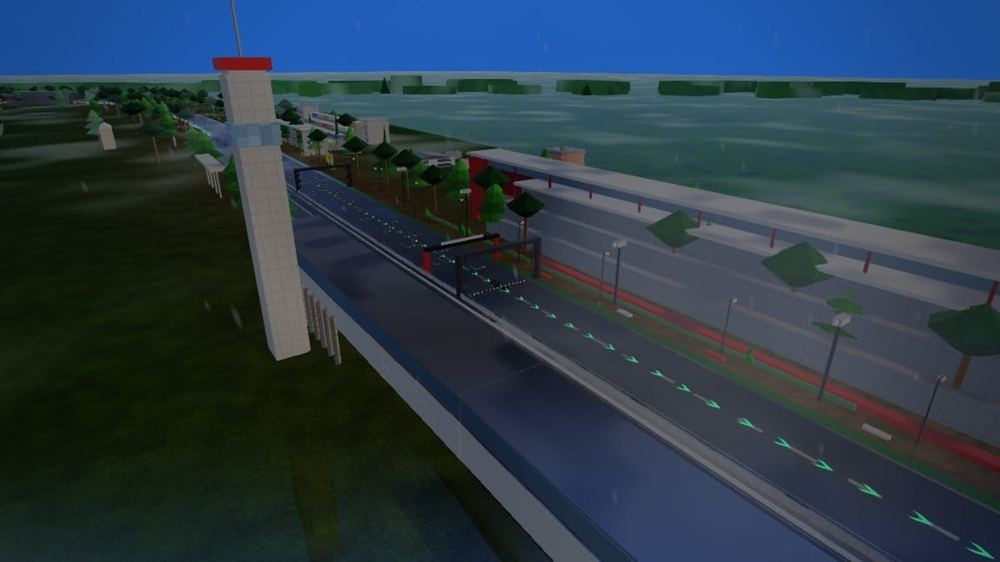 |

| start · day · storm · orbit | start · day · wet · orbit |  |
|:---:|:---:|:---:|
| 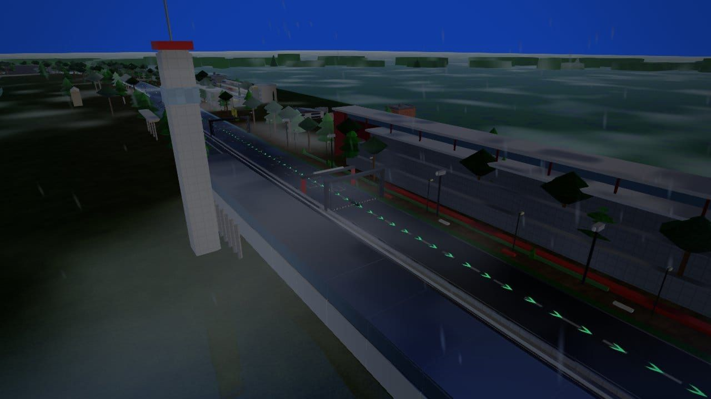 | 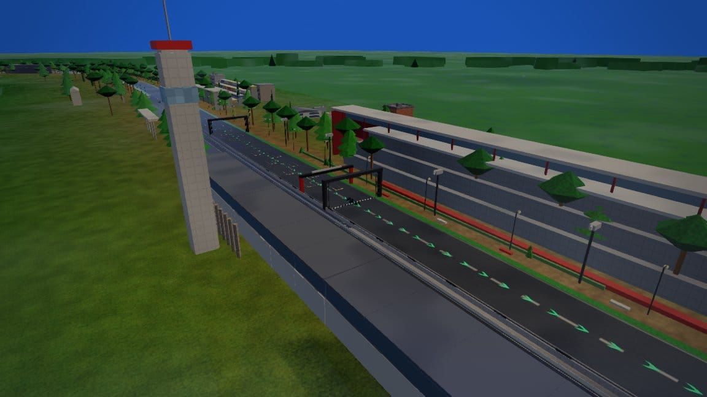 |  |

## Verification

`node tools/track/verify-track.cjs mexico` + `audit-circuit.cjs mexico --json` on tip.
