# Mugello — circuit survey (2026-10-14)

**Circuit id:** `mugello` · **Deploy brief:** [`docs/tracks/mugello.md`](../mugello.md) · **Live:** [Tuscan GP](https://brycejmurrin.github.io/f1-game/)

**Survey shots:** 28 frames (dry / day), committed at `artifacts/shots/tracks/mugello/*__dry-day.jpg`. Weather/lighting matrix follows shared shot tooling PR.

## Code map

| Layer | Path |
|--------|------|
| Def | `js/circuits/mugello.js` |
| Scenery | `js/circuits/scenery/mugello.js` |
| Landmarks | `tests/data/landmarks/mugello.json` |

## Dry day panels — Sector 1

| | | |
|:---:|:---:|:---:|
| 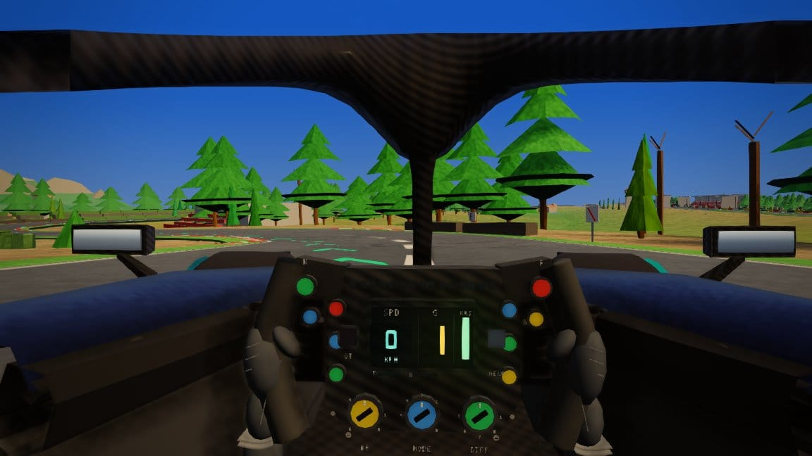 | 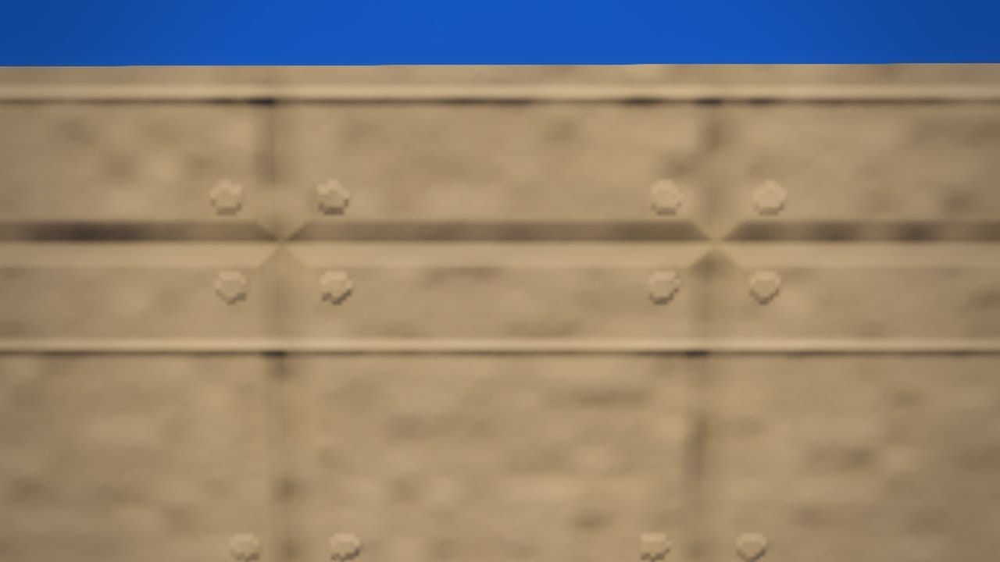 |  |
| **Climb to Poggio (chase)**<br/>weather: dry · tod: day · cam: park · s≈0.19 | **Materassi trackside**<br/>weather: dry · tod: day · cam: trackside · s≈0.238 | **Pieve campanile**<br/>weather: dry · tod: day · cam: orbit · s≈0.235 |
| | | |
|:---:|:---:|:---:|
|  | 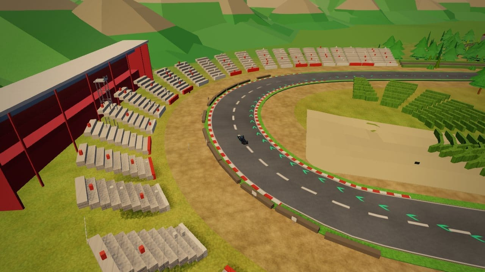 |  |
| **Poggio Secco orbit**<br/>weather: dry · tod: day · cam: orbit · s≈0.218 | **San Donato orbit**<br/>weather: dry · tod: day · cam: orbit · s≈0.15 | **San Donato trackside**<br/>weather: dry · tod: day · cam: trackside · s≈0.145 |

## Dry day panels — Sector 2

| | | |
|:---:|:---:|:---:|
| 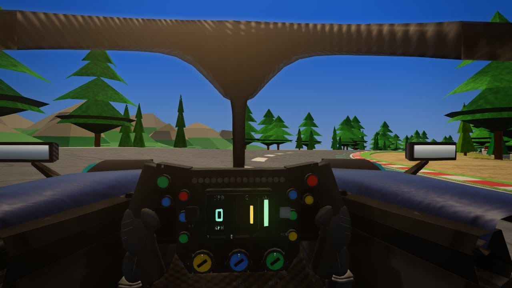 | 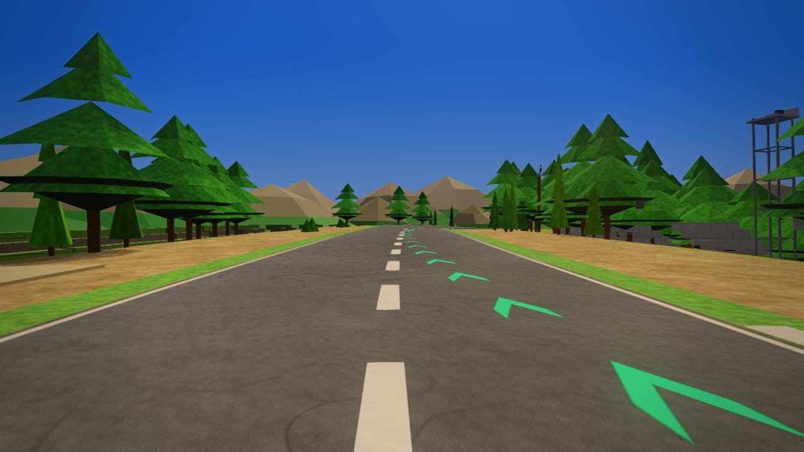 |  |
| **Arrabbiata chase**<br/>weather: dry · tod: day · cam: park · s≈0.52 | **Arrabbiata eye level**<br/>weather: dry · tod: day · cam: eye · s≈0.495 | **Arrabbiata + casale orbit**<br/>weather: dry · tod: day · cam: orbit · s≈0.5 |
| | | |
|:---:|:---:|:---:|
|  | 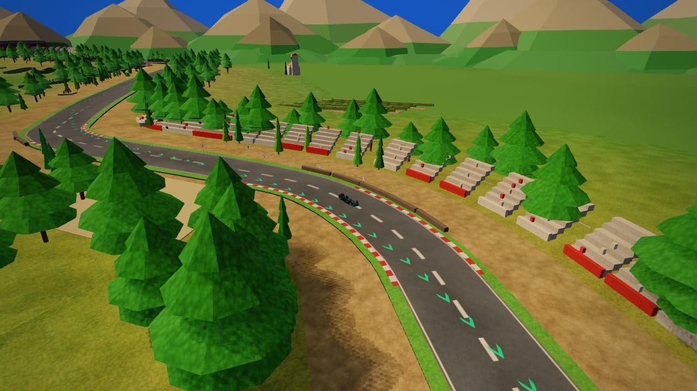 |  |
| **Casale hero**<br/>weather: dry · tod: day · cam: cinematic · s≈0.498 | **Casanova orbit**<br/>weather: dry · tod: day · cam: orbit · s≈0.32 | **Casanova-Savelli trackside**<br/>weather: dry · tod: day · cam: trackside · s≈0.312 |
| | | |
|:---:|:---:|:---:|
| 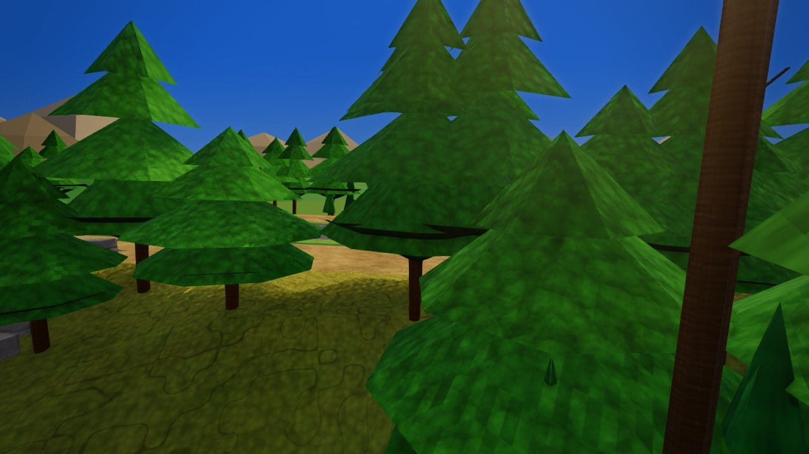 | 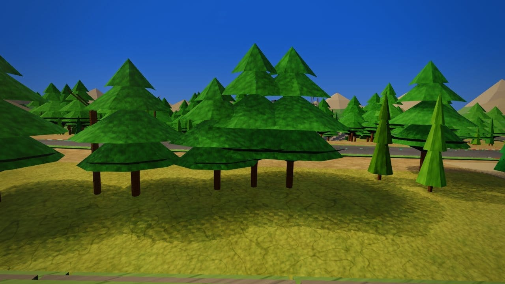 | 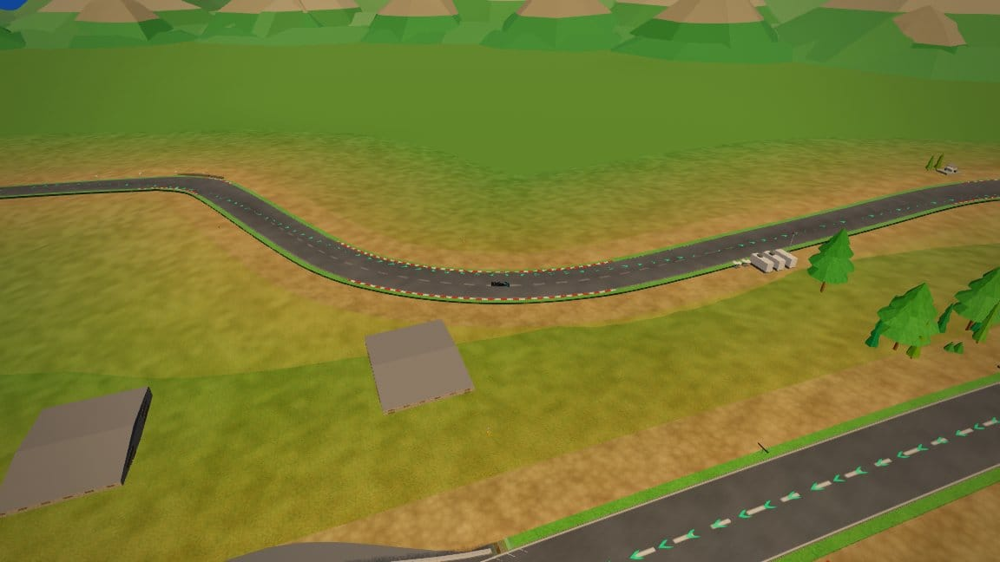 |
| **Forest edge**<br/>weather: dry · tod: day · cam: trackside · s≈0.55 | **Arrabbiata GA hill**<br/>weather: dry · tod: day · cam: trackside · s≈0.505 | **Mid-lap valley orbit**<br/>weather: dry · tod: day · cam: orbit · s≈0.42 |
| | | |
|:---:|:---:|:---:|
| 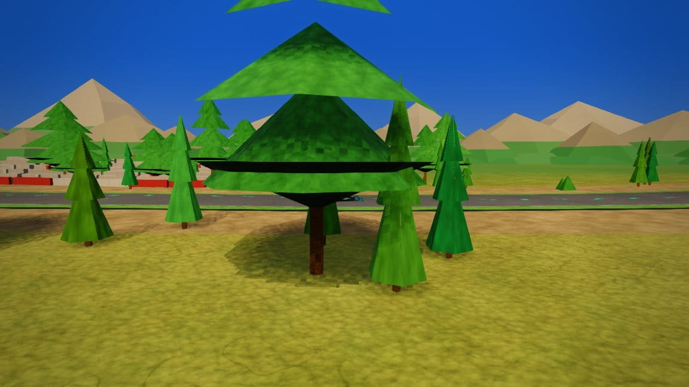 |  |  |
| **Savelli sector split**<br/>weather: dry · tod: day · cam: trackside · s≈0.34 | **Valley sightline**<br/>weather: dry · tod: day · cam: orbit · s≈0.36 |  |

## Dry day panels — Sector 3

| | | |
|:---:|:---:|:---:|
| 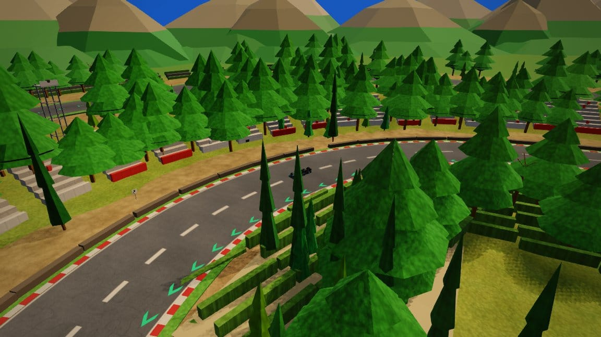 |  |  |
| **Bucine orbit**<br/>weather: dry · tod: day · cam: orbit · s≈0.875 | **Bucine trackside**<br/>weather: dry · tod: day · cam: trackside · s≈0.88 | **Tribuna Centrale**<br/>weather: dry · tod: day · cam: eye · s≈0.005 |
| | | |
|:---:|:---:|:---:|
| 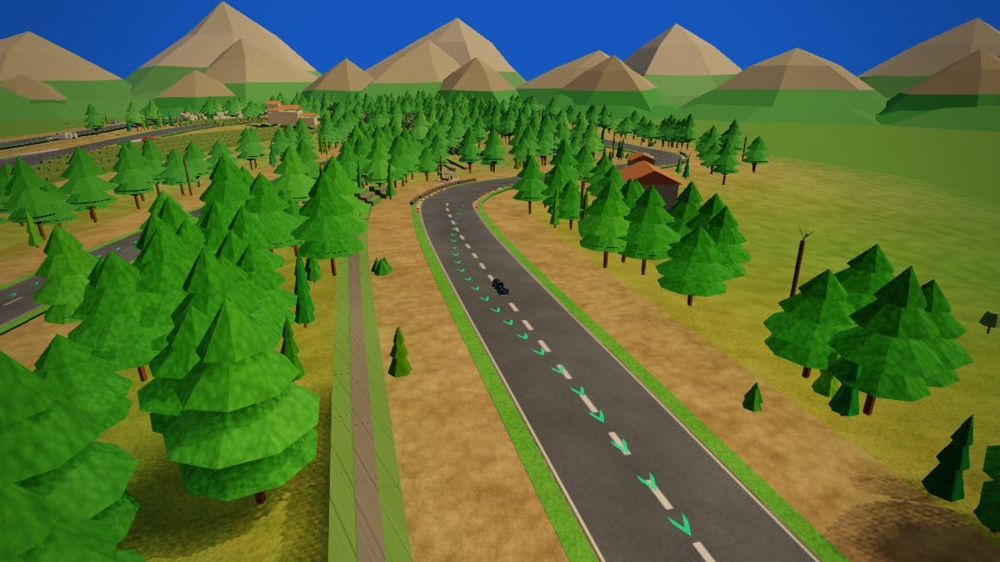 |  | 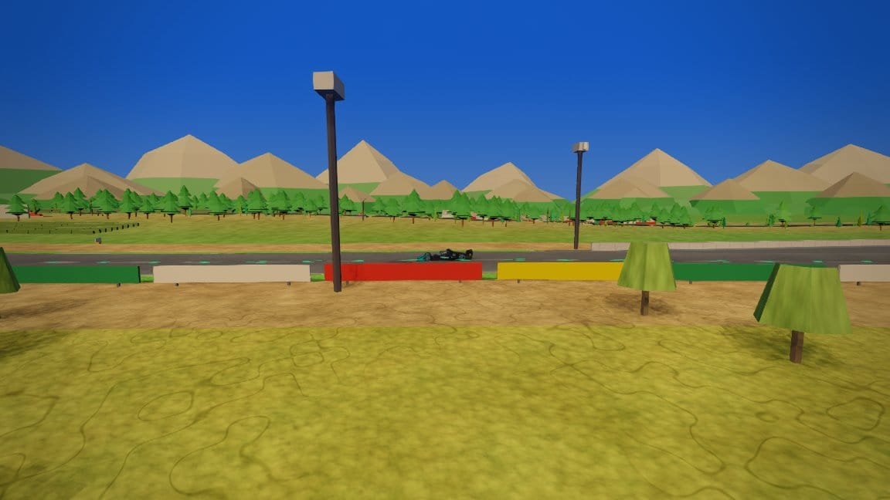 |
| **Correntaio orbit**<br/>weather: dry · tod: day · cam: orbit · s≈0.635 | **Correntaio trackside**<br/>weather: dry · tod: day · cam: trackside · s≈0.62 | **Main straight trackside**<br/>weather: dry · tod: day · cam: trackside · s≈0.04 |
| | | |
|:---:|:---:|:---:|
| 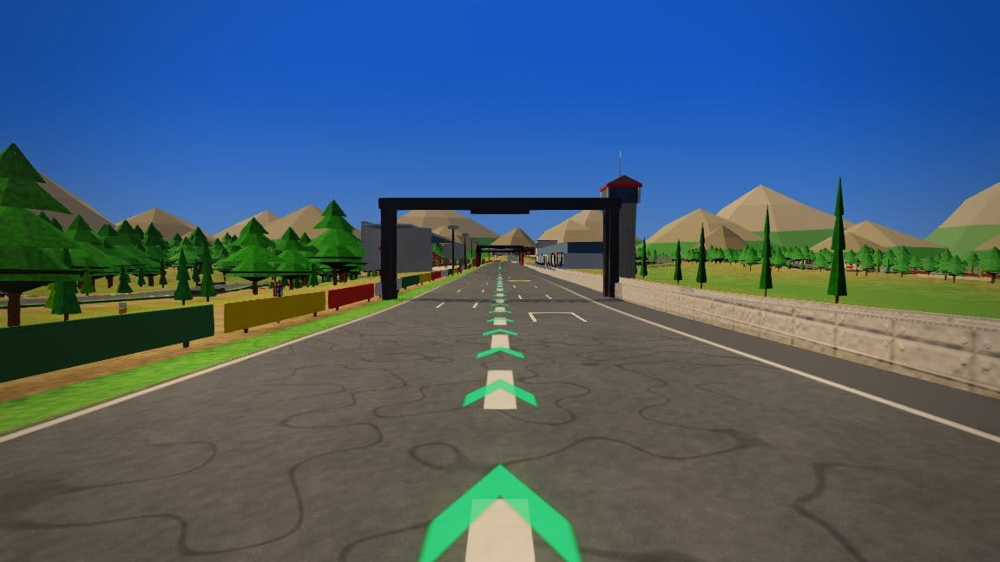 |  |  |
| **Pit lane eye**<br/>weather: dry · tod: day · cam: eye · s≈0.96 | **Pit straight orbit**<br/>weather: dry · tod: day · cam: orbit · s≈0.98 | **Start/finish orbit**<br/>weather: dry · tod: day · cam: orbit · s≈0 |
| | | |
|:---:|:---:|:---:|
| 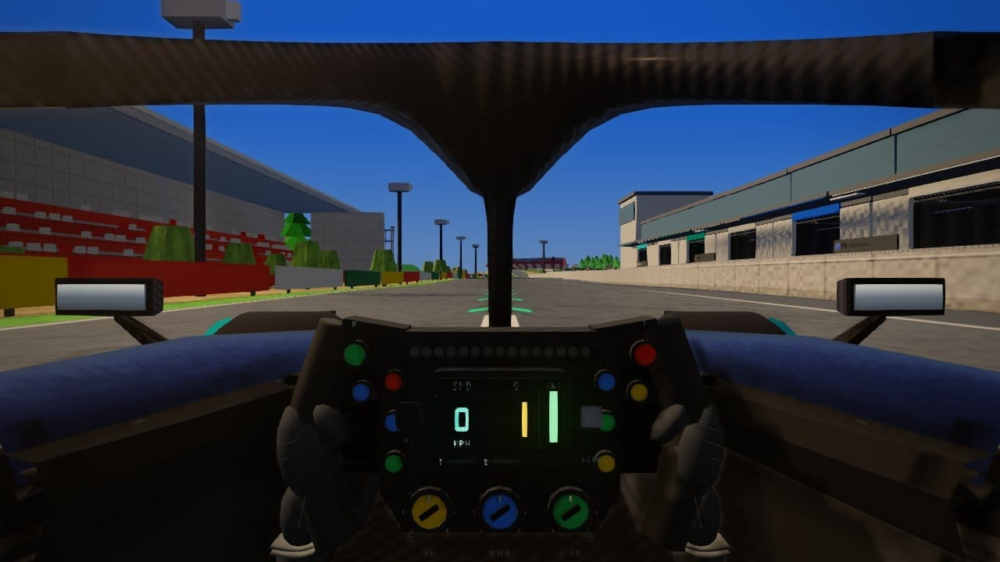 | 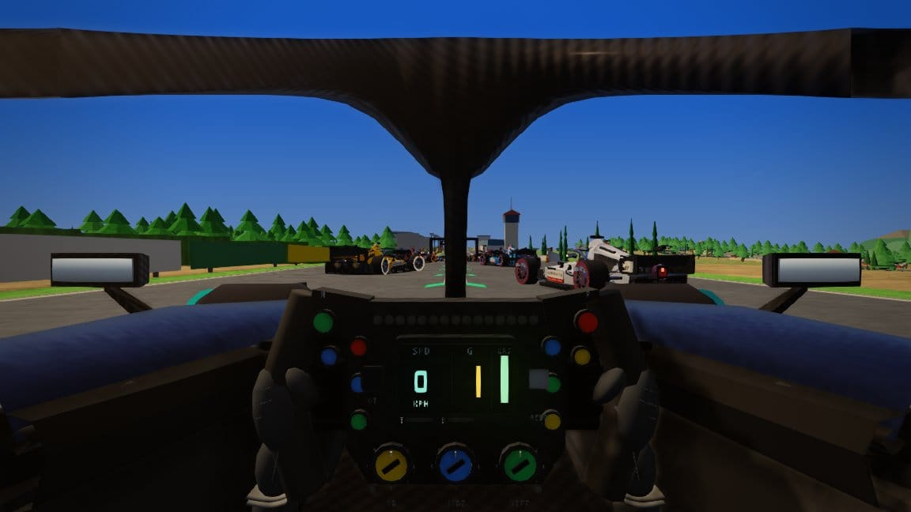 |  |
| **Grid chase**<br/>weather: dry · tod: day · cam: park · s≈0 | **Back straight chase**<br/>weather: dry · tod: day · cam: park · s≈0.93 |  |

## Findings and fixes

**Fixed:** vine soil burial; terrazza `openArea`; hill-stand plinth on `groundUnder`.

**Open:** terrazza clip at cap (5 severe); no lamps (`lamp: "none"`).

**Audit:** buried 6→3; `audit-circuit mugello` ok.

## Weather / lighting (deferred)

After shared tooling: 6 heroes × wet/rain/overcast/fog + dawn/dusk/night.

```sh
node tools/track/verify-track.cjs mugello
node tools/track/audit-circuit.cjs mugello
```
