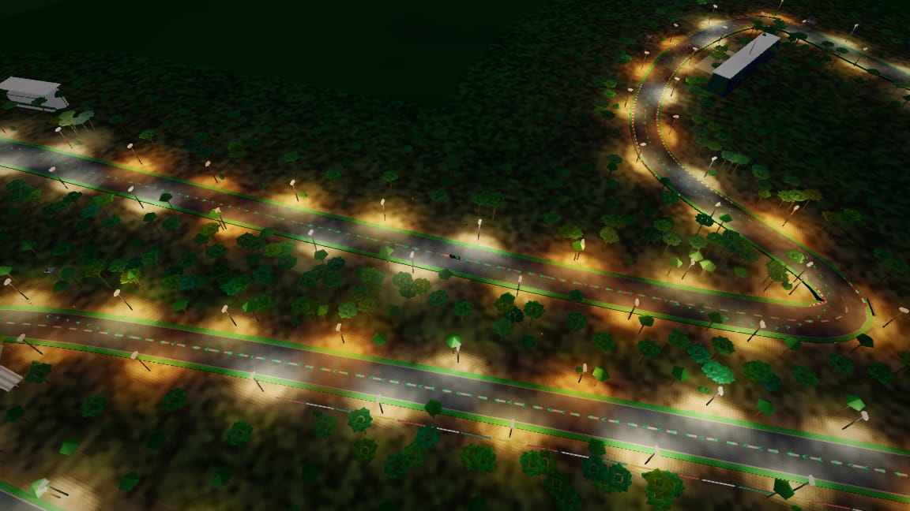
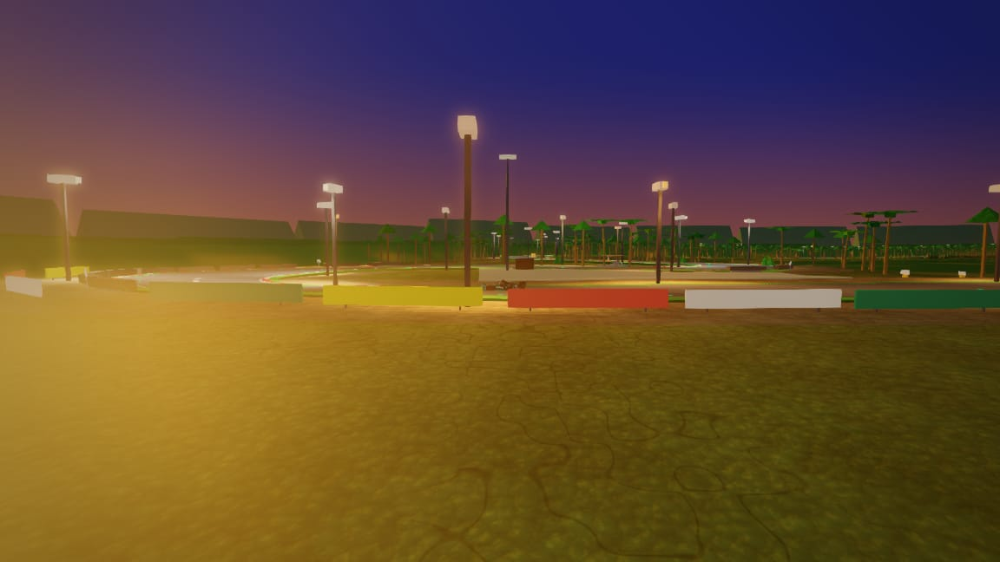
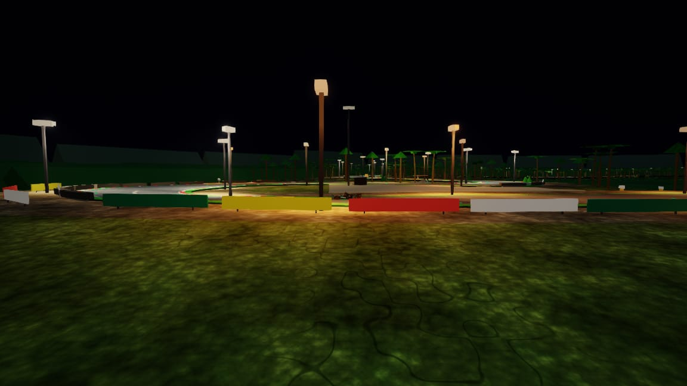
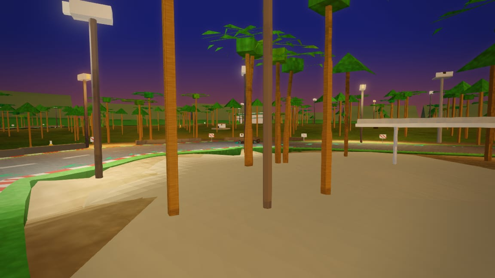
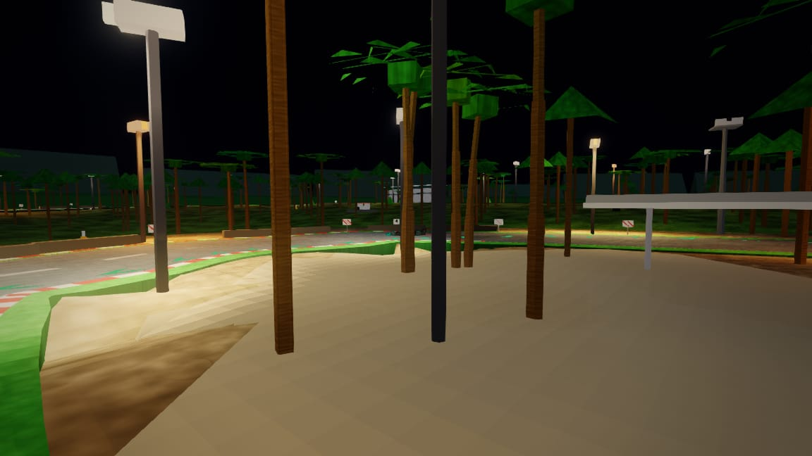
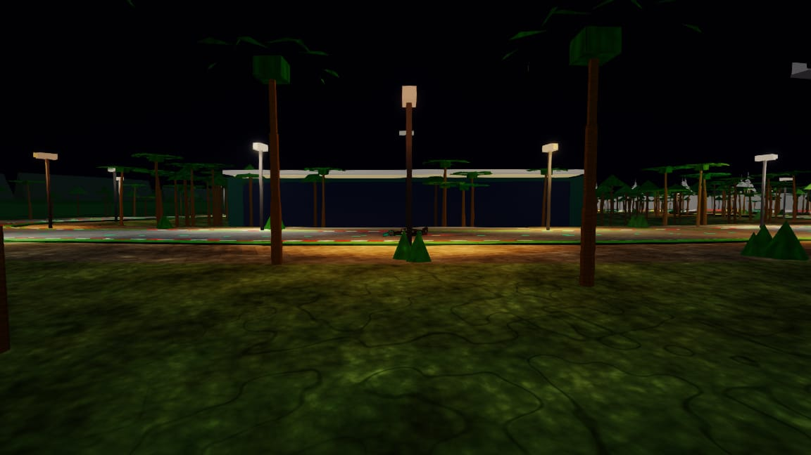
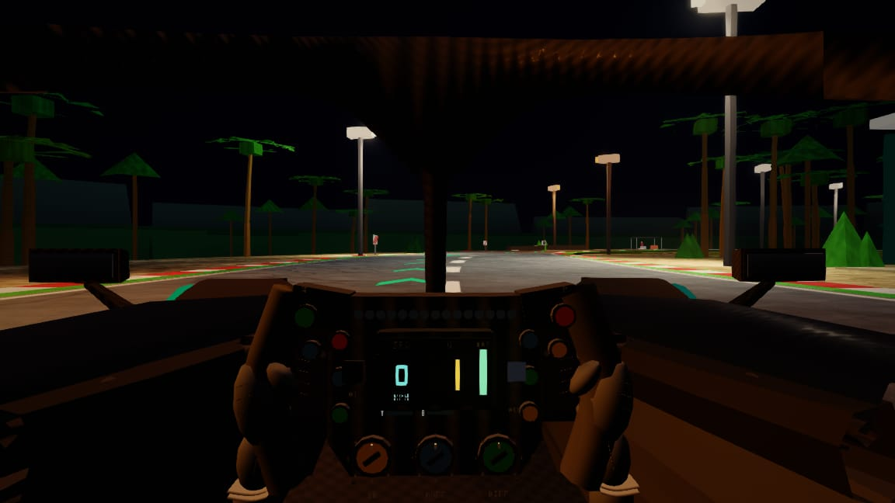

# Sepang — circuit survey (2026-10-14)

**Circuit id:** `sepang` · **Branch:** `cursor/sepang-survey-30aa` · **Shots:** 28 JPEGs in `artifacts/shots/tracks/sepang/`

Weather variants (rain/wet/overcast/fog) deferred until shared shot batch tooling lands.

## Code map

| Layer | Path |
|--------|------|
| Def | `js/circuits/sepang.js` |
| Scenery | `js/circuits/scenery/sepang.js` |
| Brief | `docs/tracks/sepang.md` |

## Sector panels — dry · day

| | | |
|:---:|:---:|:---:|
|  |  |  |
| *hibiscus canopy · day · dry* | *paddock pits · day · dry* | *pit chase · day · dry* |
|  |  |  |
| *pit orbit · day · dry* | *race control · day · dry* | *infield wide · day · dry* |
|  |  |  |
| *klia skyline · day · dry* | *palm plantation · day · dry* | *t1 k1 stand · day · dry* |
|  |  |  |
| *t5 stand · day · dry* | *t7 f stand · day · dry* | *back straight · day · dry* |
|  |  |  |
| *midlap cinematic · day · dry* | *spectator hill · day · dry* | *t15 hairpin · day · dry* |
|  |   |   |
| *t9 hairpin · day · dry* |   |   |

## Time-of-day panels — dry weather

| | | |
|:---:|:---:|:---:|
|  |  |  |
| *hibiscus · dusk · dry* | *hibiscus · night · dry* | *infield · night · dry* |
|  |  |  |
| *pit straight · dusk · dry* | *pit straight · night · dry* | *turn1 · dusk · dry* |
|  |  |  |
| *turn1 · night · dry* | *turn15 · dusk · dry* | *turn15 · night · dry* |
|  |  |  |
| *turn9 · dusk · dry* | *turn9 · night · dry* | *turn9 park · night · dry* |

## Findings

| Item | Status |
|------|--------|
| Motorhome burial on paddock slope | Fixed (terrain gate) |
| K1 stand flatCoplanar | Fixed (riser stagger) |
| Suppressed grandstand=1 | Open |
| Weather matrix | Deferred (shared shot PR) |
