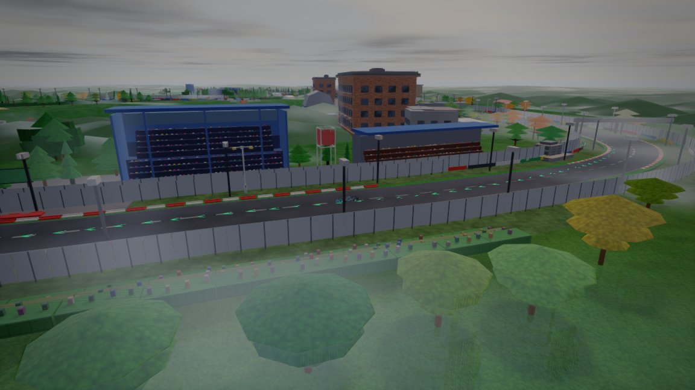
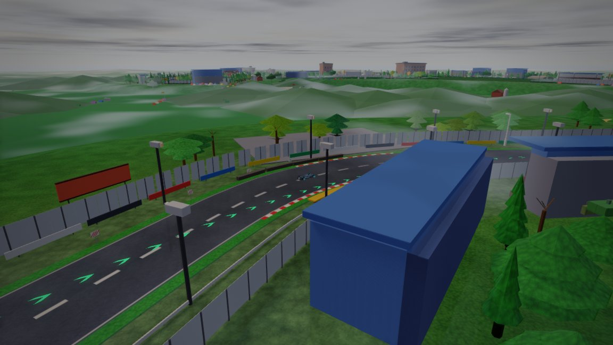
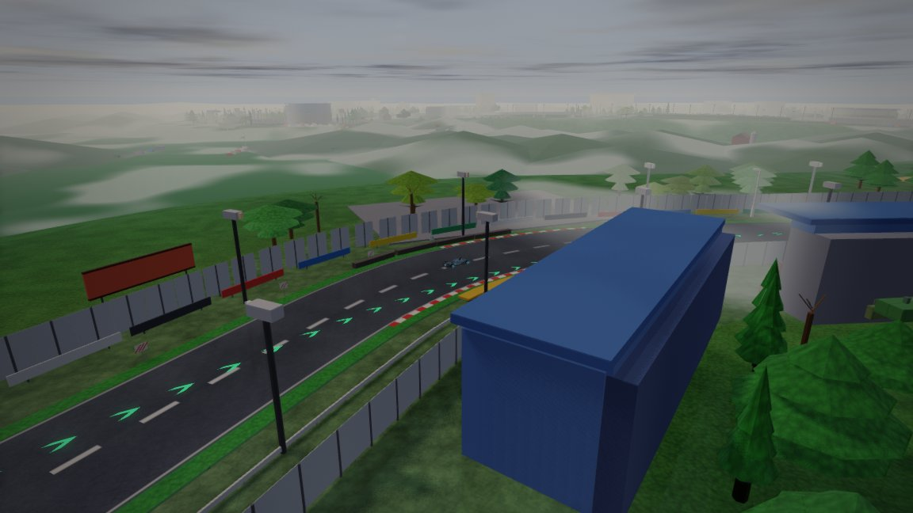
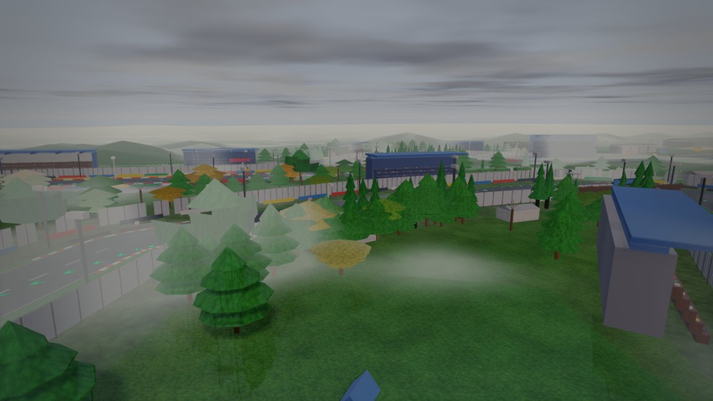
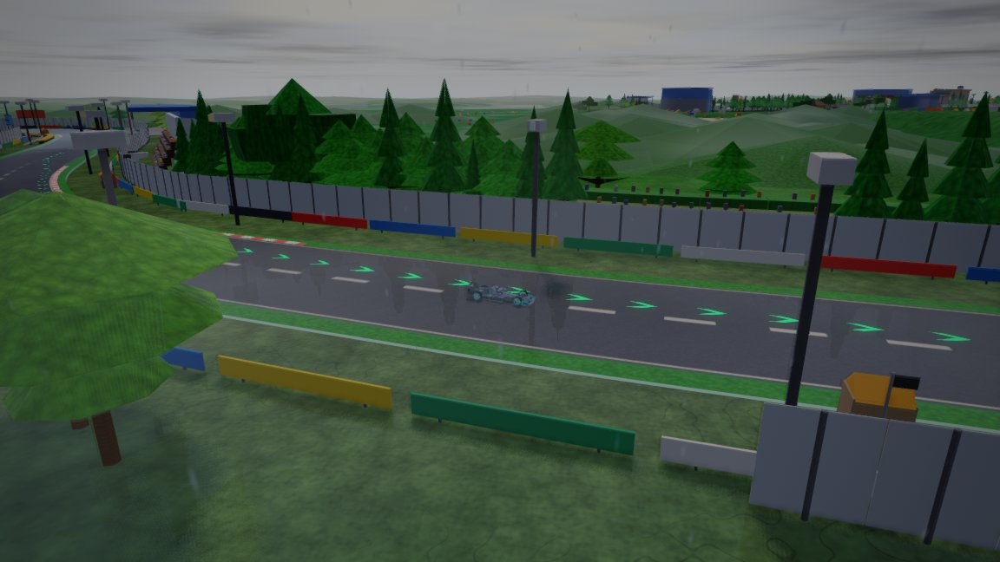
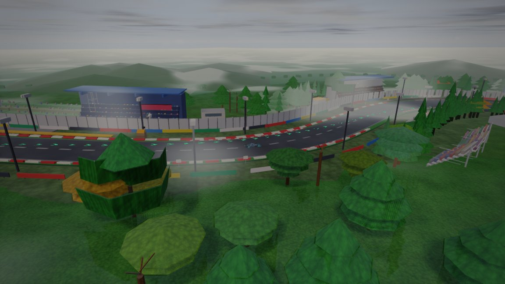

# Silverstone — circuit survey (2026-10-14, expanded)

**Live:** https://brycejmurrin.github.io/f1-game/  
**Branch:** `cursor/silverstone-survey-745b`  
**Captures:** 42 headless frames (`APEX_GL=llvmpipe`, `tools/shot/shot.mjs --backend webgl2 --wait 12`), committed under `artifacts/shots/tracks/silverstone/`. Batch source: `capture-jobs.json` → `batch.json`.

## Weather and time-of-day (engine)

| Control | API / CLI | Values |
|---|---|---|
| Time of day | `__apex.setTimeOfDay(tod)`, shot `--tod` / job `tod` | `dawn`, `day`, `dusk`, `night` |
| Weather | `__apex.weather(wx)`, shot job `weather` (added this survey) | `dry`, `wet`, `rain`, `overcast`, `fog` |
| Circuit flag | `js/circuits/silverstone.js` | `night: false` (menu default day; night still drivable via TOD) |

Reference: `js/game.js` (`raceWeather`), `tools/shot/agent.mjs --weather`, `docs/tracks/silverstone.md` (British overcast palette).

## Code map

| Layer | Path | Role |
|---|---|---|
| Circuit def | `js/circuits/silverstone.js` | OSM centreline, `startFrac: 0.5224`, `sceneryStartFrac: 0.0200`, `flatTerrain`, `terrainOuter: 110`, bank zones, Wing `roofProfile` |
| Scenery | `js/circuits/scenery/silverstone.js` | Hedgerows, campsites, Wing/T2 hangars, grandstands, marshal bays, museum |
| Brief | `docs/tracks/silverstone.md` | Landmarks + four horizon campsite bands |
| Landmarks | `tests/data/landmarks/silverstone.json` | Wing wave roof, control tower, T2 hangars |

## Sector and landmark coverage (dry · day)

Racing sectors ≈ `[0.30, 0.62]` on lap; scenery-frame `s` below. Shots live in-repo at `artifacts/shots/tracks/silverstone/`.


### Sector 1 — Copse through Hangar Straight

| | | |
|---|---|---|
|  |  |  |
| s1-chapel · day-dry | s1-copse · day-dry | s1-hangar-t2 · day-dry |
|  |  |   |
| s1-hangar-wide · day-dry | s1-maggotts · day-dry |

### Sector 2 — Stowe through Hamilton Straight

| | | |
|---|---|---|
|  |  |  |
| s2-club · day-dry | s2-hamilton-stand · day-dry | s2-pit-park · day-dry |
|  |  |  |
| s2-stowe · day-dry | s2-vale · day-dry | s2-wing-hero · day-dry |

### Sector 3 — Abbey through Woodcote + landmarks

| | | |
|---|---|---|
|  |  |  |
| lm-museum · day-dry | lm-start-gantry · day-dry | s3-abbey · day-dry |
|  |  |  |
| s3-brooklands · day-dry | s3-farm · day-dry | s3-village-loop · day-dry |
|  |   |   |
| s3-woodcote · day-dry |

## Hero viewpoints — weather and lighting matrix

Repeated framing at six signatures: Copse, Maggotts (cinematic), Hangar/T2, Wing, Abbey, Village Loop.

### abbey

| | | |
|---|---|---|
|  |  |  |
| dusk · dry | night · dry | day · overcast |

### copse

| | | |
|---|---|---|
|  |  |  |
| dusk · dry | night · dry | day · rain |
|  |  |  |
| day · wet | day · overcast | day · fog |

### hangar

| | | |
|---|---|---|
|  |  |  |
| dusk · dry | night · dry | day · rain |
|  |   |   |
| day · fog |

### maggotts

| | | |
|---|---|---|
|  |  |  |
| day · dry | dusk · dry | night · dry |
|  |   |   |
| day · rain |

### village

| | | |
|---|---|---|
|  |  |  |
| dusk · dry | night · dry | day · fog |

### wing

| | | |
|---|---|---|
|  |  |  |
| dusk · dry | night · dry | day · rain |
|  |   |   |
| day · wet |

## Findings (visual + audits)

### Strengths
- **0 surface folds**, **0 float**, **0 severe clip** (`audit-circuit` 2026-10-14 post-fix).
- Wing + Hamilton grandstand pairing reads on `s2-wing-hero__day-dry` and `s2-pit-park__day-dry`.
- Horizon campsites visible on Hangar Straight wide shots; T2 hangars improved after ~10 m inward move.

### Weather / lighting backlog

| ID | Severity | Evidence | Note |
|---|---|---|---|
| W1 | Med | `hero-hangar__night-dry`, `hero-village__night-dry` | Outfield and campsites fall off to black; only pit-straight doubles and corner towers carry night read |
| W2 | Low | `hero-wing__night-dry` | Hand-placed pit lamps and Wing emissive bands work; distant backdrop hills do not pick up moon fill |
| W3 | Low | `hero-wing__day-rain`, `hero-maggotts__day-rain` | Rain particles + grey sky read; tarmac lacks strong wet specular (engine-wide) |
| W4 | Low | `hero-copse__day-overcast` vs `s1-copse__day-dry` | Circuit already applies `ATM.britishOvercast` — extra `weather:overcast` is subtle |
| W5 | Low | `hero-copse__day-fog` | Authored mountain haze + fog weather stacks to soft horizon (not z-fight) |
| W6 | Info | `night: false` on def | No circuit-specific night lamp cap; acceptable for UK summer GP default |

### Geometry backlog (circuit-scoped fixes)

| ID | Status | Note |
|---|---|---|
| F1 T2 hangar distance | **Fixed** | Hangars 88–92 m (was 96–104 m) |
| F2 Museum fascia coplanar | **Fixed** | Fascia band lifted; flatCoplanar 6→5 |
| F3 Marshal bay roof | **Fixed** | Orange strip raised |
| F4 Helipad markings | **Fixed** | H boxes raised |
| F5 Legacy infield campsites | Open | `silverstone-camping-field-*` duplicates horizon fields; blocked by `scenery-api-contract` test |

## Verification

```sh
node tools/track/verify-track.cjs silverstone
node tools/track/audit-circuit.cjs silverstone
```

Props: **427709** tris · buried **37** · flatCoplanar **5** (within baseline).
