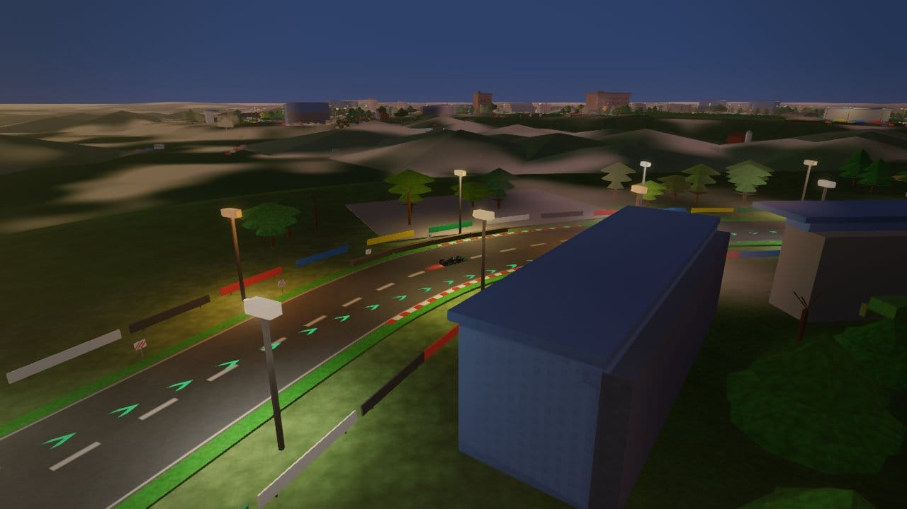
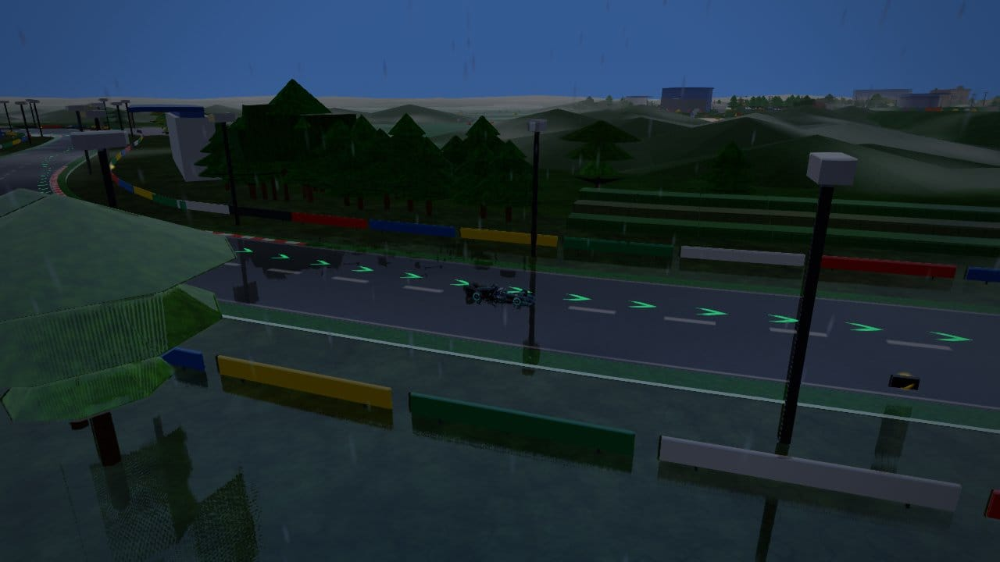
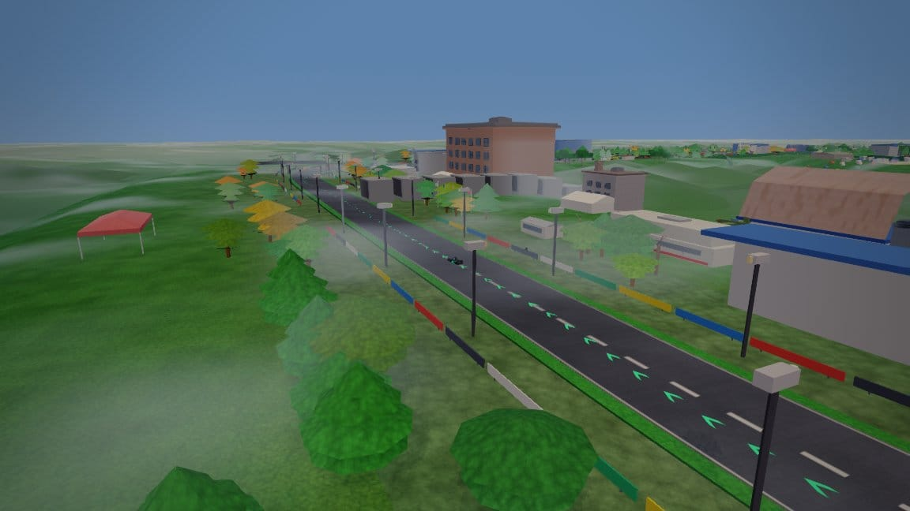
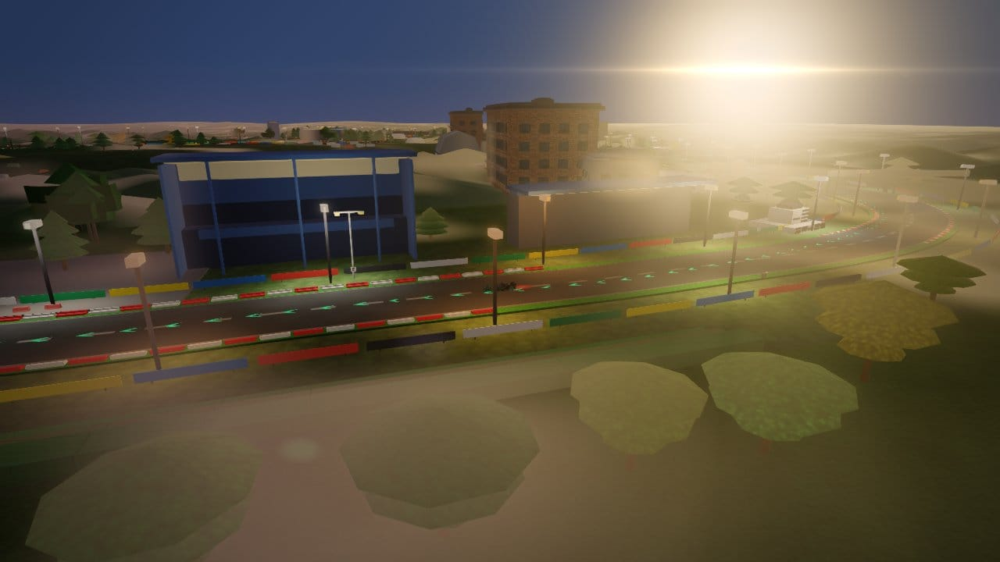
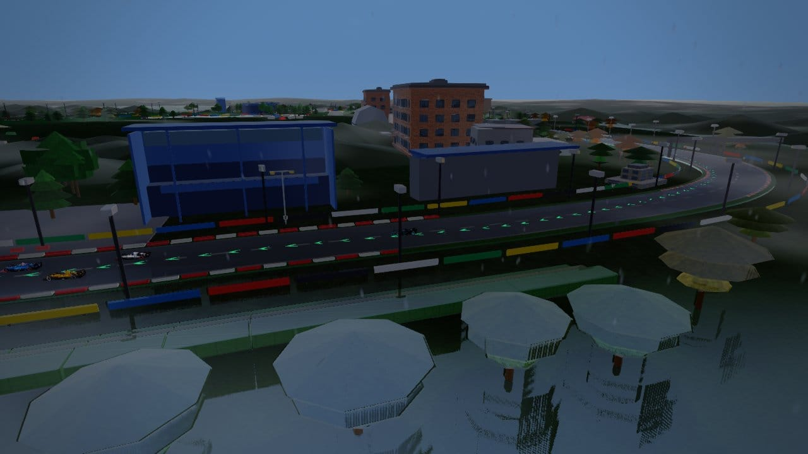

# Silverstone — circuit survey (2026-10-14)

**Branch:** `cursor/silverstone-survey-745b` · **Frames:** 36 (`artifacts/shots/tracks/silverstone/`, JPEG ≤1280 px, q≈80, <300 KB)

Captured with shared `shot.mjs` batch (`--present-timeout 90 --capture-retries 4 --wait 120`, SwiftShader). Sector sweep **day · dry**; six hero signatures with **dawn/dusk/night** and **wet/rain/overcast/fog/storm** mix.

## Code map

| Layer | Path |
|---|---|
| Def | `js/circuits/silverstone.js` |
| Scenery | `js/circuits/scenery/silverstone.js` |

## Sector panels (day · dry)

### Sector 1

| | | |
|---|---|---|
|  |  |  |
| chapel · day · dry | copse · day · dry | hangar t2 · day · dry |
|  |  |
| hangar wide · day · dry | maggotts · day · dry |

### Sector 2

| | | |
|---|---|---|
|  |  |  |
| club · day · dry | hamilton stand · day · dry | pit park · day · dry |
|  |  |  |
| stowe · day · dry | vale · day · dry | wing hero · day · dry |

### Sector 3 + landmarks

| | | |
|---|---|---|
|  |  |  |
| lm museum · day · dry | lm start gantry · day · dry | abbey · day · dry |
|  |  |  |
| brooklands · day · dry | farm · day · dry | village loop · day · dry |
|  |
| woodcote · day · dry |

## Hero panels (weather · time of day)

### copse

| | | |
|---|---|---|
|  |  |  |
| copse · dawn · dry | copse · day · rain | copse · night · dry |

### maggotts

| | | |
|---|---|---|
|  |  |  |
| maggotts · day · storm | maggotts · dusk · dry | maggotts · night · dry |

### hangar

| | | |
|---|---|---|
|  |  |  |
| hangar · day · fog | hangar · dusk · dry | hangar · night · dry |

### wing

| | | |
|---|---|---|
|  |  |  |
| wing · day · overcast | wing · day · wet | wing · night · dry |

### abbey

| | | |
|---|---|---|
|  |  |  |
| abbey · dawn · dry | abbey · day · rain | abbey · dusk · dry |

### village

| | | |
|---|---|---|
|  |  |  |
| village · day · fog | village · dusk · dry | village · night · dry |

## Verification

```sh
node tools/track/verify-track.cjs silverstone
node tools/track/audit-circuit.cjs silverstone
```
