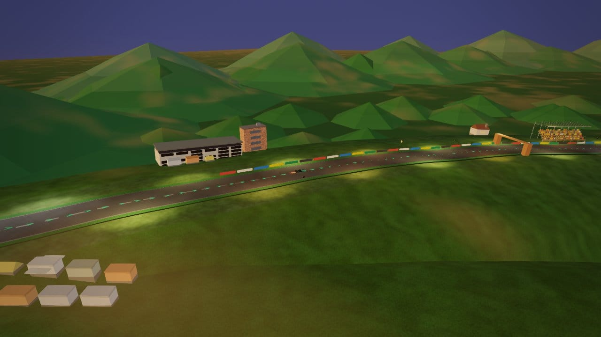
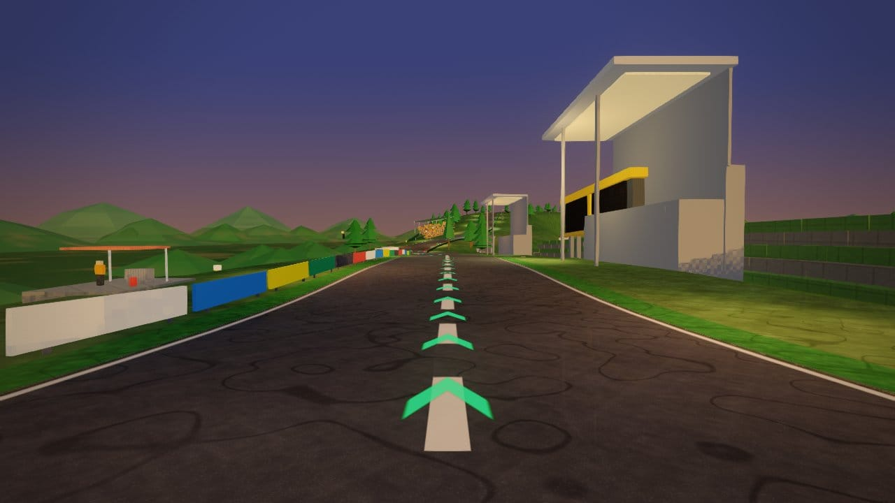
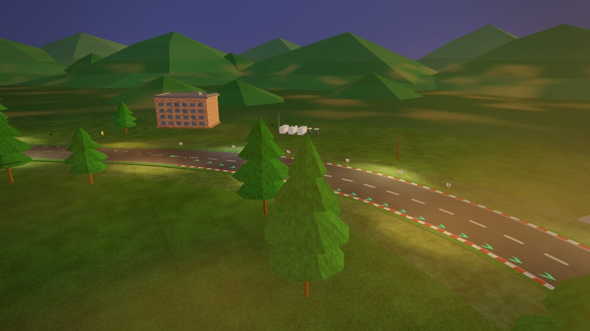

# Spa-Francorchamps — circuit survey (2026-10-14)

**Circuit id:** `spa`  
**Live:** https://brycejmurrin.github.io/f1-game/  
**Branch:** `cursor/spa-survey-fixes-a5b0` → `claude/f1-game-project-26h3ng`

## Capture status

| Item | Status |
|------|--------|
| Dry **day / dusk / night** (`shot.mjs --tod`) | **33 frames** committed under `artifacts/shots/tracks/spa/` (`git add -f`; JPEG q≈80, ≤1280 px wide). |
| **Weather** (`wet` / `rain` / `overcast` / `fog` / dawn) | **Deferred** — batch `wx` after shared shot tooling PR. Planned on **4–6 hero views**. |

**Night note:** `js/circuits/spa.js` sets `night: false` and `furniture.lamp: "none"`. Night shots are intentionally dark; no circuit floodlight pass — expect missing trackside lamps (backlog P2).

---

## Code map

| Layer | Path | Role |
|--------|------|------|
| Circuit def | `js/circuits/spa.js` | OSM centreline (`path.len` 6979 m), 64-knot elevation, `sceneryStartFrac` 0.9875, `terrainOuter` 90 / `terrainFalloffStart` 54, damp-Ardennes `pal`, bank zones, sectors `[0.28, 0.68]`, 20 turn markers. |
| Scenery | `js/circuits/scenery/spa.js` | Lazy `TrackScenery["spa"]`: mountains, `forestEdge` + `forestRank`, Gold 3, terraces, Bus Stop, brook, N62 ribbon, church, kits. |
| Meta | `js/track/circuit-meta.js` | Picker: theme `green`, 7 km, `sunAzimBias` 0.44. |
| Engine | `js/track/tracks.js` | Builds defs, `_sceneryShift`, `buildProps` → `def.scenery(api)`. |
| Brief | `docs/tracks/spa.md` | Palette, landmarks, research (old course, village). |

Authored scenery fractions ≈ racing + 0.0423 (see `OPEN` comments in scenery).

---

## Theme and models

- **Atmosphere:** `ATM.dampArdennes`, grey sky/fog, mown-grass runoff override.
- **Hero IDs:** `spa-raidillon-gold-dual-jumbotron`, `spa-timing-tower`, `spa-francorchamps-church`, Kemmel footbridges, RV camps.
- **Audit (this branch):** `verify-track` OK; clip **3 severe** (cap 4); float 0; ground unsupported 0, flatCoplanar 0.

---

## Screenshots by sector (committed, dry weather)

**33 frames** in `artifacts/shots/tracks/spa/` (JPEG q≈80, max width 1280 px).

### Sector 1 — La Source → Kemmel (racing s ≈ 0–0.28)

| | | |
|:---:|:---:|:---:|
|  |  |  |
|  |  |  |
|  |  |  |
|  |  |  |
|  |  |  |
|  |  |  |
|  |   |   |

### Sector 2 — Les Combes → Stavelot (s ≈ 0.28–0.68)

| | | |
|:---:|:---:|:---:|
|  |  |  |
|  |  |  |
|  |  |  |
|  |   |   |

### Sector 3 — Blanchimont → Bus Stop (s ≈ 0.68–1.0)

| | | |
|:---:|:---:|:---:|
|  |  |  |
|  |   |   |

---

## Screenshots by time of day (dry weather)

### Midday (`tod: day`)

| | | |
|:---:|:---:|:---:|
|  |  |  |
|  |  |  |
|  |  |  |
|  |  |  |
|  |  |   |

### Golden hour (`tod: dusk`)

| | | |
|:---:|:---:|:---:|
|  |  |  |
|  |  |  |
|  |  |  |
|  |  |  |
|  |  |   |

### Night (`tod: night` — partial lap; `night: false` on def)

| | | |
|:---:|:---:|:---:|
|  |  |  |
|  |  |   |

### Weather variants (planned after shared shot tooling PR)

| Planned view | Weather | Time |
|--------------|---------|------|
| Eau Rouge | fog, rain | day |
| Pouhon | wet | day |
| Bus Stop | wet | day |
| Pit straight | overcast | day |
| Blanchimont | fog | day |
| Kemmel | dry | dawn |

---

## Findings

### Layout / road

- Centreline **0 surface folds**; ~101 m relief reads well (Eau Rouge, Raidillon, Gold 3).
- **Bus Stop** inner kerb: sharp terrain fold (ribbon overlap) — engine/terrain consumer, not centreline.

### Scenery

- **Strengths:** Gold 3 amphitheatre, deep `forestRank`, N62 ribbon, brook, damp palette.
- **Pine tiers:** occasional horizontal banding on crowns (engine tier cull) — shot Eau Rouge day.
- **Gold 3:** stand spacing tightened; ~1.2 m box clip @ s≈0.130 remains (within clip cap).
- **Pit loop:** deep-rank pine vs motorhome ~2.1 m clip @ s≈0.957 (track doubles back); `OPEN` widened, still one severe spot.

### Lighting / weather-specific (from day/dusk/night only)

| Issue | Where | Severity |
|-------|-------|----------|
| No floodlights / very dark night | Whole lap (`night: false`, `lamp: none`) | Expected until optional lamp pass |
| Dusk sky still readable | Gold 3, Eau Rouge | OK — matches damp brief |
| Wet/rain/overcast/fog | — | **Not shot yet** (tooling PR) |

---

## Ranked backlog

| P | Item | Scope |
|---|------|--------|
| P1 | Bus Stop terrain fold | Terrain / def — likely not scenery-only |
| P2 | Night visibility (`night: true` or selective `lampPost`) | `spa.js` def + scenery |
| P3 | Pit-loop forest vs motorhome clip | `spa.js` `OPEN` / motorhome anchor |
| P4 | Gold 3 stand overlap | `grandstandEx` spacing |
| P5 | Weather panel (6 frames) | After shared `shot` PR |

---

## Fixes on this branch (`js/circuits/scenery/spa.js` only)

1. Gold 3 `grandstandEx` spacing; `spectatorHill` shift.
2. Timing-tower clock on glazing (ground unsupported → 0).
3. Church spire 6 cm offset (flatCoplanar → 0).
4. `forestRank` `OPEN` windows (Kemmel, Bus Stop loop, Blanchimont); Kemmel accent pines `s` 0.16→0.22.
5. Clip severe **4 → 3** (Kemmel forest vs terrace cleared).

---

## Verification

```sh
node tools/track/verify-track.cjs spa
node tools/track/audit-circuit.cjs spa
# Browser (post-push): tests/specs/spa-foundation.spec.js
```
