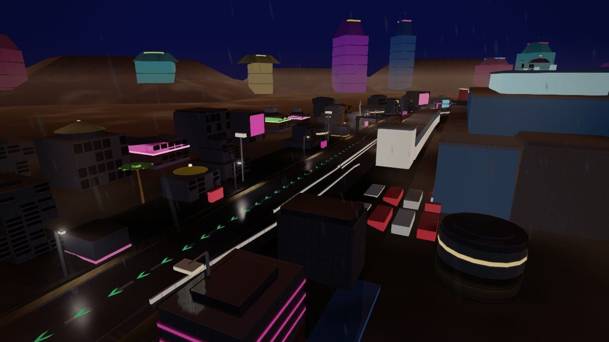
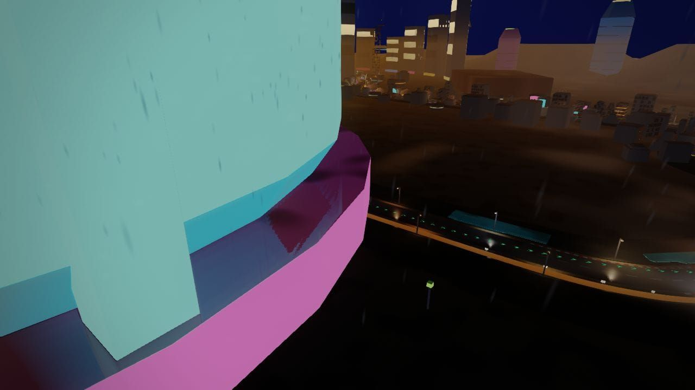
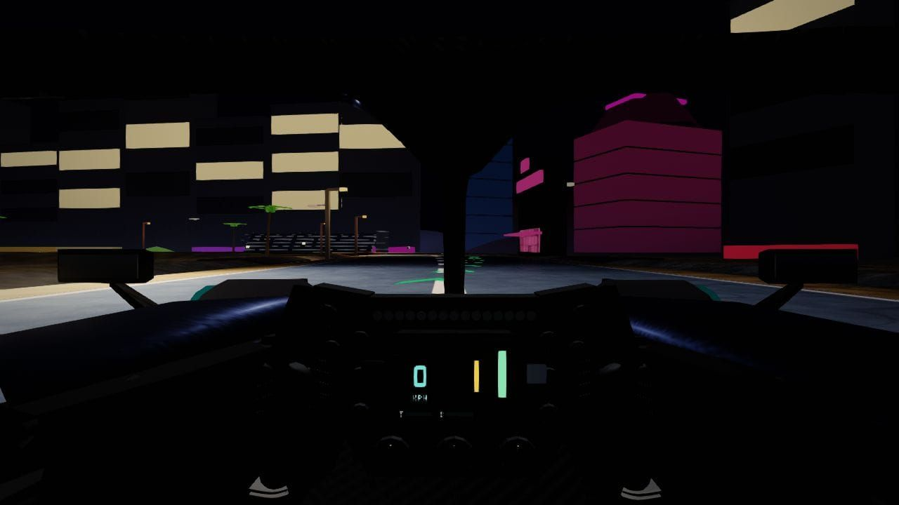
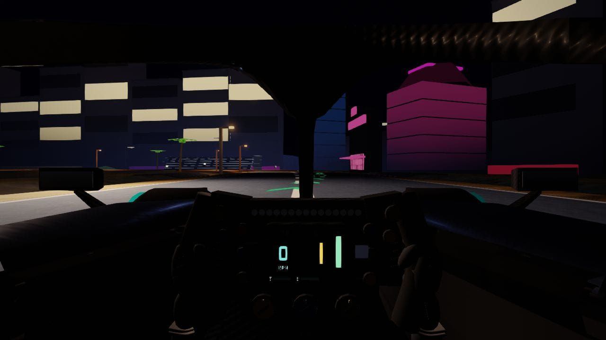
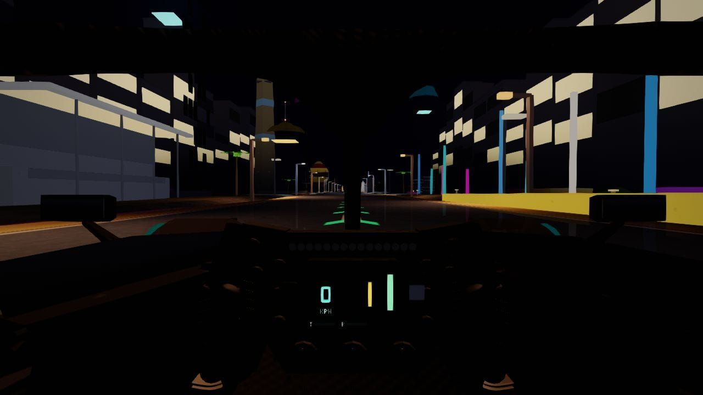
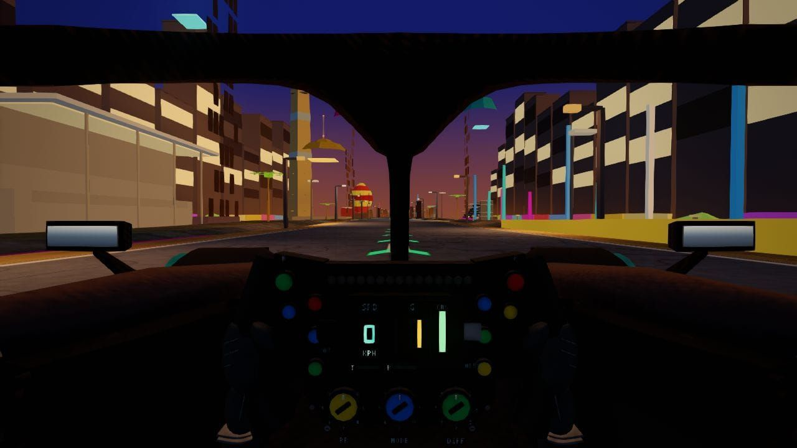

# Las Vegas GP — circuit survey (`vegas`)

**Date:** 2026-10-15  
**Branch:** `cursor/vegas-survey-b8a0`  
**Brief:** [`docs/tracks/vegas.md`](../vegas.md)  
**Shots:** **36** JPEGs in [`artifacts/shots/tracks/vegas/`](../../../artifacts/shots/tracks/vegas/) (1280px max, q≈80, `shot.mjs --jpeg --present-timeout 90 --capture-retries 4 --wait 120`, SwiftShader).

## Code map

| Layer | Role |
|--------|------|
| `js/circuits/vegas.js` | OSM centreline, `sceneryCoordinates: "racing"`, `theme: street_night`, `dressingExclusions` for Strip/Sphere hand-build |
| `js/circuits/scenery/vegas.js` | `sl(f)` racing-frame landmarks, Strip canyon densify, neon verges, gateway/finish spans |
| `tests/data/landmarks/vegas.json` | Required heroes: Sphere, Wynn/Encore, Caesars, Bellagio, Paris balloon, Grand Prix Plaza |

**Sectors (racing arc):** `sectors: [0.291, 0.62]` → S1 pit–Koval, S2 Sphere–Venetian, S3 Strip–Harmon.

## Audits

`verify-track.cjs vegas` OK · `audit-circuit.cjs vegas` OK (float/clip/ground; palm guard drops 6).

## Findings

| ID | Topic | Shot | Note |
|----|--------|------|------|
| V1 | Day rain sky | `wx-sphere-day-rain.jpg` | White sky on `street_night` + day/rain |
| V2 | Dawn fog | `wx-pit-dawn-fog.jpg` | Heavy but readable |
| V3 | Overcast | `wx-bellagio-day-overcast.jpg` | Flat grey; distant Sphere silhouette OK |
| V4 | Palm drops | verify-track | Six suppressed; Strip gap 25 m (unchanged count) |
| V5 | Night wet | `wx-strip-mid-night-wet.jpg` | Wet sheen + neon |
| V6 | Storm | `wx-pit-dusk-storm.jpg` | Dusk lightning wash; landmarks hold |

## Fix

Strip palm setback +2–3 m (`js/circuits/scenery/vegas.js`).

---

## Sector tour (weather: dry · time: night)

### Sector 1

| | | |
|:---:|:---:|:---:|
|  |  |  |
| Pit · orbit · night · dry | Main stand · chase · night · dry | T5 · chase · night · dry |

### Sector 2

| | | |
|:---:|:---:|:---:|
|  |  |  |
| Sphere · orbit · night · dry | Sphere chicane · chase · night · dry | Wynn/Encore · orbit · night · dry |
|  | | |
| Venetian · chase · night · dry | | |

### Sector 3

| | | |
|:---:|:---:|:---:|
|  |  |  |
| High Roller · orbit · night · dry | Strip gateway · orbit · night · dry | Caesars · chase · night · dry |
|  |  |  |
| Bellagio · chase · night · dry | Paris/Eiffel · orbit · night · dry | Strip straight · chase · night · dry |
|  |  | |
| Harmon · chase · night · dry | S/F · orbit · night · dry | |

---

## Weather / lighting (5 hero anchors)

### Pit (`s≈0.02` · orbit)

| | | |
|:---:|:---:|:---:|
|  |  |  |
| Pit · orbit · dusk · dry | Pit · orbit · day · overcast | Pit · orbit · day · rain |
|  |  | |
| Pit · orbit · dawn · fog | Pit · orbit · dusk · storm | |

### Sphere (`s≈0.28` · orbit)

| | | |
|:---:|:---:|:---:|
|  |  |  |
| Sphere · orbit · day · dry | Sphere · orbit · day · overcast | Sphere · orbit · day · rain |
|  |  | |
| Sphere · orbit · dawn · fog | Sphere · orbit · dusk · storm | |

### Strip mid (`s≈0.50` · chase)

| | | |
|:---:|:---:|:---:|
|  |  |  |
| Strip · chase · night · dry | Strip · chase · night · wet | Strip · chase · dusk · dry |
|  |  |  |
| Strip · chase · day · overcast | Strip · chase · day · rain | Strip · chase · dawn · fog |

### Bellagio (`s≈0.68` · chase)

| | | |
|:---:|:---:|:---:|
|  |  |  |
| Bellagio · chase · night · wet | Bellagio · chase · dusk · dry | Bellagio · chase · day · overcast |
|  |  | |
| Bellagio · chase · day · rain | Bellagio · chase · dawn · fog | |

Night dry Bellagio: `s3-bellagio.jpg` (sector row). Night dry pit/Sphere: `s1-pit-plaza.jpg`, `s2-sphere-orbit.jpg`.
