# Watkins Glen (`watkins_glen`) — circuit survey

**Date:** 2026-10-14  
**Branch:** `cursor/watkins-glen-survey-e49b` → `claude/f1-game-project-26h3ng`  
**Live:** https://brycejmurrin.github.io/f1-game/  
**Shots (committed):** `artifacts/shots/tracks/watkins_glen/*.jpg` (**36** JPEGs: 21 sector day/dry + 15 hero weather/tod variants; `shot.mjs --jpeg --wait 120 --present-timeout 90 --capture-retries 4`)

## Code map

| Layer | Path | Role |
|--------|------|------|
| Registry | `js/track/tracks.js` → `Tracks.LIST` | Classic US GP; `theme: green`, `terrainOuter: 120`. |
| Circuit def | `js/circuits/watkins_glen.js` | OSM centreline 5454 m; Esses / Boot elevation; sectors `[0.334, 0.666]`; 11 `turns`; `dressingExclusions` pit + Esses; `broadleafFall` furniture. |
| Scenery | `js/circuits/scenery/watkins_glen.js` | Autumn maples, pit complex, blue Armco, footbridge, camps, RV lot, dairy, gate, Seneca `waterBand`. |
| Landmarks | `tests/data/landmarks/watkins_glen.json` | `glen-timing-tower`, `glen-pit-terrace`, `glen-esses-hill`. |
| Brief | `docs/tracks/watkins_glen.md` | Palette, elevation, landmark table. |

**Build health:** `verify-track` OK; `audit-circuit` ok — float/clip/coplanar 0; ground buried **0** (within baseline cap 1); ~339.6k props tris.

## Theme and models

- **Look:** Finger Lakes autumn — scarlet/amber `maple()` rank, `forestEdge` colour bands, weathered timber / concrete club infrastructure.
- **Hero groups:** pit garages, 2006 lattice tower, Nazareth pit terrace, Esses hill stand, footbridge, Boot/climb camps, RV field, dairy farm, main gate.

---

## Panel grids — Sector 1 (s ≈ 0.00–0.33, day / dry)

| | | |
|:---:|:---:|:---:|
|  |  |  |
| Pit straight — orbit, day, dry | Start line — trackside, day, dry | Turn 1 — orbit, day, dry |
|  |  |  |
| Esses approach — orbit, day, dry | Esses — chase, day, dry | Dairy farm — orbit, day, dry |
|  | | |
| Seneca backdrop — orbit, day, dry | | |

## Panel grids — Sector 2 (s ≈ 0.33–0.66, day / dry)

| | | |
|:---:|:---:|:---:|
|  |  |  |
| Esses exit — orbit, day, dry | Footbridge — orbit, day, dry | RV camp — orbit, day, dry |
|  |  |  |
| Boot entry — orbit, day, dry | Boot mid — orbit, day, dry | Boot toe — orbit, day, dry |
|  | | |
| Boot woodland camp — orbit, day, dry | | |

## Panel grids — Sector 3 (s ≈ 0.66–1.00, day / dry)

| | | |
|:---:|:---:|:---:|
|  |  |  |
| Climb out of Boot — orbit, day, dry | Climb camp — orbit, day, dry | The Anvil — orbit, day, dry |
|  |  |  |
| Pit terrace — orbit, day, dry | Timing tower — orbit, day, dry | Main gate — orbit, day, dry |

## Panel grids — Hero: pit terrace (orbit s≈0.975)

| | | |
|:---:|:---:|:---:|
|  | 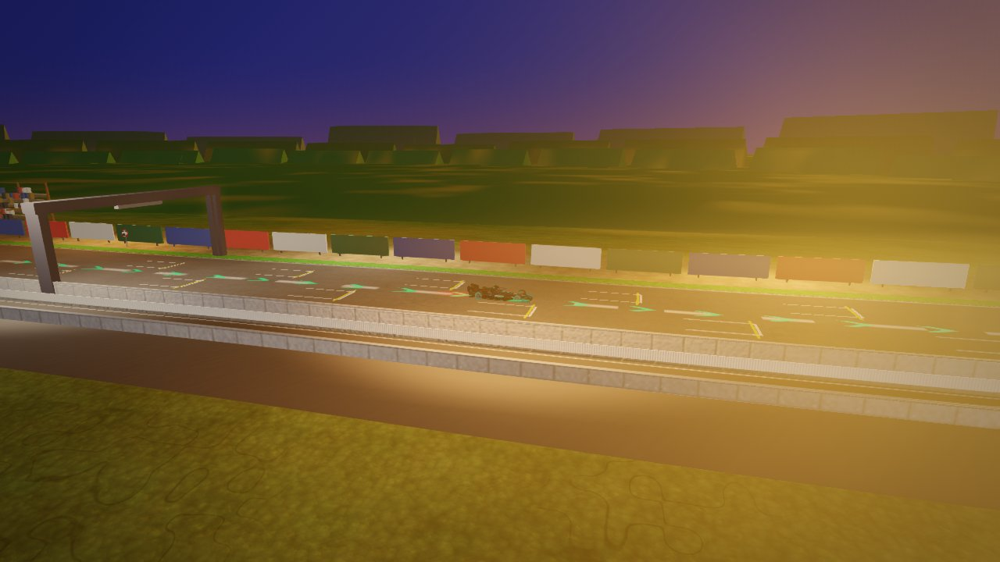 | 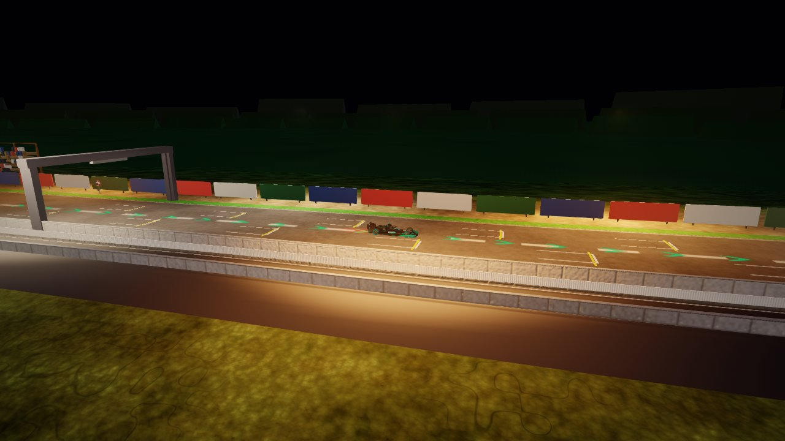 |
| Pit terrace — orbit, **day**, dry | Pit terrace — orbit, **dusk**, dry | Pit terrace — orbit, **night**, dry |
|  |  |  |
| Pit terrace — orbit, day, **wet** | Pit terrace — orbit, day, **rain** | Pit terrace — orbit, day, **overcast** |
| 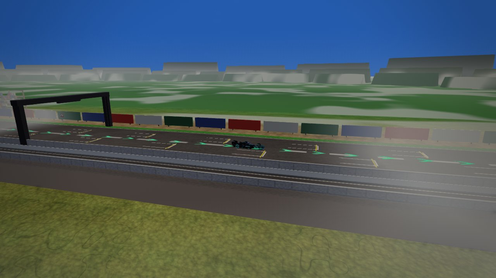 | 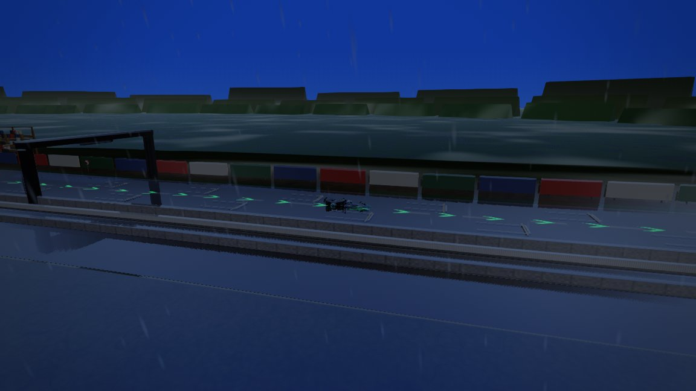 | |
| Pit terrace — orbit, day, **fog** | Pit terrace — orbit, day, **storm** | |

## Panel grids — Hero: Esses (chase s≈0.245)

| | | |
|:---:|:---:|:---:|
|  | 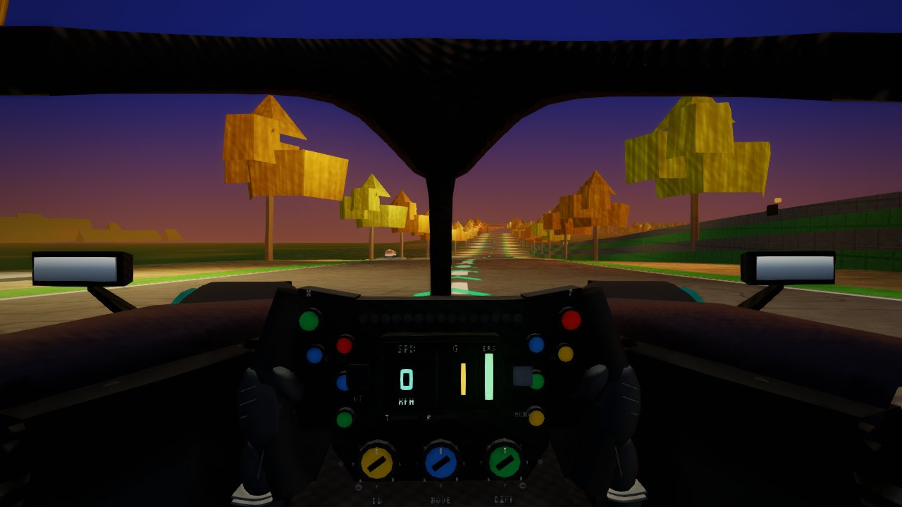 | 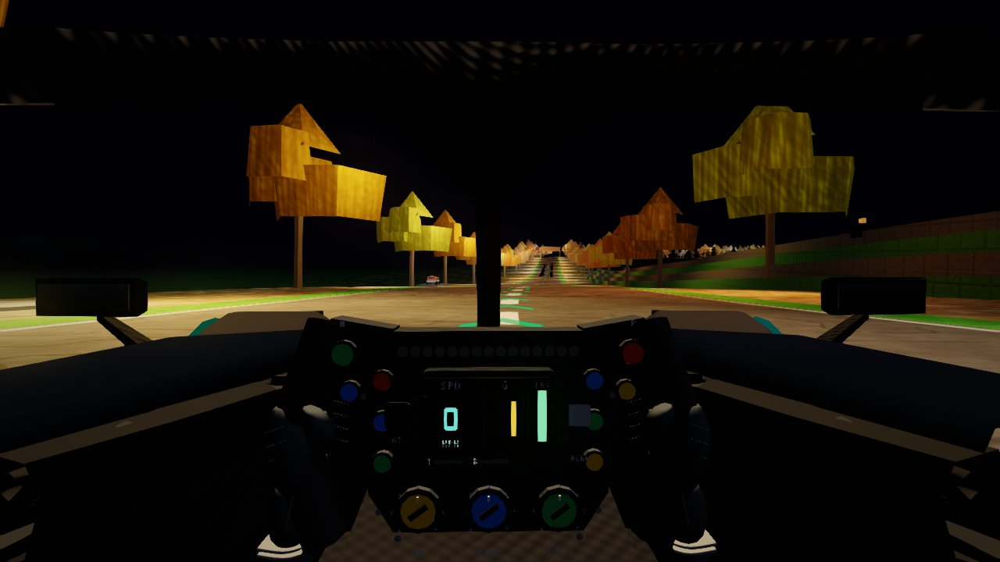 |
| Esses — chase, **day**, dry | Esses — chase, **dusk**, dry | Esses — chase, **night**, dry |
| 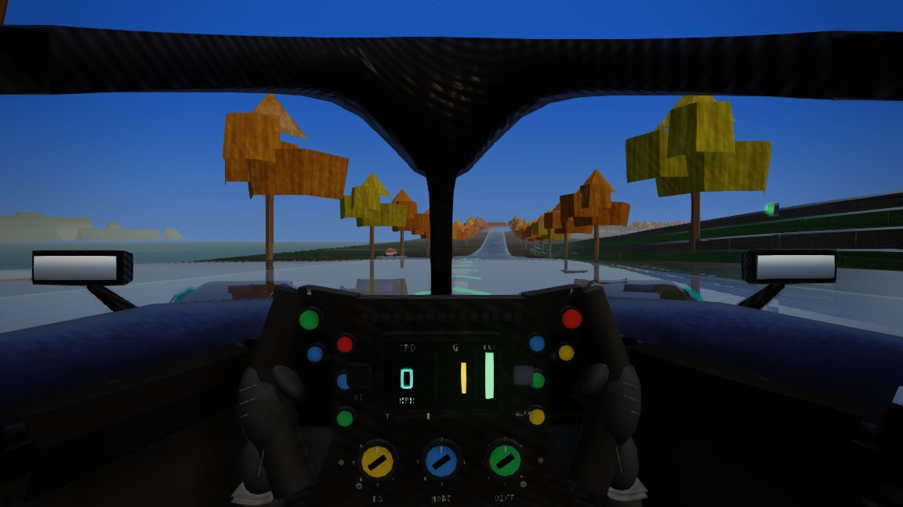 |  | 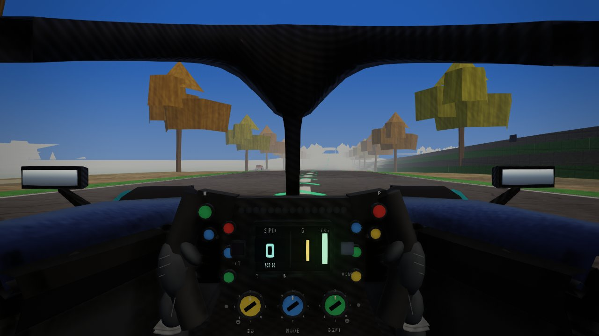 |
| Esses — chase, day, **wet** | Esses — chase, day, **rain** | Esses — chase, day, **fog** |

## Panel grids — Hero: Boot mid (orbit s≈0.52)

| | | |
|:---:|:---:|:---:|
|  | 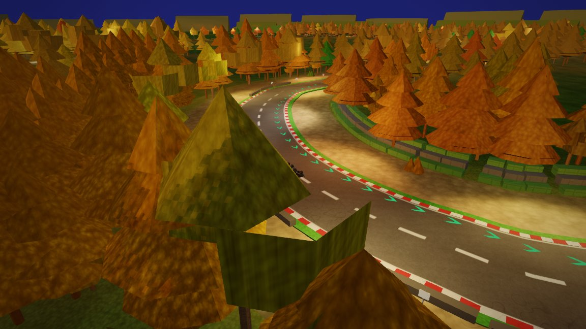 | 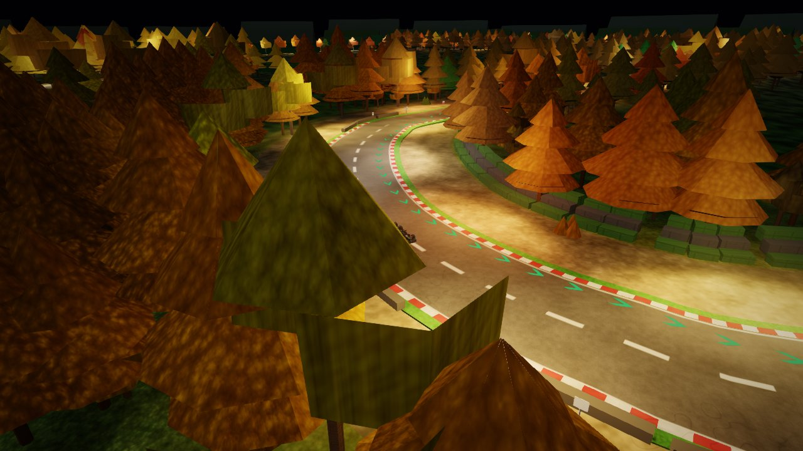 |
| Boot mid — orbit, **day**, dry | Boot mid — orbit, **dusk**, dry | Boot mid — orbit, **night**, dry |
| 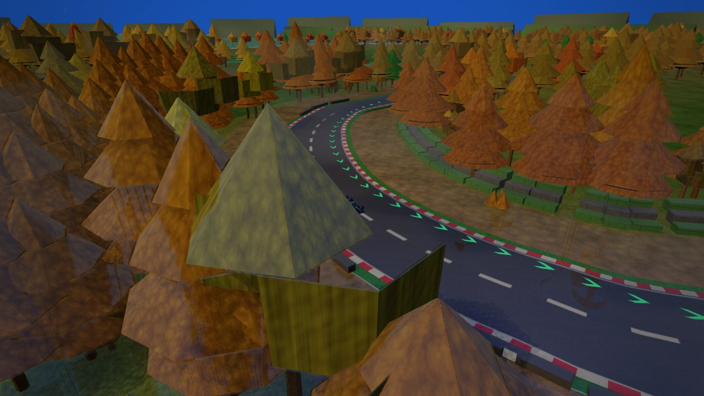 | | |
| Boot mid — orbit, day, **wet** | | |

## Panel grids — Hero: Anvil (orbit s≈0.90)

| | | |
|:---:|:---:|:---:|
|  | 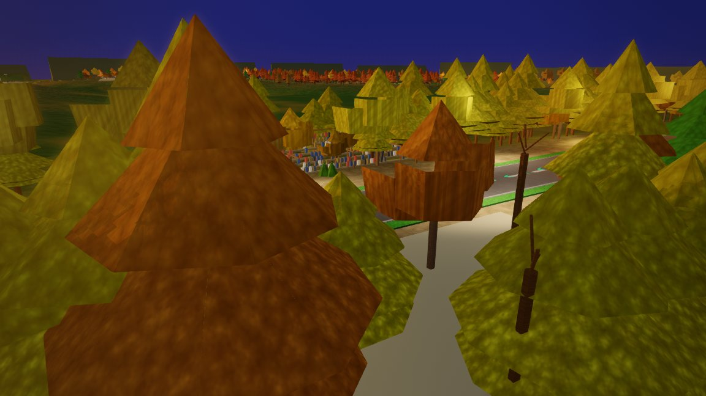 | |
| The Anvil — orbit, **day**, dry | The Anvil — orbit, **dusk**, dry | |

**Picker (repo asset):** `assets/stills/watkins_glen.webp`

---

## Findings

**Strengths:** Fall colour in Esses/Boot; pit complex readable; blue double Armco; audits clean.

**Visual issues (day, dry):** Generic tree row on Esses outside; busy pit hoarding panels; Seneca lake not track-visible (expected).

**Weather / lighting (from hero matrix):**

| Issue | Where seen | Notes |
|-------|------------|--------|
| **Night pit very dark** | Pit terrace — night, dry | `furniture.lamp: "none"` — no flood masts; expected until lamp policy |
| **Rain particles readable** | Pit / Esses — day, rain | Autumn foliage stays saturated; road wetness visible |
| **Fog / storm mute distance** | Pit — day, fog/storm; Esses — day, fog | Boot woods flatten into grey; OK for atmosphere |
| **Dusk golden lift** | All four heroes — dusk, dry | Matches `watkins_glen\|dusk\|dry` preset intent |

### Weather / lighting backlog

| Issue | Notes |
|-------|--------|
| Night lamps | Def `furniture.lamp` or hand `lampPost` |
| Anvil night / rain / fog | Not in 36-cap set; add if needed |
| Footbridge dusk | Sector 2 day dry only |

## Fix applied (circuit-only)

| Change | File |
|--------|------|
| OB `broadcastCompound` gap 110 → **125 m** | `js/circuits/scenery/watkins_glen.js` |

## Ranked improvements

| P | Item |
|---|------|
| 1 | Esses generic tree bleed |
| 2 | Footbridge + Anvil night/rain samples |
| 3 | `api.bleacher` migration |
| 4 | Night lamps policy |

## Verification

```sh
node tools/track/verify-track.cjs watkins_glen
node tools/track/audit-circuit.cjs watkins_glen
```
