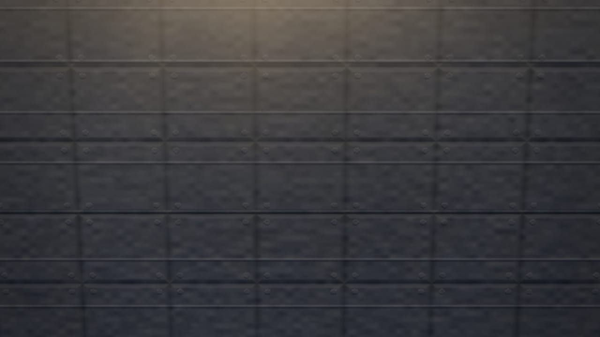
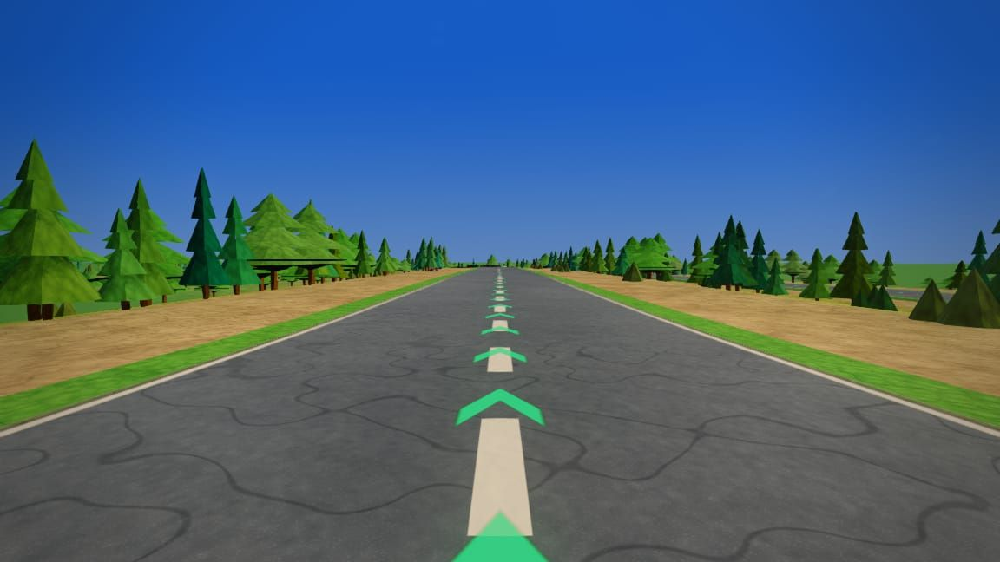
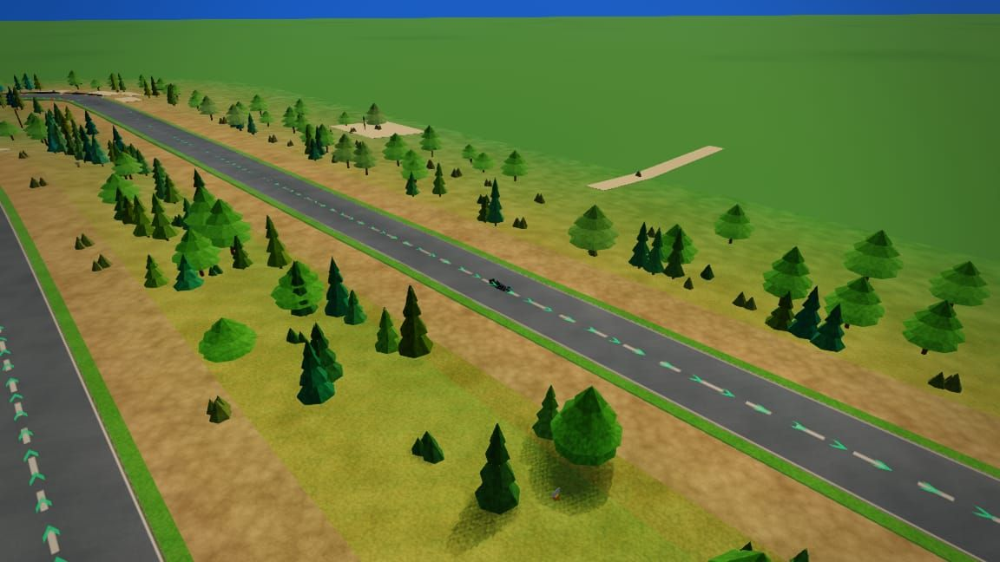
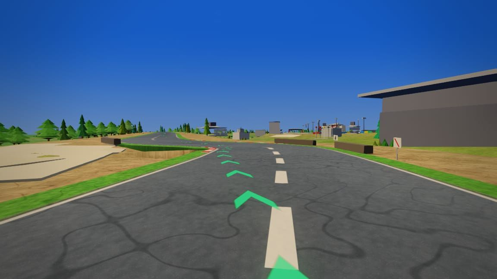
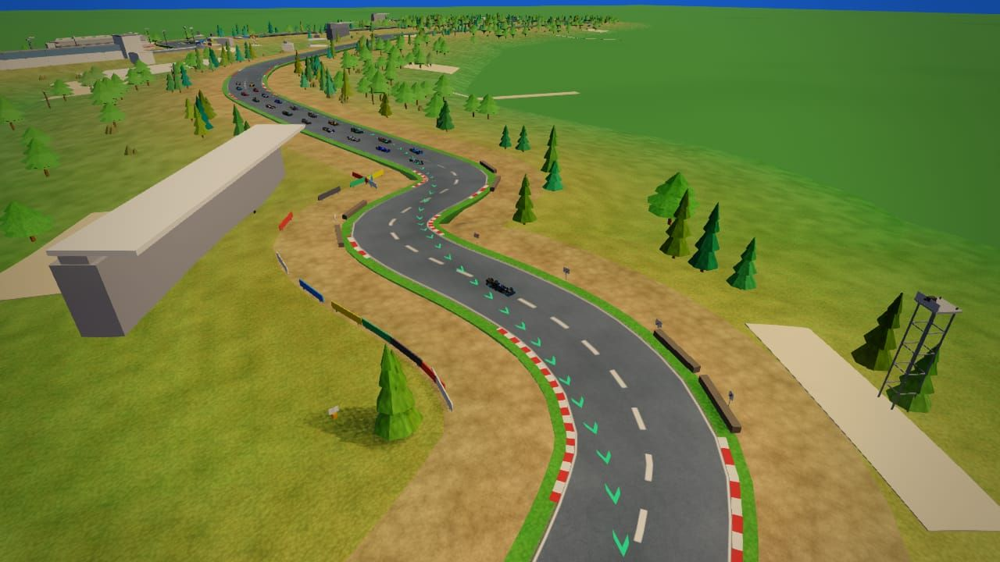
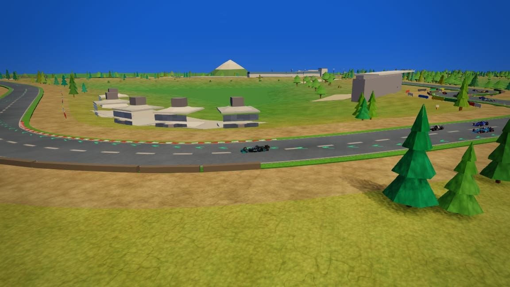
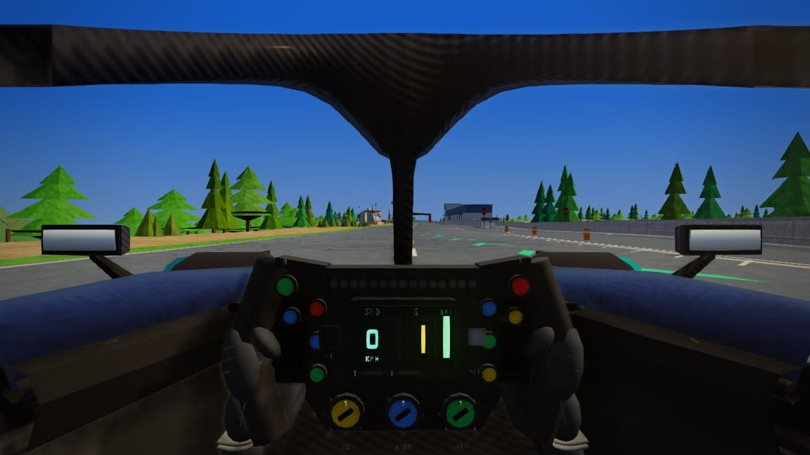
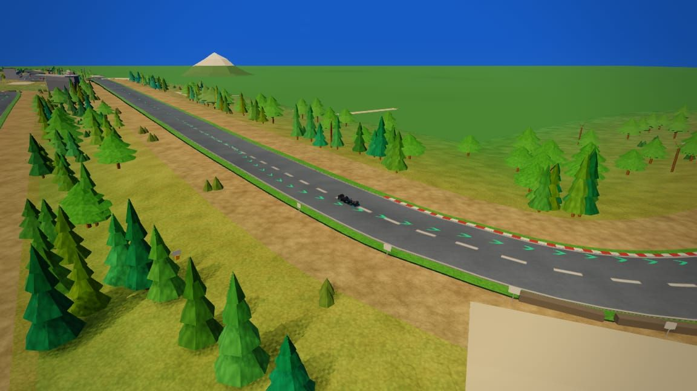

# Zolder — circuit survey (2026-10-14)

**Layout:** 4.010 km OSM trace (2002–present), 10 turns, clockwise, `theme: green`, day default.  
**Evidence:** `../../../artifacts/shots/tracks/zolder/*.jpg` (TLX headless, `shot.mjs` batch, local serve :3456); node VM audits.  
**Brief:** `docs/tracks/zolder.md` · **Data:** `js/circuits/zolder.js` · **Dressing:** `js/circuits/scenery/zolder.js`

> **Weather batch capture:** Game supports `raceWeather` `dry|wet|rain|overcast|fog` and `raceTimeOfDay` `day|dawn|dusk|night` (`js/game.js`). Batch **time-of-day** shots below use existing `shot.mjs` `--tod`. **Rain/overcast/fog matrix** is deferred until rebase on the shared tooling PR (*tools: shared shot tooling for circuit surveys*) so `artifacts/shots/tracks/**` can be committed and weather fields apply reliably. Two early `wx-*` frames in this folder were taken during a partial batch before that split; treat as provisional.

## Code map

| Piece | Role |
| --- | --- |
| `js/circuits/zolder.js` | `TrackDefs` entry: OSM centreline, `startFrac: 0.1226`, `sceneryStartFrac: 0`, `ownPitStraight: true`, `terrainOuter: 110`, Limburg palette, 10 `turns[]` apex fractions, `furniture.tree: "fir"`, `furniture.lamp: "none"`. |
| `js/circuits/scenery/zolder.js` | Lazy `TrackScenery.zolder(api)` — global heath, 16 named blocks, fast sweeper pass, terril `mountain()`. |
| `js/track/tracks.js` | `Tracks.LIST` registration; `buildProps` → scenery closure. |
| `tests/data/landmarks/zolder.json` | Required models: `zolder-main-grandstand`, `zolder-sf-museum`, `zolder-villeneuve-poles`, `zolder-sterrenwacht`. |
| Frame debt | `_sceneryShift ≈ 0.844`: pit/S/F use `sl()`; corners use authored `K()`. |

## Theme and models

Pale sand + Scots pine heath; club greys; four required landmarks; distant mine terril (`mountain()` ~s 0.14). No circuit floodlight masts (`lamp: "none"`).

---

## Panel grids (33 JPEGs, ≤1280px, q≈80)

Committed on branch `cursor/zolder-survey-696f` under `artifacts/shots/tracks/zolder/`. PR review uses [raw GitHub URLs](https://raw.githubusercontent.com/brycejmurrin/f1-game/cursor/zolder-survey-696f/artifacts/shots/tracks/zolder/).

### Sector coverage (day / dry)

| <br>**Pit straight (orbit)** · wx dry · day<br>`s1-01-pit-orbit.jpg` | <br>**S/F tribune (orbit)** · wx dry · day<br>`s1-02-sf-stand.jpg` | <br>**S/F tribune (trackside)** · wx dry · day<br>`s1-02b-sf-stand-close.jpg` |
| --- | --- | --- |
| <br>**Villeneuve paddock poles** · wx dry · day<br>`s1-03-villeneuve-poles.jpg` | <br>**Earste chicane T1 (park)** · wx dry · day<br>`s1-04-earste-chicane.jpg` | <br>**T1 context (orbit)** · wx dry · day<br>`s1-05-t1-orbit.jpg` |
| <br>**Kanaalbocht T3 (park)** · wx dry · day<br>`s1-06-kanaalbocht.jpg` | <br>**Outer forest edge (eye)** · wx dry · day<br>`s1-07-forest-edge.jpg` | <br>**Lucien Bianchi T4 (park)** · wx dry · day<br>`s2-01-bianchi.jpg` |
| <br>**Villeneuve chicane T5 (trackside)** · wx dry · day<br>`s2-02-villeneuve-chicane.jpg` | <br>**Villeneuve chicane (orbit)** · wx dry · day<br>`s2-02b-villeneuve-orbit.jpg` | <br>**Chicane memorial plaque** · wx dry · day<br>`s2-03-memorial.jpg` |
| <br>**Infield service (orbit)** · wx dry · day<br>`s2-04-service-area.jpg` | <br>**Kleine chicane T6 (park)** · wx dry · day<br>`s2-05-kleine-chicane.jpg` | <br>**Back sweeper (eye)** · wx dry · day<br>`s3-01-back-sweeper.jpg` |
| <br>**Bolderberg hairpin T7 (park)** · wx dry · day<br>`s3-02-hairpin.jpg` | <br>**Hairpin (orbit)** · wx dry · day<br>`s3-02b-hairpin-orbit.jpg` | <br>**Fast pine section (cinematic)** · wx dry · day<br>`s3-03-fast-pine.jpg` |
| <br>**Terlamen T8 (trackside)** · wx dry · day<br>`s3-04-terlamen.jpg` | <br>**Jochen Rindt T10 paddock (park)** · wx dry · day<br>`s3-05-rindt-paddock.jpg` | <br>**Full layout (high orbit)** · wx dry · day<br>`s3-06-layout-high.jpg` |


### Landmarks (day / dry)

| <br>**S/F museum hall** · wx dry · day<br>`lm-sf-museum.jpg` | <br>**Permanent grandstand** · wx dry · day<br>`lm-main-grandstand.jpg` | <br>**Sterrenwacht orbit probe** · wx dry · day<br>`lm-sterrenwacht-probe.jpg` |
| --- | --- | --- |
| <br>**Mine terril skyline** · wx dry · day<br>`lm-terril.jpg` |   |   |


### Time-of-day variants (dry)

| <br>**S/F tribune (orbit)** · wx dry · dawn<br>`tod-sf-dawn.jpg` | <br>**S/F tribune (orbit)** · wx dry · dusk<br>`tod-sf-dusk.jpg` | <br>**S/F tribune (orbit)** · wx dry · night<br>`tod-sf-night.jpg` |
| --- | --- | --- |
| <br>**Villeneuve poles (trackside)** · wx dry · dusk<br>`tod-poles-dusk.jpg` | <br>**Hairpin (park)** · wx dry · dusk<br>`tod-hairpin-dusk.jpg` | <br>**Terlamen (trackside)** · wx dry · night<br>`tod-terlamen-night.jpg` |


### Provisional wet (*re-capture after shared shot PR)

| <br>**S/F tribune (orbit)** · wx wet* · day<br>`wx-sf-day-wet.jpg` | <br>**Villeneuve chicane (trackside)** · wx wet* · day<br>`wx-villeneuve-wet.jpg` |   |
| --- | --- | --- |


## Weather / lighting backlog

| Issue | Notes |
| --- | --- |
| **Missing night lighting** | `furniture.lamp: "none"` — pits and stands are dark at `night`; optional future `lampPost` pass in `zolder.js` only. |
| **Wet road without lamps** | Wet sheen reads on tarmac; full rain/overcast/fog matrix deferred until shared shot PR. |
| **Night + fog combo** | Not captured. |
| **Z-fighting** | No new coplanar spots vs baseline. |

## Findings (summary)

| Area | Result |
| --- | --- |
| Road | `verify-track` OK; surface folds **0** |
| Audits | float 0, clip 0, buried **5** (within baseline 7) |
| Identity | Sand + pine reads well; four required models present |
| Frame debt | Sterrenwacht on pit fold — poor T2 sightline |

## Ranked improvements

1. **Sterrenwacht / start line** — frame probe. High value, high risk.  
2. **Weather survey completion** — after shared shot PR.  
3. **Optional pit lamps** — circuit-only.  
4. **Terril bearing** — when sourced.  

## Fixes in this PR (zolder scenery only)

- `clubBuilding` terrain-seated pit offices.  
- Villeneuve poles plinth seating; S/F `emitOpenStand` plinth +0.03 m.

## Verification

```sh
node tools/track/verify-track.cjs zolder
node tools/track/audit-circuit.cjs zolder
```
